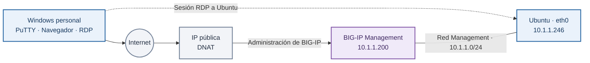
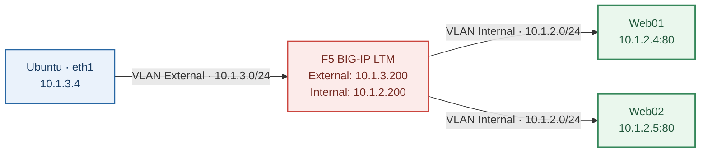

# Laboratorio 1 — Aseguramiento del acceso administrativo: Management IP, ACLs, Port Lockdown, políticas administrativas y provisionamiento

## Metadatos

| Campo | Valor |
|---|---|
| **Duración** | **35 minutos** |
| **Complejidad** | Media |
| **Nivel Bloom** | Aplicar (Apply) |
| **Plataforma** | BIG-IP Virtual Edition (VE) desplegado en Microsoft Azure |
| **Modalidad** | Laboratorio individual, un pod por participante |
| **Método** | Configuración con TMUI y comprobación con comandos directos de TMSH |
| **Entregable** | `Lab01_Validacion_IDPOD.md` |

## Descripción general

En este laboratorio asegurarás el acceso administrativo a tu BIG-IP. Primero comprobarás el acceso por la red privada y por Internet. Después configurarás **dos listas de acceso independientes**, una para SSHD y otra para HTTPD: en cada prueba permitirás únicamente al cliente Ubuntu del pod, comprobarás el bloqueo de una nueva conexión desde tu computadora personal y restaurarás el servicio antes de continuar. También probarás el bloqueo real de SSH sobre la Self IP externa `10.1.3.200`, aplicarás una política de contraseñas, crearás un usuario con privilegios limitados y verificarás la licencia y el aprovisionamiento de LTM.

La administración pública se realiza desde tu **equipo Windows personal**; la administración privada, desde el **cliente Ubuntu del pod**, al que accedes mediante escritorio remoto. **No modificarás el acceso remoto a Ubuntu, las reglas NSG de Azure, las direcciones IP, las VLAN ni el aprovisionamiento de los módulos.**

## Objetivos de aprendizaje

Al terminar podrás:

1. Identificar la Management IP y verificar la conectividad SSH y HTTPS por rutas públicas y privadas.
2. Restringir SSHD y HTTPD por dirección IP de origen, demostrar un rechazo real y restaurar el acceso.
3. Configurar y comprobar Port Lockdown en una Self IP del plano de datos, sin confundirla con Management.
4. Aplicar requisitos de contraseñas y crear un usuario con rol Resource Administrator.
5. Consultar la licencia, el nivel de aprovisionamiento LTM y el estado de los servicios principales.

## Prerrequisitos

### Conocimientos requeridos

| Conocimiento | Detalle |
|---|---|
| IPv4 y CIDR | Dirección origen/destino, prefijo `/24` y dirección de host `/32` |
| TCP/IP | SSH/TCP 22, HTTPS/TCP 443, ICMP |
| Linux | Uso básico de terminal, `ssh`, `ping`, `curl` |
| BIG-IP | Diferencia entre Management IP, Self IP, TMUI y TMSH |

### Acceso y entorno

| Requisito | Estado requerido antes de comenzar |
|---|---|
| Pod individual | BIG-IP VE, cliente Ubuntu con escritorio remoto, Server1 y Server2 |
| BIG-IP | Encendido, licenciado, con LTM aprovisionado y servicios estables |
| Credenciales | Usuario administrativo y contraseña de BIG-IP asignados a tu pod |
| IP pública BIG-IP | Proporcionada con los datos de acceso de tu pod |
| Windows personal | Acceso a la IP pública de BIG-IP mediante navegador y PuTTY |
| Ubuntu del pod | Acceso de gestión a `10.1.1.200` y adaptador `eth1` con `10.1.3.4/24`; ruta conectada a `10.1.3.0/24` |
| Permisos en Azure | **No requeridos**; no entrarás al portal ni modificarás NSG |

### Software del laboratorio

| Componente | Versión / requisito | Uso |
|---|---|---|
| F5 BIG-IP VE | Versión instalada en tu pod (entorno de referencia: 21.0.0.3) | TMUI y TMSH |
| Ubuntu Desktop | Imagen Linux con escritorio remoto del pod | Cliente administrativo privado |
| OpenSSH Client (Ubuntu) | Instalado | Acceso SSH privado |
| Firefox (Ubuntu) | Instalado | TMUI privada |
| curl, ping e iproute2 (Ubuntu) | Instalados | Pruebas de conectividad y de interfaz |
| Herramientas de red en Ubuntu | `ip`, `ping`, `ssh` y `curl` | Comprobar conectividad y Port Lockdown |
| Windows 10/11 | Computadora personal | Origen externo a Azure |
| PuTTY (Windows) | Instalado, [sitio oficial](https://www.putty.org/) | Prueba de SSH público |
| Edge, Chrome o Firefox (Windows) | Navegador actualizado | Prueba de HTTPS público |
| Ubuntu Server | Instalado en Server1 y Server2 | Servidores de aplicaciones del pod |
| Apache HTTP Server | Instalado en los servidores, si corresponde a la imagen del pod | Servicio web para prácticas posteriores |

> **Antes de iniciar:** la conexión SSH al BIG-IP presenta directamente el prompt de **TMSH**. Todos los comandos `list`, `show`, `modify` y `save` de esta guía se ejecutan tal como están escritos, sin prefijo ni comando de entrada adicional. Los comandos `ssh`, `ping`, `curl` e `ip` se ejecutan exclusivamente en la terminal de Ubuntu. Ten abiertas dos ventanas distintas: una con el cliente Ubuntu por escritorio remoto y otra en tu computadora personal Windows. Si PuTTY, Firefox o el navegador de Windows no pueden conectarse **antes** de aplicar las restricciones, no ejecutes el Paso 2; informa al instructor.

## Entorno de laboratorio

### Topología de red


## Diagrama 1. Acceso y administración de BIG-IP



## Diagrama 2. Tráfico de aplicaciones




### Direccionamiento y componentes de red

| Elemento | Direccion | Funcion |
|---|---|---|
| BIG-IP Management | **10.1.1.200/24** | Administracion del equipo, independiente de Port Lockdown |
| Ubuntu `eth0` | **10.1.1.246/24** | Origen administrativo privado para SSH y TMUI |
| Ubuntu `eth1` | **10.1.3.4/24** | Origen de las pruebas contra la VLAN External |
| BIG-IP Self IP External | **10.1.3.200/24** | Destino de las pruebas de Port Lockdown |
| BIG-IP Self IP Internal | **10.1.2.200/24** | Conectividad con servidores |
| BIG-IP IP publica | **IP asignada a tu pod** | Acceso desde Windows por SSH/HTTPS |
| Server1 / Web01 | **10.1.2.4/24** | Servidor web |
| Server2 / Web02 | **10.1.2.5/24** | Servidor web |

La IP publica de BIG-IP es un destino; Azure realiza DNAT hacia la Management IP. La IP de origen puede preservarse si no hay dispositivos intermedios que hagan SNAT. El **Port Lockdown** de este laboratorio se probará contra la Self IP `10.1.3.200`, **no** contra la Management IP. Las direcciones privadas de BIG-IP terminadas en `.200` deben estar asignadas a sus interfaces correspondientes en Azure antes de iniciar el pod; el participante no cambia direcciones IP.

### Asignacion de interfaces BIG-IP VE

| Componente | Red / configuracion | Accion en el laboratorio |
|---|---|---|
| Management | `10.1.1.200/24` | Consultar; no modificar |
| Self IP External / VLAN `External` | `10.1.3.200/24` | Cambiar temporalmente Port Lockdown y restaurar |
| Self IP Internal / VLAN `Internal` | `10.1.2.200/24` | Consultar; no modificar |
| Ubuntu `eth0` | `10.1.1.246/24` | Mantener acceso de administracion |
| Ubuntu `eth1` | `10.1.3.4/24` | Originar conexiones a `10.1.3.200` |

### Verificación previa del entorno

**Desde el cliente Ubuntu** (abre Terminal):

```bash
ip -4 addr show eth0
ip -4 addr show eth1
ip route get 10.1.3.200
ping -c 2 10.1.1.200
curl -k -I --connect-timeout 5 https://10.1.1.200
```

Después, abre Firefox en Ubuntu y navega a **`https://10.1.1.200`**. Inicia sesión en TMUI.

**Desde Windows personal:**

1. Abre el navegador y accede a `https://IP_PUBLICA_DE_TU_BIGIP`.
2. Abre **PuTTY** y escribe en **Host Name (or IP address)** la IP pública de tu BIG-IP; configura **Port 22** y **Connection type: SSH**; pulsa **Open**.
3. Inicia sesión con tu usuario administrativo y confirma que tanto TMUI como SSH responden desde Windows.

> Si es la primera conexión de PuTTY, comprueba que el equipo y la dirección son los de tu pod antes de aceptar la clave del servidor. Un aviso de certificado autofirmado en TMUI puede ser normal en un laboratorio.

## Distribución de tiempos

| Actividad | Tiempo |
|---|---:|
| Paso 1. Verificar Management IP y accesos | 3 min |
| Paso 2. Aplicar y restaurar ACL SSHD y HTTPD | 8 min |
| Paso 3. Configurar Port Lockdown | 7 min |
| Paso 4. Política de contraseñas y usuario | 8 min |
| Paso 5. Verificar licencia | 3 min |
| Paso 6. Verificar aprovisionamiento LTM | 3 min |
| Validación y registro de evidencias | 3 min |
| **TOTAL** | **35 min** |

## Instrucciones paso a paso

### Paso 1: Verificar la Management IP (3 minutos)

**Objetivo:** verificar que la administración privada y pública funcionan antes de modificar las ACL.

1. Desde **Firefox en Ubuntu**, ingresa a `https://10.1.1.200` y abre **System > Platform**. Identifica la Management IP. **No modifiques ningún campo**.
2. Abre una terminal de **Ubuntu** y conéctate por SSH:

   ```bash
   ssh <USUARIO_ADMIN>@10.1.1.200
   ```

   Sustituye `<USUARIO_ADMIN>` por el usuario de tu pod. **Deja esta sesión abierta durante todo el Paso 2.** Comprueba que el prompt corresponde a TMSH antes de introducir comandos de configuración.
3. La conexión SSH al BIG-IP abre directamente la consola **TMSH** de este pod. Escribe los siguientes comandos en el prompt de TMSH (sin el prefijo `tmsh`):

   ```text
   list sys management-ip
   list sys management-route
   ```

4. Verifica también que puedes abrir una **nueva** sesión PuTTY hacia la IP pública del BIG-IP y TMUI desde tu navegador de Windows.

**Resultado esperado:** Management IP `10.1.1.200`; SSH/HTTPS privados desde Ubuntu y públicos desde Windows funcionan. Si alguno no funciona, no continúes con el Paso 2.

---

### Paso 2: Configurar ACLs restrictivas a SSHD y HTTPD (8 minutos)

**Objetivo:** permitir temporalmente la administración únicamente desde `10.1.1.246`, comprobar el bloqueo de nuevas conexiones públicas y recuperar cada servicio.

**Regla de seguridad:** realiza las pruebas **una a la vez**. Mantén abiertas la terminal SSH privada y TMUI privada en Ubuntu. No cierres el escritorio remoto de Ubuntu hasta comprobar que **ambos accesos públicos** se restauraron.

#### Parte A — SSHD: restringir, probar y restaurar (4 minutos)

1. Desde **TMUI privada en Ubuntu**, entra a **System > Platform**. Localiza el apartado **SSH Access / SSH IP Allow**. Anota la configuración inicial de **SSH IP Allow** (normalmente *All Addresses*).
2. En **SSH IP Allow**, selecciona **Specify Range** e introduce únicamente la dirección del cliente Ubuntu:

   ```text
   10.1.1.246
   ```

   Pulsa **Update**. No cambies Management IP, gateway ni contraseñas de las cuentas existentes.
3. Desde la sesión TMSH del BIG-IP **ya abierta por SSH desde Ubuntu**, verifica:

   ```text
   list sys sshd allow
   ```

   **Esperado:** el origen permitido corresponde a `10.1.1.246` (o `10.1.1.246/32`, según la representación).
4. En **otra terminal local de Ubuntu** (no dentro de TMSH), prueba una **nueva conexión SSH privada**:

   ```bash
   ssh -o ConnectTimeout=5 <USUARIO_ADMIN>@10.1.1.200
   ```

   **Esperado:** se solicita autenticación o se abre sesión.
5. En **Windows**, abre **una conexión nueva de PuTTY** hacia `IP_PUBLICA_DE_TU_BIGIP`, puerto 22. **Esperado:** no se establece una nueva sesión SSH. Una conexión PuTTY abierta con anterioridad no sirve como prueba.
6. **Restaura inmediatamente SSHD desde TMUI privada (Ubuntu)**: vuelve a **SSH IP Allow > All Addresses** si ese era el valor inicial y pulsa **Update**. Si el valor original era diferente, restáuralo exactamente.
7. Ejecuta `list sys sshd allow` y abre otra sesión PuTTY desde Windows. **Esperado:** vuelve a funcionar el SSH público.

> **Recuperación SSHD:** si TMUI privada no responde, pero conservas la sesión TMSH conectada desde Ubuntu y el valor original era `All`, ejecuta en esa sesión: `modify sys sshd allow replace-all-with { all }`. No cierres la sesión hasta recuperar el acceso público.

#### Parte B — HTTPD: restringir, probar y restaurar (4 minutos)

1. Comprueba que **SSHD ya está restaurado**. Mantén abiertas la sesión SSH privada y Firefox privado en Ubuntu.
2. En la **sesión SSH privada conectada al BIG-IP (prompt de TMSH)**, ejecuta los siguientes comandos. HTTPD se configura desde **TMSH** porque su lista de orígenes permitidos puede no ofrecer un campo equivalente en TMUI:

   ```text
   list sys httpd allow
   modify sys httpd allow replace-all-with { 10.1.1.246/32 }
   list sys httpd allow
   ```

   **Anota el valor inicial** del primer comando antes de modificarlo.
3. En **Firefox de Ubuntu**, abre una **ventana privada nueva** y accede a `https://10.1.1.200`. **Esperado:** TMUI privada sigue funcionando.
4. En **Windows personal**, abre una **ventana de navegación privada nueva** e intenta `https://IP_PUBLICA_DE_TU_BIGIP`. **Esperado:** una nueva conexión pública no abre TMUI.
5. **Restaura HTTPD de inmediato** desde la sesión TMSH privada. Si inicialmente el valor era `All`, ejecuta:

   ```text
   modify sys httpd allow replace-all-with { all }
   list sys httpd allow
   ```

   Si la lista original era distinta, restaura **exactamente** sus entradas.
6. Abre una ventana nueva del navegador de Windows hacia la IP pública del BIG-IP. **Esperado:** TMUI vuelve a funcionar.
7. Guarda la configuración final:

   ```text
   save sys config
   ```

**Resultado esperado:** SSHD y HTTPD fueron restringidos por separado; Ubuntu siguió autorizado, Windows quedó bloqueado temporalmente y ambos accesos públicos quedaron recuperados al finalizar. **No continúes si alguna ACL permanece restringida por error.**

---

### Paso 3: Probar Port Lockdown sobre la Self IP External (7 minutos)

**Objetivo:** comprobar con conexiones reales que Port Lockdown controla el acceso a los servicios de una Self IP. Usaras **Ubuntu `10.1.3.4`** como origen y **BIG-IP External `10.1.3.200`** como destino. Las modificaciones se realizan desde **TMUI por la Management IP `10.1.1.200`** y se comprueban con **TMSH**.

**Precaucion:** manten abierta durante toda la actividad una sesion SSH de Ubuntu hacia `10.1.1.200`, ademas de TMUI privada por esa misma IP. No modifiques la Self IP de Management, las VLAN, las rutas ni las reglas de Azure.

#### A. Verificar la red externa y la Self IP (2 minutos)

1. Abre una **terminal local de Ubuntu** (no la sesión TMSH) y ejecuta:

   ```bash
   ip -4 addr show eth1
   ip route get 10.1.3.200
   ```

   **Resultado esperado:** `eth1` tiene `10.1.3.4/24` y la consulta de ruta indica aproximadamente:

   ```text
   10.1.3.200 dev eth1 src 10.1.3.4
   ```

   **No agregues rutas:** Ubuntu y la Self IP pertenecen a la misma subred `10.1.3.0/24`, por lo que Ubuntu ya dispone de una ruta conectada. Si el resultado muestra otra interfaz o un origen distinto, detén la prueba y avisa al instructor.

2. Verifica la conectividad básica con la Self IP externa:

   ```bash
   ping -c 2 -I eth1 10.1.3.200
   ```

   Si no responde, esto **no prueba** que falte una ruta ni que Port Lockdown esté funcionando; el ICMP puede estar bloqueado. Confirma las direcciones y continúa únicamente si el instructor ha validado la conectividad del pod.

3. Desde Firefox de Ubuntu, entra a `https://10.1.1.200`, abre **Network > Self IPs** y selecciona **`External-IP` (`10.1.3.200`)**. Anota el valor original de **Port Lockdown**. En la sesión TMSH administrativa consulta:

   ```text
   list net self External-IP
   ```

   **No crees Self IPs nuevas ni cambies las direcciones o las VLAN.**

#### B. Permitir SSH explícitamente con Allow Custom (2 minutos)

4. En **TMUI > Network > Self IPs > External-IP**, cambia **Port Lockdown** a **Allow Custom**. Agrega unicamente el servicio **TCP, puerto 22** y selecciona **Update**.
5. En **TMSH**, comprueba la lista de servicios permitidos:

   ```text
   list net self External-IP allow-service
   ```

   **Resultado esperado:** se permite `tcp:22`.
6. Desde una **segunda terminal local de Ubuntu**, abre una conexion nueva:

   ```bash
   ssh -o ConnectTimeout=5 <USUARIO_ADMIN>@10.1.3.200
   ```

   **Resultado esperado:** se solicita la contrasena o se inicia TMSH. La prueba es positiva si llegas a la fase de autenticacion; no es necesario mantener abierta esta sesion. Sal de ella con `quit` si ingresaste a TMSH.

   Si aparece `Connection timed out` o `Connection refused`, no atribuyas el resultado todavia a Port Lockdown: tambien pueden intervenir las reglas de red de Azure, el servicio SSHD o una ruta incorrecta. Registra la incidencia y restaura la configuracion original.

#### C. Bloquear SSH con Allow None (1 minuto)

7. Regresa a **TMUI > Network > Self IPs > External-IP** y cambia **Port Lockdown** a **Allow None**. Selecciona **Update**.
8. Verifica desde TMSH:

   ```text
   list net self External-IP allow-service
   ```

   **Resultado esperado:** `none`.
9. Desde la terminal local de Ubuntu, intenta establecer **otra conexion nueva**:

   ```bash
   ssh -o ConnectTimeout=5 <USUARIO_ADMIN>@10.1.3.200
   ```

   **Resultado esperado:** no se permite una nueva sesion SSH sobre la Self IP externa. El mensaje concreto puede variar entre rechazo y tiempo de espera. Una sesion SSH abierta previamente no sirve para demostrar el bloqueo.

10. Desde **Ubuntu**, verifica que **la Management IP sigue siendo accesible**:

    ```bash
    ssh -o ConnectTimeout=5 <USUARIO_ADMIN>@10.1.1.200
    ```

    **Resultado esperado:** el acceso por Management sigue funcionando porque no se ha modificado su servicio SSH.

#### D. Restaurar Port Lockdown (2 minutos)

11. En **TMUI > Network > Self IPs > External-IP**, restablece **exactamente el valor inicial** registrado en el apartado A (por ejemplo, `Allow None`, si era ese el original). Selecciona **Update**.
12. Comprueba en **TMSH**:

    ```text
    list net self External-IP allow-service
    save sys config
    ```

    **Resultado esperado:** la lista `allow-service` coincide con la configuracion inicial; la administracion por `10.1.1.200` continua disponible.

13. Desde Ubuntu, verifica por última vez la ruta conectada, sin alterarla:

    ```bash
    ip route get 10.1.3.200
    ```

    **Resultado esperado:** tráfico por `eth1` con origen `10.1.3.4`.

**Criterio de éxito:** con `Allow Custom` y TCP/22, Ubuntu puede iniciar una conexion SSH nueva hacia `10.1.3.200`; con `Allow None`, esa misma conexion nueva queda bloqueada; y finalmente se restaura el Port Lockdown original. Esta prueba verifica un servicio dirigido al propio BIG-IP en la Self IP externa; **no representa una restriccion del trafico hacia Virtual Servers**.

---

### Paso 4: Establecer una política de contraseñas y crear un usuario (8 minutos)

**Objetivo:** aplicar requisitos de contraseña y crear una cuenta administrativa con un rol distinto de Administrator.

1. En TMUI, abre **System > Users** y selecciona la pestaña **Authentication**.
2. En **Secure Password Enforcement**, selecciona **Enabled**. Configura los siguientes parámetros:

   | Parámetro | Valor |
   |---|---:|
   | Minimum Length | 8 |
   | Required Uppercase Characters | 1 |
   | Required Lowercase Characters | 1 |
   | Required Numeric Characters | 1 |
   | Required Special Characters | 1 |
   | Maximum Duration | 90 días |
   | Maximum Login Failures | 5 |

   Mantén los demás parámetros en sus valores actuales y pulsa **Update**.
3. Desde la sesión TMSH del BIG-IP verifica:

   ```text
   list auth password-policy
   ```

   Confirma que los valores de longitud y complejidad coinciden con la tabla.
4. En TMUI abre **System > Users > User List > Create**. Completa los campos:

   | Campo | Valor |
   |---|---|
   | User Name | `laboperator` |
   | Password / Confirm | Una contraseña **nueva y única** que cumpla la política |
   | Role | **Resource Administrator** |
   | Partition Access | **All** / todas las particiones permitidas en el pod |

   Guarda el usuario.
5. En una **ventana privada** del navegador de Ubuntu, inicia sesión con `laboperator`. Verifica que el inicio de sesión funciona y observa los permisos disponibles. **No utilices esta cuenta para cambiar la configuración de seguridad del sistema.**
6. Vuelve a la sesión administrativa inicial y ejecuta:

   ```text
   list auth user laboperator
   ```

**Resultado esperado:** la política muestra los requisitos establecidos y `laboperator` existe con rol **Resource Administrator**. Este rol puede administrar recursos LTM según permisos y particiones: **no es una cuenta de solo lectura**.

**Seguridad:** no escribas la contraseña elegida en capturas, informes o el entregable.

---

### Paso 5: Verificar licencia y Service Check Date (3 minutos)

**Objetivo:** reconocer la información de licencia sin confundirla con la versión de BIG-IP instalada.

1. Abre en TMUI **System > License**.
2. Identifica la información de licencia disponible, los módulos habilitados y la fecha de servicio (**Service Check Date**) si se muestra.
3. Desde TMSH por la conexión SSH privada, ejecuta:

   ```text
   show sys license
   show sys version
   ```

4. Identifica la **versión instalada** mediante `show sys version`. El campo `Licensed Version` de la licencia puede ser distinto: no es la versión del software que está ejecutándose.

**Resultado esperado:** puedes identificar la licencia y distinguir los módulos autorizados de la versión real del sistema. **No copies la Registration Key** al entregable.

---

### Paso 6: Verificar el aprovisionamiento LTM y los recursos (3 minutos)

**Objetivo:** confirmar que LTM está habilitado sin realizar cambios que reinicien servicios.

1. En TMUI, abre **System > Resource Provisioning**.
2. Busca **Local Traffic (LTM)** y confirma que está aprovisionado en el nivel establecido para el pod (habitualmente **Nominal**).
3. Desde TMSH por la conexión SSH privada, ejecuta:

   ```text
   list sys provision ltm
   show sys provision
   show sys service
   ```

4. Comprueba que los servicios principales están en ejecución; busca `mcpd`, `tomcat` y `tmm` en el resultado, si aparecen en la vista de servicios de tu versión.

**Resultado esperado:** LTM continúa aprovisionado y los servicios están operativos. **No modifiques** `provision.tmmcount` ni el nivel de aprovisionamiento.

## Validación y pruebas (3 minutos)

Realiza esta comprobación final y registra los resultados en el entregable:

| ID | Verificación | Resultado esperado |
|---|---|---|
| V1 | Desde Windows: PuTTY a IP pública BIG-IP | SSH público restaurado |
| V2 | Desde Windows: navegador a IP pública BIG-IP | HTTPS público restaurado |
| V3 | Desde Ubuntu: SSH y Firefox a `10.1.1.200` | Ambos accesos privados funcionando |
| V4 | SSHD y HTTPD (`list sys sshd allow` y `list sys httpd allow`) | Ambas listas restauradas a su valor inicial |
| V5 | Desde Ubuntu `10.1.3.4` hacia Self IP `10.1.3.200` | SSH permitido con `Allow Custom tcp:22`, bloqueado con `Allow None` y Port Lockdown original restaurado |
| V6 | Política y usuario (`list auth password-policy`, `list auth user laboperator`) | Política y usuario creados correctamente |
| V7 | Licencia y LTM | Licencia consultada; LTM aprovisionado y servicios operativos |

### Entregable

Crea el archivo **`Lab01_Validacion_IDPOD.md`** con este contenido, sustituyendo `IDPOD` por el identificador de tu pod:

```markdown
# Laboratorio 1 — Registro de validación

**Pod:**
**Fecha:**
**Management IP:** 10.1.1.200
**IP pública BIG-IP:**

| Prueba | Cumple / No cumple | Evidencia o comentario breve |
|---|---|---|
| V1. SSH público restaurado | | |
| V2. HTTPS público restaurado | | |
| V3. SSH y HTTPS privados | | |
| V4. ACL SSHD y HTTPD restauradas | | |
| V5. SSH a External Self IP: permitido / bloqueado / restaurado | | |
| V6. Política y usuario laboperator | | |
| V7. Licencia, LTM y servicios | | |

**Incidencias encontradas:**
**Acción correctiva aplicada:**
```

## Solución de problemas

### Problema 1: No puedes conectarte por PuTTY desde Windows después de restringir SSHD

1. No cierres Ubuntu ni la sesión SSH privada ya abierta.
2. Desde **TMUI privada en Ubuntu**, ve a **System > Platform > SSH IP Allow** y restaura **All Addresses**, siempre que ese fuera el valor inicial.
3. Desde TMSH por la conexión SSH privada, comprueba: `list sys sshd allow`.
4. Abre una **nueva** conexión PuTTY desde Windows y confirma la recuperación.

Si TMUI privada no responde y el valor original era `All`, puedes restaurar desde la sesión privada de TMSH:

```text
modify sys sshd allow replace-all-with { all }
```

### Problema 2: No puedes abrir TMUI pública después de restringir HTTPD

1. Mantén la sesión SSH privada conectada desde Ubuntu.
2. Si el valor original era `All`, ejecuta:

   ```text
   modify sys httpd allow replace-all-with { all }
   list sys httpd allow
   ```

3. Abre una ventana nueva de navegador en Windows y comprueba el acceso a la IP pública.

### Problema 3: Una prueba de bloqueo público no produce el resultado esperado

Comprueba que el acceso público **funcionaba antes** de restringirlo; utiliza una conexión nueva de PuTTY o una ventana privada nueva del navegador. Asegúrate de que no estás accediendo desde una VPN, proxy u otro equipo que cambie el origen del tráfico. No modifiques el NSG. Registra la incidencia si el comportamiento no coincide.

### Problema 4: No puedes acceder por SSH a la Self IP `10.1.3.200`

1. Desde Ubuntu ejecuta `ip route get 10.1.3.200` y verifica que indique `dev eth1 src 10.1.3.4`. **No agregues rutas manuales** si ya aparece este resultado.
2. En BIG-IP comprueba `list net self External-IP` y `list net self External-IP allow-service` desde la sesión de TMSH por Management.
3. Confirma que la prueba se hace con una **nueva conexión SSH** hacia `10.1.3.200`.
4. Si incluso con `Allow Custom tcp:22` aparece `No route to host` o un tiempo de espera, la prueba no demuestra un bloqueo por Port Lockdown. Podría existir un problema en la IP privada configurada en la NIC externa de Azure, las reglas del NSG o el acceso de red. **No cambies las IP ni Azure**: restaura el Port Lockdown original y avisa al instructor.
5. La administración por `10.1.1.200` debe permanecer disponible en todo momento.

### Problema 5: BIG-IP muestra `INOPERATIVE` o deja de responder

**Detén las modificaciones y avisa al instructor.** No reinicies módulos o servicios repetidamente ni cambies aprovisionamiento. La recuperación de la VM en Azure corresponde al instructor.

## Limpieza

Antes de cerrar el laboratorio, comprueba que:

| Elemento | Estado final |
|---|---|
| Management IP | `10.1.1.200` sin cambios |
| SSHD | ACL original restaurada |
| HTTPD | ACL original restaurada |
| Acceso desde Windows | SSH (PuTTY) y HTTPS (navegador) funcionando |
| Acceso desde Ubuntu | SSH y HTTPS privados funcionando |
| Self IP External `10.1.3.200` | Port Lockdown original restaurado |
| Política de contraseñas | Configurada con los requisitos del Paso 4 |
| Usuario | `laboperator` creado |
| Licencia y LTM | Sin cambios |
| Ubuntu `eth1` | `10.1.3.4` sin cambios |
| Server1 y Server2 | `10.1.2.4` y `10.1.2.5` sin cambios |

Desde la sesión TMSH abierta por SSH desde Ubuntu, guarda la configuración final de BIG-IP:

```text
save sys config
```

**No elimines al usuario `laboperator` ni deshagas la política de contraseñas**, porque forman parte de la configuración administrativa lograda en este ejercicio. Si tu instructor indica que esos ajustes deben restablecerse para la siguiente práctica, utiliza los valores de inicio del pod.

## Resumen

Has verificado los accesos de administración por la red pública y privada, aplicado una restricción real de SSHD y otra de HTTPD, demostrado qué origen puede conectarse y restaurado ambos servicios. También has utilizado Port Lockdown sobre una Self IP del plano de datos, configurado una política de contraseñas, creado un usuario local y comprobado la licencia y el aprovisionamiento de LTM mediante TMUI y TMSH.

### Alineación con objetivos de certificación

| Área | Competencia practicada |
|---|---|
| Administración de BIG-IP | Management IP, acceso por SSH y TMUI |
| Seguridad administrativa | Listas de orígenes permitidos en SSHD y HTTPD |
| Seguridad de red | Port Lockdown sobre Self IP |
| Gestión de usuarios | Política de contraseñas y roles |
| Operación de BIG-IP | Licencia, módulos, aprovisionamiento y servicios |

### Recursos adicionales

- [F5 — Self IP Port Lockdown, comportamiento y configuracion](https://my.f5.com/manage/s/article/K000150714)

- [Referencia F5 TMSH — `sys sshd`](https://clouddocs.f5.com/cli/tmsh-reference/latest/modules/sys/sys_sshd.html)
- [Referencia F5 TMSH — `sys httpd`](https://clouddocs.f5.com/cli/tmsh-reference/latest/modules/sys/sys_httpd.html)
- [Laboratorio F5: BIG-IP Management Interface](https://clouddocs.f5.com/training/community/f5cert/html/class2/modules/module09.html)
- [Documentación F5 — Administración de usuarios](https://techdocs.f5.com/en-us/bigip-15-0-0/big-ip-systems-user-account-administration/local-user-account-management.html)

# Laboratorio 2 — Gestión del ciclo de vida de BIG-IP: licencia, volúmenes de arranque y respaldo previo a una actualización

## Metadatos

| Campo | Valor |
|---|---|
| **Duración** | **35 minutos** |
| **Complejidad** | Media |
| **Nivel de Bloom** | Aplicar |
| **Alineación curricular** | F5CAB1: administración inicial, licenciamiento, software y recuperación |
| **Plataforma** | BIG-IP VE en Microsoft Azure |
| **Versión de referencia del pod** | BIG-IP 21.0.0.3; verifique la versión instalada en su equipo |
| **Modalidad** | Práctica individual guiada: configuración por TMUI y comprobación por TMSH |

## Descripción general

En este laboratorio realizará una revisión operativa de su BIG-IP antes de una posible actualización. Identificará los datos de licencia y los módulos disponibles, consultará las ubicaciones de arranque, revisará el inventario de imágenes de software y **generará y descargará un respaldo UCS real**. Finalmente, realizará un cambio de configuración de bajo riesgo, comprobará su efecto y lo revertirá sin alterar la versión que está ejecutándose.

**Alcance:** no se reactiva la licencia, no se instala ninguna ISO, no se cambia el volumen de arranque y no se reinicia BIG-IP. Estas operaciones requieren una imagen compatible, verificación de elegibilidad y una ventana de mantenimiento. El objetivo práctico es dejar el equipo respaldado y listo para planificar esos cambios.

## Objetivos de aprendizaje

- [ ] Identificar **Licensed On**, **Service Check Date**, modalidad de licencia y módulos autorizados.
- [ ] Distinguir módulos **licenciados** de módulos **aprovisionados**.
- [ ] Identificar la versión instalada y el volumen de arranque activo.
- [ ] Reconocer dónde se importan y verifican imágenes de software.
- [ ] Crear un archivo UCS y conservar una copia fuera del BIG-IP.
- [ ] Ejecutar una reversión real y controlada de configuración y relacionarla con un plan de actualización y rollback.

## Prerrequisitos

### Conocimientos requeridos

| Área | Conocimiento |
|---|---|
| BIG-IP | Acceso por TMUI y comandos básicos de consulta en TMSH |
| Redes | Diferencia entre IP pública, Management IP y Self IP |
| Operación | Conceptos de licencia, respaldo, versión instalada y reinicio |

### Acceso y entorno

- Haber completado el Laboratorio 1 y disponer de un BIG-IP operativo.
- Acceder a TMUI directamente desde el navegador de **Windows personal** mediante la **IP pública de Management** asignada al pod.
- Disponer del **cliente Ubuntu** del pod (accesible por escritorio remoto), con terminal, Firefox y OpenSSH.
- Tener usuario administrador en BIG-IP y acceso a TMSH por SSH. **Al conectarse por SSH, la sesión ya presenta TMSH**; los comandos de BIG-IP de esta guía se escriben sin el prefijo `tmsh`.
- Disponer de espacio suficiente en el cliente Ubuntu para descargar el UCS.

## Entorno de laboratorio

### Topología y direccionamiento


## Diagrama 1. Acceso y administración de BIG-IP


## Diagrama 2. Tráfico de aplicaciones


### Componentes de software

| Componente | Versión / configuración de referencia | Función |
|---|---|---|
| BIG-IP VE | TMOS 21.0.0.3 | Dispositivo administrado |
| Microsoft Azure | Pod asignado al estudiante | Infraestructura de las máquinas virtuales |
| Ubuntu Desktop / Linux | Versión instalada en el pod | Cliente de administración y almacenamiento del respaldo |
| OpenSSH | Instalado en Ubuntu | Conexión a TMSH y descarga del UCS cuando se admita SCP |
| Firefox | Instalado en Ubuntu | Acceso alternativo por Management IP privada |
| Navegador en Windows | Navegador disponible | Acceso principal por IP pública |
| PuTTY en Windows | Versión disponible | Acceso SSH público opcional |
| Imagen ISO BIG-IP | **No requerida para esta práctica** | Se explica su gestión sin instalar software |

### Verificación previa (2 minutos, incluida en el Paso 1)

1. Abra TMUI en Windows mediante `https://<IP_PUBLICA_BIGIP>`.
2. En Ubuntu, compruebe que la interfaz de gestión responde:

```bash
curl -sk -o /dev/null -w 'HTTP %{http_code}\n' https://10.1.1.200/tmui/login.jsp
```

**Resultado esperado:** `HTTP 200`. Si su pod no responde, avise al instructor antes de continuar.

## Instrucciones paso a paso

### Paso 1 — Examinar licencia y Service Check Date (5 minutos)

**Objetivo:** reconocer los campos que muestra TMUI y complementar con TMSH la información de licencia que no aparece en la pantalla.

1. Desde Windows, entre a TMUI mediante la IP pública de Management de su pod y abra **System > License > Summary**.
2. En la sección **General Properties**, identifique únicamente los campos que muestra esta pantalla:

   | Campo en TMUI | Valor observado |
   |---|---|
   | License Type | |
   | Licensed Date | |
   | Active Modules (identifique LTM y modalidad de Marketplace) | |
   | Optional Modules (si aparecen) | |

   **No busque `Service Check Date`, `Licensed Version` ni `Platform ID` en esta pantalla:** estos datos se consultarán desde TMSH. La pestaña **Module Allocation** presenta información distinta; no es necesaria para completar esta tabla.

3. Desde PuTTY en Windows o SSH desde Ubuntu, conecte con BIG-IP. La sesión abre directamente en **TMSH**. Ejecute los comandos siguientes **sin agregar `tmsh` delante**:

   ```text
   show sys license
   show sys version
   show sys clock
   ```

4. Consulte la salida de los comandos y complete esta segunda tabla:

   | Campo consultado en TMSH | Valor observado |
   |---|---|
   | Licensed Version (`show sys license`) | |
   | Licensed On (`show sys license`) | |
   | Service Check Date (`show sys license`) | |
   | Platform ID (`show sys license`) | |
   | Versión realmente instalada (`show sys version`) | |
   | Fecha y hora actuales (`show sys clock`) | |

5. Compare **Licensed Date** (TMUI) con **Licensed On** (TMSH). En el pod de referencia, ambos muestran **18 de octubre de 2017**. Compruebe que **Service Check Date** corresponde a otro dato: **5 de octubre de 2017** en el pod de referencia, aunque el reloj del dispositivo indique 2026.

**Interpretación:** `Licensed Date` / `Licensed On` es la fecha histórica registrada en la licencia. `Service Check Date` se relaciona con la elegibilidad de determinadas actualizaciones de software; **no es por sí misma una fecha de vencimiento**. `show sys clock` indica la fecha actual. `Licensed Version` tampoco es necesariamente la versión TMOS que está ejecutándose.

**Resultado esperado:** se identifican los campos reales de TMUI y TMSH y se explica por qué las fechas de licencia pueden ser antiguas sin que esto pruebe que la licencia de Marketplace esté vencida.

> **Seguridad:** no copie ni publique la Registration Key completa en las evidencias.

### Paso 2 — Reconocer las opciones de reactivación (3 minutos)

**Objetivo:** localizar el procedimiento de reactivación sin interrumpir el pod.

1. En **System > License**, examine si existe la opción **Re-activate**.
2. Identifique los métodos disponibles en la interfaz: automático (requiere comunicación con servicios de licenciamiento) y manual (intercambio de datos de activación).
3. Responda: ¿qué verificaría antes de reactivar una licencia en un ambiente productivo? Considere modalidad de licencia, elegibilidad de software, conectividad y ventana de mantenimiento.

**Resultado esperado:** reconoce el procedimiento y sus requisitos. **No seleccione una opción que inicie la reactivación ni modifique la licencia.**

### Paso 3 — Revisar módulos aprovisionados y recursos (4 minutos)

**Objetivo:** diferenciar capacidad licenciada y servicios realmente habilitados.

1. En TMUI, abra **System > Resource Provisioning**.
2. Identifique el nivel del módulo **LTM** y observe si hay otros módulos habilitados.
3. Desde TMSH ejecute:

```text
list sys provision
show sys provision
```

4. Complete:

| Módulo | ¿Figura en la licencia? | Nivel aprovisionado |
|---|---|---|
| LTM | | |
| Otro módulo visible (si existe) | | |

**Resultado esperado:** identifica LTM y distingue `none`, `minimum`, `nominal` y otros niveles disponibles en la instalación. **No cambie ningún nivel de aprovisionamiento**, ya que podría reiniciar servicios.

### Paso 4 — Identificar boot locations (5 minutos)

**Objetivo:** localizar el volumen activo y evaluar si existe un volumen alternativo para una actualización futura.

1. En TMUI, abra **System > Software Management > Boot Locations**.
2. Registre el volumen activo y cualquier otro volumen disponible.
3. Desde TMSH ejecute:

```text
show sys software status
```

4. Complete solamente las filas que aparezcan realmente en su equipo:

| Volumen observado | Versión | ¿Activo? | Estado |
|---|---|---|---|
| | | | |
| | | | |

5. Determine cuál es el volumen que **no debe sobrescribirse** durante una actualización: el que aparece como activo.

**Resultado esperado:** puede distinguir `Active` de `complete` y reconoce que no deben suponerse nombres fijos como `HD1.1` o `HD1.2` sin consultar la instalación.

**No pulse Activate ni reinicie el equipo.**

### Paso 5 — Revisar imágenes de software e integridad (4 minutos)

**Objetivo:** reconocer el proceso de preparación de una ISO sin transferir archivos grandes.

1. En TMUI, abra **System > Software Management > Image List**.
2. Observe las imágenes existentes. No importe ninguna imagen.
3. Desde TMSH consulte:

```text
list sys software image
```

4. Si existen imágenes, anote el nombre, versión y compilación de una de ellas. Si la lista está vacía, registre **«sin imágenes importadas»**.
5. Responda: ¿por qué se debe comparar el hash publicado por F5 con el hash de una ISO antes de instalarla?

**Resultado esperado:** distingue **imagen ISO importada**, **software instalado en un volumen** y **volumen activo**. Una imagen en Image List no significa que el sistema la esté ejecutando.

> **Nota:** la transferencia de ISO, el checksum real y la instalación no forman parte de esta sesión de 35 minutos. Su duración depende del tamaño del archivo, el almacenamiento y el soporte de actualización de la licencia.

### Paso 6 — Crear y descargar un respaldo UCS (8 minutos)

**Objetivo:** generar un respaldo real de configuración y guardar una copia fuera de BIG-IP.

1. Desde TMUI, abra **System > Archives**.
2. Seleccione **Create**.
3. Asigne el nombre `lab02-preupgrade.ucs` y conserve las demás opciones de respaldo conforme a la configuración de su pod. Confirme la creación.
4. En la lista **Archives**, localice el archivo y utilice la opción de **Download** para guardarlo en el equipo desde el que está navegando. Si trabaja desde Windows, guárdelo en una carpeta local del curso.
5. Desde TMSH verifique:

```text
list sys ucs
```

6. Compruebe que el archivo descargado existe y tiene un tamaño distinto de cero. **No lo restaure** durante el laboratorio.

**Resultado esperado:** existe `lab02-preupgrade.ucs` en BIG-IP y una copia fuera del equipo.

**Consideración de seguridad:** un UCS puede incluir contraseñas, claves y otros datos sensibles. No lo suba a repositorios públicos ni lo comparta con otros estudiantes.

**Si la creación o descarga tarda más de lo previsto:** conserve el respaldo local de BIG-IP, anote el paso pendiente y continúe con el Paso 7. No interrumpa servicios para terminarlo.

### Paso 7 — Simular un cambio y practicar su reversión (4 minutos)

**Objetivo:** realizar un cambio administrativo real, comprobarlo y recuperar el estado original. Este ejercicio reproduce, a pequeña escala, las tres fases de un procedimiento de actualización: **línea base → cambio → validación y reversión**. No simula un cambio de versión ni sustituye el rollback de software mediante un volumen de arranque anterior.

**Escenario empresarial:** antes de una actualización, el equipo de operaciones necesita comprobar que sabe identificar una configuración original y devolverla a ese estado si una intervención no cumple los criterios de aceptación.

#### A. Registrar el estado previo (1 minuto)

1. Mantenga abierta la sesión administrativa mediante la **Management IP `10.1.1.200`**. **No utilice la Self IP externa como único acceso de recuperación.**
2. En TMUI abra **Network > Self IPs > External-IP** y observe la configuración actual. No cambie dirección IP, VLAN, Traffic Group ni Port Lockdown.
3. En TMSH, ejecute:

   ```text
   list net self External-IP
   ```

4. Anote el valor **original** de `description`, si aparece. Si no existe una descripción, registre **sin descripción**. Verifique además que `address` es `10.1.3.200/24` y anote el modo `allow-service`.

#### B. Ejecutar y verificar un cambio controlado (1 minuto)

5. Desde TMSH, cambie **únicamente la descripción** de la Self IP externa:

   ```text
   modify net self External-IP description "LAB02-CAMBIO-TEMPORAL"
   list net self External-IP
   ```

6. Compruebe que aparece `LAB02-CAMBIO-TEMPORAL` y que **la dirección `10.1.3.200/24`, la VLAN `External` y Port Lockdown siguen iguales**. Este cambio no debería interrumpir la conectividad.

#### C. Practicar la reversión (1 minuto)

7. Restaure la descripción que anotó en el apartado A:

   - **Si originalmente no tenía descripción:**

     ```text
     modify net self External-IP description ""
     ```

   - **Si tenía una descripción:** sustituya el texto de ejemplo por el valor original exacto:

     ```text
     modify net self External-IP description "DESCRIPCION_ORIGINAL"
     ```

8. Verifique la recuperación:

   ```text
   list net self External-IP
   ```

   El valor de `description` debe coincidir con el registrado en el apartado A. **No restaure el UCS para deshacer este cambio menor**; la reversión directa es más rápida y evita sobrescribir otras configuraciones del dispositivo.

#### D. Comprobar que el servicio sigue disponible (1 minuto)

9. Desde Ubuntu, ejecute:

   ```bash
   curl -sk -o /dev/null -w 'Management HTTPS: %{http_code}\n' https://10.1.1.200/tmui/login.jsp
   ```

   **Resultado esperado:** `Management HTTPS: 200` (o una respuesta HTTP de autenticación/redirección válida, según el estado de la sesión).

10. Complete esta tabla de evidencia:

   | Comprobación | Resultado esperado | Resultado obtenido |
   |---|---|---|
   | Descripción después del cambio | `LAB02-CAMBIO-TEMPORAL` | |
   | Descripción después de la reversión | Igual al valor original | |
   | Dirección de la Self IP | `10.1.3.200/24` sin cambios | |
   | Port Lockdown | Igual al valor original | |
   | Acceso HTTPS a Management | Responde | |

**Pregunta de análisis:** ¿por qué no utilizamos `load sys ucs` para recuperar una simple descripción? Porque restaurar un UCS puede sustituir gran parte de la configuración y afectar servicios; aquí basta con deshacer el cambio puntual.

**Relación con una actualización real:** si una versión nueva falla después de activarla, la estrategia de recuperación puede incluir volver a arrancar desde el volumen anterior, siempre que siga íntegro y arrancable. **Esa acción NO se ejecuta en este laboratorio.** El respaldo UCS del Paso 6 constituye una protección adicional, pero no reemplaza un volumen de arranque sano.

**Resultado esperado:** el estudiante realizó un cambio real, verificó su efecto, lo revirtió y comprobó que conserva el acceso de administración.

## Validación y pruebas (2 minutos)

Marque los resultados obtenidos:

- [ ] Se identificaron **Licensed On** y **Service Check Date** sin confundirlos con la fecha actual.
- [ ] Se confirmó que LTM está licenciado y se revisó su aprovisionamiento.
- [ ] Se identificó el volumen activo.
- [ ] Se revisó Image List sin instalar ninguna versión.
- [ ] Se creó `lab02-preupgrade.ucs` y se conservó una copia fuera de BIG-IP (o se documentó la descarga pendiente).
- [ ] Se ejecutó y verificó un cambio temporal en la descripción de `External-IP`.
- [ ] Se revirtió el cambio y se comprobó que el estado original y el acceso administrativo se conservaron.
- [ ] El BIG-IP continúa operativo en su versión inicial.

Desde TMSH puede comprobar el estado sin modificarlo:

```text
show sys version
show sys software status
list sys provision ltm
```

## Solución de problemas

### Problema 1 — La opción de descarga del UCS no está disponible

Confirme que el archivo figure en **System > Archives**, que el usuario tiene permisos administrativos y que el navegador no haya bloqueado la descarga. No deshabilite controles de seguridad del navegador ni cambie permisos del sistema sin autorización. Puede utilizar la descarga desde el navegador Windows personal si ese acceso está habilitado.

### Problema 2 — No aparece un segundo volumen de arranque

Es una condición posible: el inventario depende de la imagen y configuración del BIG-IP. Registre los volúmenes existentes y **no cree ni elimine volúmenes durante esta práctica**. Una actualización real necesitará revisar espacio y estrategia de instalación antes de proceder.

### Problema 3 — La pantalla Image List está vacía

No es un error. Significa que no hay imágenes ISO disponibles en el repositorio de software local. Registre el resultado; la actividad es de inspección.

### Problema 4 — La licencia muestra fechas antiguas

No interprete `Licensed On` ni `Service Check Date` como si fueran la fecha del sistema o la fecha de vencimiento de una suscripción horaria de Azure. Documente modalidad, módulos y versión instalada. La posibilidad de actualizar a una versión específica requiere una validación independiente.

### Problema 5 — BIG-IP deja de responder

No reinicie el pod ni modifique el aprovisionamiento. Utilice el acceso alternativo de administración configurado durante el Laboratorio 1 y comunique el incidente al instructor.

## Limpieza

**No elimine el archivo `lab02-preupgrade.ucs` de BIG-IP ni la copia descargada.** Puede necesitarlo en ejercicios posteriores. No hay cambios de versión, de volumen de arranque ni de licenciamiento que revertir.

## Resumen

En este laboratorio identificó las características de licencia, aprovisionamiento y software del BIG-IP y realizó una operación real de administración del ciclo de vida: **crear y conservar un respaldo UCS**. También reconoció las boot locations, distinguió las imágenes importadas de las versiones instaladas y documentó cómo preparar una actualización y una posible recuperación sin arriesgar la disponibilidad del pod.

### Relación con los objetivos de certificación

| Área | Competencia practicada |
|---|---|
| Licenciamiento | Interpretación de datos de licencia y Service Check Date |
| Administración de software | Inventario de boot locations e imágenes |
| Operación y continuidad | Respaldo UCS, preparación y planificación de rollback |
| Verificación | Consulta de estado mediante TMUI y TMSH |

### Recursos adicionales

- [F5 BIG-IP System Essentials — Software Management](https://techdocs.f5.com/en-us/bigip-21-1-0/big-ip-system-essentials/software-management.html)
- [F5 BIG-IP 21.1 — Consideraciones para instalar software](https://techdocs.f5.com/en-us/bigip-21-1-0/big-ip-release-notes/big-ip-install.html)
- [F5 TMSH — sys ucs](https://clouddocs.f5.com/cli/tmsh-reference/v16/modules/sys/sys_ucs.html)
- [F5 TMSH — sys software image](https://clouddocs.f5.com/cli/tmsh-reference/latest/modules/sys/sys_software_image.html)
