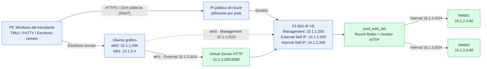

# Laboratorio 3 — Construcción y análisis del camino de datos: interfaces, VLANs, Self IPs, rutas, Virtual Servers y análisis del flujo de tráfico

## Metadatos

| Campo | Valor |
|---|---|
| **Duración** | **70 minutos** (con servidores web y conectividad preparados) |
| **Complejidad** | Media-alta |
| **Nivel de Bloom** | Aplicar y analizar |
| **Modalidad** | Práctica individual: un pod Azure por estudiante |
| **Producto** | F5 BIG-IP VE; comprobar versión instalada con `show sys version` |
| **Continuidad** | Laboratorios 1 y 2 completados; redes e interfaces ya aprovisionadas |

## Descripción general

En esta práctica se configura un servicio de balanceo HTTP funcional sobre una topología BIG-IP VE ya desplegada en Azure. El estudiante comprueba el camino de datos existente, crea un monitor de salud, incorpora dos servidores a un pool y publica el servicio mediante un **Virtual Server Standard** con **SNAT AutoMap**. Después genera tráfico, analiza las conexiones cliente y servidor con `tcpdump` y realiza una prueba de continuidad de servicio al deshabilitar temporalmente un miembro del pool.

El aprendizaje principal no consiste en repetir la configuración de red del laboratorio anterior, sino en **demostrar por qué el balanceo funciona, identificar qué IP ve cada extremo y diagnosticar qué sucede cuando se retira un backend**.

## Objetivos de aprendizaje

Al finalizar podrás:

- [ ] Verificar la conectividad de las redes existentes y explicar cuándo se necesita —o no— una ruta estática.
- [ ] Crear y validar un monitor HTTP y un pool con dos miembros.
- [ ] Publicar un Virtual Server Standard con perfiles TCP y HTTP, Round Robin y SNAT AutoMap.
- [ ] Demostrar el reparto de nuevas conexiones y examinar estadísticas del Virtual Server y del pool.
- [ ] Interpretar el flujo **cliente → VIP** y **Self IP interna → servidor** en una captura de paquetes.
- [ ] Deshabilitar temporalmente un miembro, verificar continuidad y restaurar el estado original.

## Prerrequisitos

**Conocimientos:** TCP/IP, subredes, puertos TCP, HTTP, diferencia entre monitoreo de salud y distribución de conexiones.

**Estado del pod:** BIG-IP operativo, licencia LTM activa, Management IP accesible, VLAN `External` con Self IP `External-IP` y VLAN `Internal` con su Self IP ya creada. Los servidores web están encendidos y atienden HTTP en TCP/80. El estudiante **no requiere acceso a Azure Portal** ni credenciales administrativas de los servidores web.

**Acceso:** desde el equipo Windows del estudiante, TMUI y SSH/PuTTY a la IP pública asignada a **su** pod; desde Ubuntu gráfico, Firefox/terminal al BIG-IP por la Management IP privada. Se recomienda efectuar las pruebas de carga desde Ubuntu.

**Seguridad:** conserva abierta una sesión administrativa a `10.1.1.200`; **no modifiques** interfaces de Azure, direcciones `.200`, VLANs, Self IPs, rutas de gestión, licenciamiento ni boot locations. No ejecutes comandos de eliminación sobre objetos preexistentes. **Contexto de comandos:** las instrucciones marcadas *Ubuntu (Bash)* se ejecutan en Ubuntu; las marcadas *BIG-IP (TMSH)* se ejecutan en el prompt `(tmos)#`; `tcpdump` se ejecuta en *BIG-IP (Bash)*, al cual puedes acceder desde TMSH con `run util bash`.

## Entorno de laboratorio

### Diagrama lógico 



**Flujo que se analizará:** `Ubuntu 10.1.3.4:puerto_efímero → 10.1.3.200:8080 → BIG-IP → 10.1.2.4:80 o 10.1.2.5:80`.

> **Particularidad de Azure:** en este pod la IP `10.1.3.200` sí está asignada a BIG-IP. Se reutiliza como destino del Virtual Server **solo en TCP/8080**, evitando el TCP/443 administrativo estudiado en el Laboratorio 1. Una VIP adicional como `10.1.3.100` exigiría verificar previamente su asignación y encaminamiento en la infraestructura de Azure. No se presume que cualquier dirección libre de la subred funcione como VIP. Para producción es preferible reservar una IP dedicada para la aplicación.

### Tabla de direccionamiento

| Equipo / objeto | Interfaz o plano | IP / puerto | Uso |
|---|---|---|---|
| PC Windows | Internet | IP pública del pod (variable) | Administración y RDP |
| BIG-IP | Management | `10.1.1.200/24` | TMUI y SSH privados |
| Ubuntu | `eth0` | `10.1.1.246/24` | Administración privada |
| Ubuntu | `eth1` | `10.1.3.4/24` | Cliente HTTP |
| BIG-IP | VLAN `External`, interfaz `1.1` | `10.1.3.200/24` | Self IP externa |
| BIG-IP | VLAN `Internal`, interfaz `1.2` | `10.1.2.200/24` | Self IP interna; origen SNAT AutoMap previsto |
| Web01 | Red Internal | `10.1.2.4:80` | Backend 1 |
| Web02 | Red Internal | `10.1.2.5:80` | Backend 2 |
| `vs_web_lab` | VLAN External | `10.1.3.200:8080` | Entrada al servicio balanceado |

**No se crea una ruta por defecto en esta práctica.** Ubuntu y ambas Self IPs se encuentran en redes conectadas directamente a BIG-IP. El funcionamiento de una solicitud al Virtual Server no depende de inventar un gateway `10.1.3.1`. Si los servidores backend no responden al monitor, debe comprobarse también su ruta de retorno o las políticas de red; no se asumirán gateways no verificados.

### Distribución del tiempo

| Paso | Actividad | Tiempo |
|---|---|---:|
| 1 | Baseline de interfaces, Self IPs y rutas | 8 min |
| 2 | Monitor de salud y pool | 10 min |
| 3 | Virtual Server Standard y SNAT AutoMap | 12 min |
| 4 | Pruebas de conectividad y reparto | 8 min |
| 5 | Conexiones TCP sin HTTP, HTTP válido y análisis con `tcpdump` | 12 min |
| 6 | Retiro controlado de un backend y recuperación | 12 min |
| 7 | Validación integral y registro de evidencia | 8 min |
| **Total** | | **70 min** |

## Verificación previa del entorno

1. Desde Ubuntu, verifica que la interfaz External tenga `10.1.3.4`:

   ```bash
   ip -4 addr show eth1
   ip route get 10.1.3.200
   ping -c 3 10.1.3.200
   ```

   **Interpretación:** la salida de `ip route get` debe indicar la interfaz `eth1`; no se configura una ruta estática nueva.

2. Desde Ubuntu, abre `https://10.1.1.200` en Firefox y confirma que puedes iniciar sesión en TMUI. En una terminal independiente, comprueba la conectividad al puerto de administración:

   ```bash
   curl -k -s -o /dev/null -w 'HTTP %{http_code}\n' https://10.1.1.200/tmui/login.jsp
   ```

   Se espera una respuesta HTTP, normalmente `200`; un código distinto no implica necesariamente falta de conectividad.

3. Desde TMSH en BIG-IP:

   ```text
   show sys version
   list net self
   list net vlan
   list ltm virtual one-line
   ```

   **Punto de control:** comprueba que ningún Virtual Server existente usa `10.1.3.200:8080` ni un destino comodín que coincida con ese puerto. Si aparece `vs_web_lab` de una ejecución anterior, comprueba sus propiedades antes de continuar y reutilízalo solo si coincide con los parámetros de este documento. Si hay otro listener en conflicto, **no lo elimines ni sobrescribas**: detén la creación y reporta el conflicto, indicando el nombre y destino encontrados.

## Instrucciones paso a paso

### Paso 1. Analizar interfaces, VLANs, Self IPs y routing existentes (8 min)

**Objetivo:** obtener un estado inicial verificable antes de crear objetos LTM.

1. En **Network → Interfaces**, comprueba los puertos de datos `1.1` y `1.2`.
2. En **Network → VLANs**, identifica `External` y `Internal`. **No las recrees**.
3. En **Network → Self IPs**, verifica `External-IP = 10.1.3.200/24` y la Self IP interna `10.1.2.200/24`. **No cambies Port Lockdown**.
4. En **Network → Routes**, observa qué rutas aparecen. Las subredes conectadas pueden aparecer en la tabla operativa sin ser rutas estáticas creadas por el usuario.
5. Verifica en TMSH:

   ```text
   show net interface
   list net vlan External
   list net vlan Internal
   list net self
   show net route
   ```

**Preguntas de análisis:** ¿Por qué el cliente `10.1.3.4` alcanza directamente la Self IP externa? ¿Por qué un monitor hacia `10.1.2.4` no requiere una ruta por defecto en BIG-IP? ¿Qué diferencia existe entre Management IP y Self IP?

**Evidencia:** registra que la Self IP externa pertenece a `External`, que la Self IP interna pertenece a `Internal` y que no modificaste ninguna de ellas. Si un objeto de red tiene otro nombre, usa el que realmente aparece en tu BIG-IP, sin crear duplicados.

### Paso 2. Crear un monitor HTTP y un pool de dos servidores (10 min)

**Objetivo:** hacer que BIG-IP decida qué servidores pueden recibir tráfico a partir de una comprobación HTTP.

1. En TMUI, entra a **Local Traffic → Monitors → Create**. Si `monitor_http_lab` ya existe, ábrelo y verifica sus parámetros; de lo contrario, créalo con:

   | Campo | Valor |
   |---|---|
   | Name | `monitor_http_lab` |
   | Type | `HTTP` |
   | Parent Monitor | `http` |
   | Interval | `5` segundos |
   | Timeout | `16` segundos |
   | Send String | `GET / HTTP/1.0\r\n\r\n` |
   | Receive String | `200 OK` |

   Si el formulario presenta **Send String** como campo de texto, escribe exactamente `GET / HTTP/1.0\r\n\r\n` (con las secuencias de retorno de carro y nueva línea). No escribas literalmente los caracteres de control como saltos de línea manuales.

   La petición y la cadena de recepción sirven para distinguir **servicio HTTP disponible** de simple respuesta a ping.

2. En **Local Traffic → Pools → Pool List → Create**, crea `pool_web_lab` si no existe. Si ya existe, comprueba sus miembros y su monitor en lugar de duplicarlo. Utiliza:

   | Campo | Valor |
   |---|---|
   | Name | `pool_web_lab` |
   | Health Monitors | `monitor_http_lab` |
   | Load Balancing Method | `Round Robin` |
   | Member 1 | `10.1.2.4`, Service Port `80` |
   | Member 2 | `10.1.2.5`, Service Port `80` |

3. Abre `pool_web_lab → Members` y espera hasta unos 20–30 segundos para que el monitor complete sus primeras comprobaciones. Deben existir dos miembros con estado **Available** (verde). Si no están disponibles, consulta el apartado de solución de problemas antes de crear el Virtual Server.
4. Verifica en TMSH:

   ```text
   list ltm monitor http monitor_http_lab
   list ltm pool pool_web_lab
   show ltm pool pool_web_lab members
   ```

**Si un miembro no está disponible:** antes de modificar el monitor, comprueba que Apache responda HTTP en el servidor, que BIG-IP tenga conectividad hacia la red Internal y que no exista bloqueo en el host o Azure. `Available` indica que **el monitor obtiene una respuesta válida**, no que el servidor sea inmune a fallos.

### Paso 3. Publicar un Virtual Server Standard (12 min)

**Objetivo:** ofrecer un único servicio HTTP que distribuya nuevas conexiones hacia el pool.

1. En **Local Traffic → Virtual Servers → Virtual Server List**, crea `vs_web_lab` si no existe; si ya existe, abre sus propiedades y comprueba que coincidan con las siguientes. En **Create**, utiliza:

   | Campo | Valor |
   |---|---|
   | Name | `vs_web_lab` |
   | Type | `Standard` |
   | Destination Address | `10.1.3.200` |
   | Service Port | `8080` (especificar puerto personalizado) |
   | Protocol | `TCP` |
   | HTTP Profile | `http` |
   | TCP Profile | `tcp` o perfil TCP predeterminado apropiado |
   | Default Pool | `pool_web_lab` |
   | Source Address Translation | `Auto Map` |

   Si la pantalla de tu versión separa **Configuration**, **Resources** o los perfiles en distintas secciones, completa primero los parámetros del servicio y luego asigna el *Default Pool* y los perfiles en las secciones que corresponda. No guardes el Virtual Server sin `pool_web_lab` como pool predeterminado.

   **Importante:** no cambies a TCP/443 ni crees una VIP `10.1.3.100`; el primero puede interferir con la administración y la segunda puede no estar asignada a la NIC de Azure.

2. Guarda y confirma que el Virtual Server aparece **Available**. Revisa:

   ```text
   list ltm virtual vs_web_lab
   show ltm virtual vs_web_lab
   ```

3. Comprueba que la configuración incluye una traducción de origen equivalente a:

   ```text
   source-address-translation {
       type automap
   }
   ```

**Concepto técnico:** BIG-IP mantiene una conexión TCP con el cliente y una conexión TCP distinta hacia el backend. Al usar AutoMap, en el lado Internal normalmente sustituye la IP de origen del cliente (`10.1.3.4`) por la Self IP de salida (`10.1.2.200`).

**Comprobación de conflicto:** el destino `10.1.3.200:8080` coincide con la dirección de una Self IP, pero no con sus servicios administrativos TCP/22 o TCP/443. El Virtual Server es el listener de aplicación para el puerto 8080. Esta elección es **específica de las restricciones del pod**, no una recomendación de diseño para producción.

### Paso 4. Probar el servicio y observar la distribución (8 min)

**Objetivo:** demostrar funcionalidad antes de interpretar los paquetes.

1. Desde Ubuntu, ejecuta:

   ```bash
   curl -v --connect-timeout 5 http://10.1.3.200:8080/
   ```

   Debes recibir una respuesta HTTP válida, preferiblemente `200 OK`. Si no responde, no continúes con `tcpdump` sin revisar primero el pool y el VS.

2. Genera diez solicitudes independientes. `curl` establece una conexión nueva en cada iteración (no se reutiliza una sesión de `curl`):

   ```bash
   for i in $(seq 1 10); do
     printf 'Peticion %02d: ' "$i"
     curl -sS --max-time 5 -o /dev/null -w '%{http_code}\n' http://10.1.3.200:8080/
   done
   ```

3. Abre en TMUI **Local Traffic → Pools → Pool List → pool_web_lab → Members** y revisa las estadísticas de conexiones de cada miembro. Registra los contadores antes y después de las diez solicitudes para identificar el incremento; pueden existir conexiones adicionales procedentes de los monitores. Alternativamente, en TMSH:

   ```text
   show ltm pool pool_web_lab members
   show ltm virtual vs_web_lab
   ```

**Interpretación:** con Round Robin y conexiones nuevas, ambas máquinas deben participar. **No es obligatorio obtener una alternancia exacta 1:1 en el HTML**: si ambos servidores devuelven la misma página, la distribución se demuestra con las estadísticas por miembro, no con el contenido de la respuesta. Tampoco se garantiza reparto idéntico si hay persistencia, conexiones reutilizadas o tráfico adicional.

### Paso 5. Analizar full-proxy y SNAT mediante conexiones y captura (12 min)

**Objetivo:** comprobar primero una conexión TCP del cliente sin petición HTTP y después observar en paquetes reales cómo BIG-IP selecciona un servidor y aplica SNAT AutoMap. Es importante distinguir lo que muestra la **tabla instantánea de conexiones** de lo que muestra una **captura de paquetes**.

**Antes de comenzar:** debes haber recibido HTTP 200 desde `http://10.1.3.200:8080/` en el Paso 4. Si la aplicación no funciona, resuelve primero el problema de disponibilidad. Usa tres terminales abiertas en paralelo:

| Terminal | Equipo y modo | Finalidad |
|---|---|---|
| A | BIG-IP, **Bash** | Captura con `tcpdump` |
| B | BIG-IP, **TMSH** | Tabla de conexiones y estado del pool |
| C | Ubuntu, **Bash** | Generación de tráfico HTTP |

Si las sesiones SSH de BIG-IP abren directamente el prompt `(tmos)#`, mantén la Terminal B ahí. En la Terminal A escribe `run util bash` para entrar en Bash; **no antepongas `tmsh` a los comandos de la Terminal B**.

**Parte A — Conexiones TCP sin solicitud HTTP**

1. En la **Terminal C (Ubuntu)**, ejecuta el siguiente bloque completo. Abre diez sockets hacia la VIP y conserva cada socket abierto durante 45 segundos, sin enviar HTTP:

   ```bash
   for i in $(seq 1 10); do
     (
       exec 3<>/dev/tcp/10.1.3.200/8080 || exit
       printf 'TCP %02d abierto\n' "$i"
       sleep 45
       exec 3<&-
       exec 3>&-
     ) &
   done
   wait
   ```

   **Mientras la terminal todavía está ocupada**, pasa a la Terminal B. No esperes a que termine `wait`.

2. En la **Terminal B (BIG-IP, TMSH)**, ejecuta:

   ```text
   show sys connection cs-server-addr 10.1.3.200 cs-server-port 8080
   ```

   Deberías ver varias entradas similares a esta (el puerto efímero cambia):

   ```text
   10.1.3.4:49026  10.1.3.200:8080  any6.any  any6.any  tcp
   ```

   Las dos primeras columnas identifican al **cliente Ubuntu y la VIP**. `any6.any` indica que **no se muestran extremos de una conexión asociada hacia un backend** en ese momento. En esta prueba es esperable: solo se abrió TCP y no se envió una petición HTTP.

   Si la tabla está vacía, ejecuta el comando anterior **mientras todavía transcurren los 45 segundos**. Confirma, en otra terminal de Ubuntu, que hay conexiones TCP abiertas:

   ```bash
   ss -tn | grep '10.1.3.200:8080'
   ```

   Espera a que finalice el primer `for` antes de continuar, para no confundir las conexiones de las dos pruebas.

**Parte B — Solicitud HTTP válida y selección de un backend**

3. En la **Terminal A (BIG-IP, Bash)**, inicia esta captura **antes de generar nuevas solicitudes**. La captura permanece activa hasta que pulses `Ctrl+C`:

   ```bash
   tcpdump -nni 0.0 -l '((host 10.1.3.4 and tcp port 8080) or ((host 10.1.2.4 or host 10.1.2.5) and tcp port 80))'
   ```

   Deja la captura ejecutándose. Es normal ver paquetes hacia los backends procedentes de los monitores HTTP incluso cuando no hay solicitudes del cliente.

4. En la **Terminal C (Ubuntu)**, envía cinco solicitudes HTTP completas en paralelo y mantén sus sockets abiertos 30 segundos:

   ```bash
   for i in $(seq 1 5); do
     (
       exec 3<>/dev/tcp/10.1.3.200/8080 || exit
       printf 'GET / HTTP/1.1\r\nHost: 10.1.3.200\r\nConnection: keep-alive\r\n\r\n' >&3
       printf 'HTTP %02d enviado\n' "$i"
       sleep 30
       exec 3<&-
       exec 3>&-
     ) &
   done
   wait
   ```

   **Qué debe suceder:** BIG-IP recibe un `GET /` válido y puede escoger un miembro del pool para procesarlo. Como el cliente no lee la respuesta durante el `sleep`, **mantener abierto su socket no garantiza que la conexión hacia el backend siga visible** durante esos 30 segundos.

5. Mientras el segundo bloque sigue en ejecución, consulta inmediatamente desde la **Terminal B (BIG-IP, TMSH)**:

   ```text
   show sys connection cs-server-addr 10.1.3.200 cs-server-port 8080
   show ltm pool pool_web_lab members
   ```

   Si BIG-IP conserva en ese instante la asociación cliente–servidor, puede mostrar cuatro extremos similares a los siguientes (ejemplo orientativo):

   ```text
   10.1.3.4:49026  10.1.3.200:8080  10.1.2.200:55001  10.1.2.4:80  tcp
   ```

   **No es obligatorio ver esa línea:** si `any6.any` persiste, el backend pudo haber contestado y cerrado o desvinculado la conexión antes de la consulta. Para identificar al servidor usado, continúa con la captura.

6. En la **Terminal A (BIG-IP, Bash)**, detén `tcpdump` con `Ctrl+C` cuando hayan terminado las peticiones. Identifica dos conversaciones que coincidan con el momento en que ejecutaste el segundo `for`:

   | Segmento | IP de origen | IP de destino | Interpretación |
   |---|---|---|---|
   | Cliente → VIP | `10.1.3.4:puerto_efímero` | `10.1.3.200:8080` | Ubuntu establece la conexión con BIG-IP |
   | BIG-IP → servidor | `10.1.2.200:puerto_efímero` | `10.1.2.4:80` o `10.1.2.5:80` | BIG-IP selecciona el backend y aplica SNAT AutoMap |

   En ambas conversaciones busca paquetes `Flags [S]`, `Flags [S.]` y `Flags [.]` para reconocer los handshakes TCP. La **dirección de origen `10.1.2.200`** en el segundo segmento es la evidencia de SNAT AutoMap. Los monitores pueden generar tráfico similar hacia el backend; para distinguirlo del tráfico de cliente, correlaciona el instante de los `GET` con el incremento de las conexiones/estadísticas del pool.

7. Comprueba que la VIP sigue funcionando con una petición normal desde **Ubuntu**:

   ```bash
   curl -sS --max-time 5 -o /dev/null -w 'HTTP %{http_code}\n' http://10.1.3.200:8080/
   ```

   Desde **TMSH** verifica:

   ```text
   show ltm pool pool_web_lab members
   show ltm virtual vs_web_lab
   ```

**Comprobación del Paso 5:**

- [ ] Observé conexiones `10.1.3.4 → 10.1.3.200:8080` durante la primera prueba.
- [ ] Puedo explicar por qué en esas conexiones puede aparecer `any6.any`.
- [ ] Envié solicitudes `GET /` completas durante la segunda prueba.
- [ ] En `tcpdump`, distinguí el flujo cliente–VIP y el flujo BIG-IP–backend.
- [ ] Identifiqué `10.1.2.200` como dirección de origen traducida por SNAT AutoMap.
- [ ] Confirmé que HTTP sigue respondiendo desde la VIP.

**Pregunta de análisis:** ¿por qué en el lado External aparece como destino `10.1.3.200:8080`, mientras que en el lado Internal aparece `10.1.2.4:80` o `10.1.2.5:80`? Relaciona ambos flujos con el funcionamiento *full-proxy* de BIG-IP.

---

### Paso 6. Simular una retirada controlada de un miembro (12 min)

**Objetivo:** comprobar continuidad del servicio ante una intervención sobre un backend, sin apagar máquinas ni necesitar sus contraseñas.

1. Confirma que ambos miembros están **Enabled** y **Available**, y que `curl http://10.1.3.200:8080/` devuelve HTTP 200. Registra los contadores de conexión de ambos miembros antes de hacer el cambio.
2. En **Local Traffic → Pools → Pool List → pool_web_lab → Members**, selecciona `10.1.2.5:80` y utiliza la acción **Disable** (deshabilitar miembro). **No selecciones Delete ni Forced Offline.**
3. En TMSH confirma el estado administrativo:

   ```text
   show ltm pool pool_web_lab members
   ```

4. Desde Ubuntu ejecuta:

   ```bash
   for i in $(seq 1 8); do
     curl -sS --max-time 5 -o /dev/null -w '%{http_code}\n' http://10.1.3.200:8080/
   done
   ```

5. Actualiza las estadísticas de miembros en TMUI o ejecuta nuevamente `show ltm pool pool_web_lab members`. Comprueba el **incremento** de las conexiones hacia `10.1.2.4:80` y que las nuevas peticiones no se asignan a `10.1.2.5:80`. Los monitores pueden continuar activos sobre el miembro deshabilitado.
6. Vuelve a **Members**, selecciona `10.1.2.5:80` y aplica **Enable**. Genera otras ocho peticiones nuevas y comprueba que ambos miembros vuelven a participar. **No termines la práctica hasta comprobar que Web02 quedó habilitado.**

**Análisis:** **Disable no equivale a un fallo de salud**. El miembro puede seguir respondiendo al monitor, pero queda administrativamente fuera de la selección normal de nuevas conexiones. Las conexiones existentes y determinadas configuraciones de persistencia pueden comportarse de otra forma. Esta prueba demuestra **drenaje administrativo básico y continuidad**, no una caída real de Apache.

### Paso 7. Validación integral y evidencia (8 min)

**Objetivo:** cerrar el diagnóstico con hechos y dejar el pod preparado para el siguiente laboratorio.

1. Desde BIG-IP TMSH verifica:

   ```text
   list ltm virtual vs_web_lab
   list ltm pool pool_web_lab
   show ltm pool pool_web_lab members
   show ltm virtual vs_web_lab
   list net self
   ```

2. Desde Ubuntu verifica la aplicación y la administración, como pruebas separadas:

   ```bash
   curl -sS --max-time 5 -o /dev/null -w 'VIP: HTTP %{http_code}\n' http://10.1.3.200:8080/
   curl -ksS --max-time 5 -o /dev/null -w 'TMUI: HTTP %{http_code}\n' https://10.1.1.200/tmui/login.jsp
   ```

3. Completa tu evidencia:

   | Comprobación | Evidencia observada |
   |---|---|
   | Monitor HTTP | Nombre y estado |
   | Miembros activos del pool | Web01 / Web02 |
   | VIP y puerto | `10.1.3.200:8080` |
   | Resultado de `curl` | Código HTTP |
   | IP origen en External | IP observada en captura |
   | IP origen en Internal | IP observada en captura |
   | Servicio disponible con Web02 deshabilitado | Código HTTP y contadores observados |
   | Estado final de Web02 | Enabled y Available |

4. Explica brevemente dónde investigarías primero en cada caso: **VIP sin respuesta; un pool member Offline; servicio disponible con un miembro deshabilitado**.

## Validación y pruebas: criterios de éxito

| Prueba | Éxito verificable | Qué demuestra |
|---|---|---|
| Cliente → VIP | Respuesta HTTP desde `10.1.3.200:8080` | Publicación funcional del servicio |
| Pool | Dos miembros disponibles al inicio y al final | Supervisión de salud |
| Distribución | Contadores o conexiones en ambos miembros | Round Robin bajo nuevas conexiones |
| Full-proxy | Se observan conversaciones lado cliente y lado servidor | Separación TCP de BIG-IP |
| AutoMap | Origen de servidor corresponde a Self IP de salida | SNAT de origen |
| Retirada controlada | VIP sigue atendiendo solicitudes con un miembro deshabilitado | Continuidad ante mantenimiento |
| Recuperación | Web02 vuelve a Enabled y disponible | Reversión de cambio |

## Solución de problemas

### Problema 1. La VIP no responde, pero la Management IP sí

1. Desde Ubuntu: `ip route get 10.1.3.200` (debe salir por `eth1`).
2. Verifica que la VIP se configuró con **TCP/8080**, no TCP/443.
3. En BIG-IP: `list ltm virtual vs_web_lab` y `show ltm virtual vs_web_lab`.
4. Comprueba que no existe otro listener coincidente y que el pool tiene miembros disponibles.
5. Si es necesario, captura el tráfico en BIG-IP: desde Bash `tcpdump -nni 0.0 'host 10.1.3.4 and tcp port 8080'`.

**No modifiques la Management IP, las rutas de Azure ni Port Lockdown para corregir a ciegas este síntoma.**

### Problema 2. Pool rojo o un miembro Offline

1. `show ltm pool pool_web_lab members` para consultar el motivo.
2. Verifica `list ltm monitor http monitor_http_lab` y el `Receive String` configurado.
3. Identifica si el servidor contesta en el puerto 80 y si su respuesta contiene `200 OK`.
4. Si ambos miembros fallan, revisa conectividad `Internal`, rutas de retorno y controles de red; evita cambiar aleatoriamente el monitor para forzarlo a verde.

### Problema 3. El VIP responde, pero no hay alternancia visible

Los servidores pueden mostrar contenido idéntico. Comprueba las **estadísticas por miembro** y utiliza solicitudes HTTP independientes antes de concluir que Round Robin está fallando.

### Problema 4. La captura solo muestra monitores o no hay paquetes

Comprueba que capturas en la interfaz de TMM (`0.0`) **mientras** generas tráfico desde Ubuntu. Reduce el filtro a `tcp port 8080` para aislar el lado cliente, y después examina `tcp port 80` hacia los backends. Los monitores generan tráfico adicional aunque ningún usuario consulte la VIP.

### Problema 5. `show sys connection` está vacío o muestra `any6.any`

- **Tabla vacía:** probablemente las conexiones ya terminaron. Ejecuta el `for` de **10 sockets TCP durante 45 segundos** del Paso 5 y consulta TMSH mientras continúa en ejecución. En Ubuntu usa `ss -tn | grep '10.1.3.200:8080'` para confirmar los sockets abiertos.
- **Aparece `any6.any`:** las conexiones hacia la VIP existen, pero no hay información visible de una conexión asociada del lado servidor en ese instante. El primer `for` no envía HTTP y ese resultado es esperable.
- **Se envió HTTP y todavía aparece `any6.any`:** el servidor puede haber respondido y cerrado su lado de la conexión antes de la consulta. No se requiere aumentar los timeouts ni generar tráfico indefinidamente: valida las direcciones y el pool member con `tcpdump -nni 0.0` y revisa las estadísticas del pool.

### Problema 6. Web02 no vuelve a recibir tráfico

En **Pool Members**, comprueba que el estado administrativo sea **Enabled**, no solamente que responda a los monitores. Revisa también si existen conexiones persistentes previas y repite nuevas solicitudes.

## Limpieza y estado final

**Conserva los objetos creados**, porque sirven como base para las siguientes prácticas:

- `monitor_http_lab`, `pool_web_lab` y `vs_web_lab`.
- Ambos miembros (`10.1.2.4:80` y `10.1.2.5:80`) **Enabled** y disponibles.
- Virtual Server en `10.1.3.200:8080` con SNAT AutoMap.
- Management IP `10.1.1.200`, Self IPs `.200`, VLANs y rutas **sin cambios**.

Guarda en TMSH:

```text
save sys config
```

**No elimines `vs_web_lab`, `pool_web_lab` ni `monitor_http_lab` al finalizar:** serán utilizados en prácticas posteriores. Si necesitas detener una prueba en curso, utiliza `Ctrl+C` en la terminal correspondiente; no elimines objetos de red. **Nunca elimines las VLANs, Self IPs ni rutas preexistentes.**

## Resumen

El laboratorio demuestra la diferencia entre **infraestructura de red ya existente** e **instancias de servicio creadas sobre ella**. El monitor determina salud, el pool reúne los backends, el Virtual Server presenta un destino lógico de aplicación, Round Robin reparte nuevas conexiones y SNAT AutoMap modifica la IP de origen del lado servidor. Las capturas evidencian la arquitectura full-proxy; la retirada administrativa de un miembro prueba continuidad del servicio sin interrumpir el pod.

## Recursos adicionales

- [F5 BIG-IP Local Traffic Management — documentación técnica](https://techdocs.f5.com/)
- [Referencia TMSH de F5](https://clouddocs.f5.com/cli/tmsh-reference/latest/)
- [F5: arquitectura full-proxy](https://www.f5.com/glossary/full-proxy)
- [F5 Support — artículos y documentación](https://my.f5.com/)
