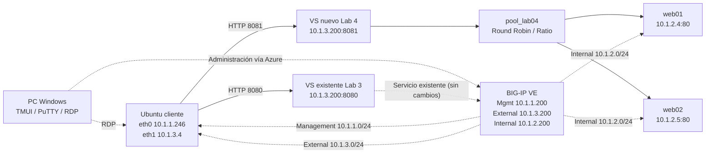
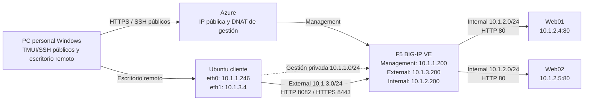

# Laboratorio 4 — Publicación de una aplicación mediante BIG-IP: Pools, Pool Members, Health Monitors, load balancing y Virtual Servers

## Metadatos

| Campo | Valor |
|---|---|
| Duración | 60 minutos |
| Complejidad | Media-alta |
| Nivel de Bloom | Aplicar y analizar |
| Modalidad | Práctica individual en pod Azure |

## Descripción general

En este laboratorio administrarás un segundo servicio web mediante BIG-IP LTM sin interrumpir el Virtual Server del Laboratorio 3. Construirás un pool independiente que utiliza los dos servidores existentes, compararás dos métodos de distribución de conexiones y provocarás una falla de verificación HTTP controlada para comprobar una diferencia fundamental: **un puerto TCP abierto no garantiza que la aplicación responda correctamente**. Finalmente, retirarás temporalmente un servidor del servicio, interpretarás su estado y recuperarás la capacidad original.

El laboratorio no requiere Azure Portal, nuevas máquinas virtuales, nuevas IP ni modificar las VLANs o Self IPs. El servicio del Laboratorio 3 debe permanecer intacto.

## Objetivos de aprendizaje

Al finalizar, podrás:

- [ ] Publicar una segunda aplicación lógica utilizando una VIP:puerto distinta y los mismos servidores físicos.
- [ ] Configurar un pool y un monitor HTTP que valide el código de respuesta, no solamente conectividad TCP.
- [ ] Comparar Round Robin con Ratio (Member), modificando pesos y evaluando estadísticas reales.
- [ ] Diagnosticar una condición en la que TCP responde, pero una ruta HTTP de aplicación falla.
- [ ] Diferenciar un miembro **Offline por monitor** de un miembro **retirado administrativamente**.
- [ ] Recuperar el servicio y comprobar que la publicación inicial permanece operativa.

## Prerrequisitos y acceso

- Laboratorios 1 a 3 completados; BIG-IP VE con interfaces, VLANs y Self IPs operativas.
- Dos servidores web funcionando en `10.1.2.4:80` y `10.1.2.5:80`.
- Cliente Ubuntu con Firefox y `curl`.
- Cuenta administrativa de BIG-IP. Las sesiones SSH del pod pueden entrar directamente en **TMSH**: ejecuta los comandos sin anteponer `tmsh`.
- **No se necesita acceso SSH a los servidores web** ni privilegios en Azure Portal.

| Equipo o componente | Dirección o identificador | Uso |
|---|---|---|
| BIG-IP Management | `10.1.1.200` | TMUI y TMSH desde Ubuntu; acceso público desde Windows según el pod |
| BIG-IP External Self IP | `10.1.3.200` | Red de clientes y dirección de publicación |
| BIG-IP Internal Self IP | `10.1.2.200` | Acceso a servidores y SNAT AutoMap |
| Ubuntu cliente | `10.1.1.246` (eth0), `10.1.3.4` (eth1) | Pruebas HTTP |
| web01 | `10.1.2.4:80` | Pool member |
| web02 | `10.1.2.5:80` | Pool member |
| Servicio previo (Lab 3) | `10.1.3.200:8080` | Servicio de referencia: no modificar |
| **Servicio nuevo (Lab 4)** | **`10.1.3.200:8081`** | Objeto principal del laboratorio |

## Diagrama de topología



**Nota de lectura:** las dos VIP utilizan la IP externa que ya está asignada a BIG-IP, pero escuchan en puertos distintos. Los pools pueden utilizar los mismos servidores sin duplicar máquinas virtuales. La configuración de los objetos LTM determina cómo se reparte el tráfico de cada servicio.

## Distribución del tiempo

| Actividad | Minutos |
|---|---:|
| 1. Verificación y línea base | 5 |
| 2. Monitor HTTP y pool independiente | 10 |
| 3. Publicación del segundo Virtual Server | 7 |
| 4. Comparación Round Robin vs. Ratio 3:1 | 12 |
| 5. Diagnóstico TCP vs. HTTP | 12 |
| 6. Mantenimiento de un Pool Member | 9 |
| 7. Recuperación y validación | 5 |
| **Total** | **60** |

---

## Paso 1. Verificar que el entorno está preparado (5 minutos)

**Objetivo:** confirmar que el servicio del Laboratorio 3 funciona y que el puerto `8081` está libre.

**Desde Ubuntu Bash**, ejecuta:

```bash
curl -sS -o /dev/null -w 'Lab3 HTTP: %{http_code}\n' --connect-timeout 5 http://10.1.3.200:8080/
curl -sS -o /dev/null -w 'Puerto 8081 antes: %{http_code}\n' --connect-timeout 3 --max-time 5 http://10.1.3.200:8081/
```

- La primera solicitud debe devolver normalmente `200` si el servicio anterior funciona.
- La segunda debe fallar o devolver `000` si no existe un listener en `8081`. **No se espera necesariamente un mensaje específico:** puede haber timeout o rechazo de conexión.

**Desde BIG-IP TMSH**, confirma:

```text
list ltm virtual
show ltm pool
list net self External-IP
```

Comprueba que la Self IP externa sigue siendo `10.1.3.200` y que ninguna configuración existente utiliza el destino `10.1.3.200:8081`.

**Criterio para continuar:** el servicio anterior funciona y la nueva combinación IP:puerto está disponible. Si ya existe un Virtual Server en `8081`, no lo sobrescribas; detén esta actividad para evitar modificar un servicio ajeno.

## Paso 2. Crear un monitor HTTP y un pool independiente (10 minutos)

**Problema que resuelve:** un balanceador necesita distinguir entre un servidor que acepta conexiones y un servidor que realmente devuelve la respuesta esperada de su aplicación.

### 2.1 Crear el monitor

En TMUI, abre **Local Traffic → Monitors → Create**. Establece:

| Campo | Valor |
|---|---|
| Name | `mon_http_lab04` |
| Type | `HTTP` |
| Interval | `5` segundos |
| Timeout | `16` segundos |
| Send String | `GET / HTTP/1.0\r\n\r\n` |
| Receive String | `200 OK` |

Guarda con **Finished**. En algunas versiones, el formulario requiere seleccionar **Advanced** para mostrar todos los campos.

**Desde TMSH**:

```text
list ltm monitor http mon_http_lab04
```

Verifica que `send` incluya la secuencia final `\r\n\r\n` y que `recv` sea `200 OK`.

### 2.2 Crear el pool

En TMUI, abre **Local Traffic → Pools → Pool List → Create**:

| Campo | Valor |
|---|---|
| Name | `pool_lab04` |
| Health Monitors | `mon_http_lab04` (mover a Active) |
| Load Balancing Method | `Round Robin` |
| Member 1 | `10.1.2.4` / puerto `80` |
| Member 2 | `10.1.2.5` / puerto `80` |

Pulsa **Add** después de capturar cada miembro, y finalmente **Finished**. Si los nodos ya existen por el Laboratorio 3, selecciónalos desde la lista de nodos: no es necesario duplicarlos.

**Desde TMSH**:

```text
list ltm pool pool_lab04
show ltm pool pool_lab04 members
```

**Resultado esperado:** ambos miembros disponibles después de los primeros ciclos del monitor. Si alguno aparece Offline, comprueba el acceso HTTP directo desde **BIG-IP TMSH** (sin entrar a Bash):

```text
run util bash -c "curl -I http://10.1.2.4/"
run util bash -c "curl -I http://10.1.2.5/"
```

En cada servidor Apache se espera una línea semejante a `HTTP/1.1 200 OK`. El parámetro `-I` envía una solicitud **HEAD**, mientras que el monitor del pool envía **GET**. Si el servidor devuelve un código diferente o no acepta HEAD, comprueba la respuesta GET mediante:

```text
run util bash -c "curl -sS -o /dev/null -w '%{http_code}\n' http://10.1.2.4/"
run util bash -c "curl -sS -o /dev/null -w '%{http_code}\n' http://10.1.2.5/"
```

**Criterio para continuar:** los dos servidores responden a GET con `200` y ambos miembros del pool están disponibles. Si GET funciona y el monitor marca Offline, revisa la configuración del monitor antes de continuar.

## Paso 3. Publicar un segundo Virtual Server (7 minutos)

**Problema que resuelve:** publicar dos servicios lógicos diferentes utilizando los mismos recursos físicos, con políticas de entrega independientes.

En TMUI, abre **Local Traffic → Virtual Servers → Virtual Server List → Create**:

| Campo | Valor |
|---|---|
| Name | `vs_lab04` |
| Type | `Standard` |
| Destination Address/Mask | `10.1.3.200` / máscara de host (`255.255.255.255`) |
| Service Port | `8081` |
| Protocol | `TCP` |
| HTTP Profile (Client) | `http` |
| TCP Profile | `tcp` (predeterminado, confirmar) |
| Source Address Translation | `Auto Map` |
| Default Pool | `pool_lab04` |

Selecciona **Advanced** si necesitas mostrar perfiles y traducción de origen. Finaliza la creación.

**En BIG-IP TMSH**:

```text
list ltm virtual vs_lab04
show ltm virtual vs_lab04
```

Confirma `destination ...:8081`, el pool `pool_lab04`, un perfil TCP, un perfil HTTP y `source-address-translation { type automap }`.

**En Ubuntu Bash**:

```bash
curl -v --connect-timeout 5 http://10.1.3.200:8081/
curl -sS -o /dev/null -w 'Lab3: %{http_code}\n' http://10.1.3.200:8080/
```

**Resultado esperado:** el servicio nuevo devuelve `HTTP 200`; el servicio anterior continúa respondiendo. El segundo `curl` permite detectar accidentalmente un cambio que afectó el laboratorio anterior.

## Paso 4. Comparar Round Robin y Ratio (Member) (12 minutos)

**Problema que resuelve:** cuando los dos servidores tienen capacidades distintas, repartir las conexiones por igual puede no ser la mejor política. Ratio permite asignar pesos estáticos.

### 4.1 Línea base con Round Robin

Desde **Ubuntu Bash** ejecuta 40 solicitudes independientes. Cada ejecución de `curl` crea un proceso nuevo para reducir la reutilización de conexiones del cliente:

```bash
for i in $(seq 1 40); do
  curl -sS -o /dev/null --connect-timeout 5 --max-time 10 \
    -H 'Connection: close' "http://10.1.3.200:8081/?rr=$i"
done
```

En TMUI abre **Statistics → Module Statistics → Local Traffic → Pools** y selecciona `pool_lab04` (la ubicación concreta de estadísticas puede variar). Compara el incremento de conexiones/solicitudes de ambos miembros. También puedes usar:

```text
show ltm pool pool_lab04 members
```

**Interpretación:** con ambos miembros sanos, Round Robin debería aproximarse a una distribución 50/50 de *nuevas conexiones*. Los contadores son acumulativos: registra el valor antes y después de la prueba, en lugar de esperar que sean exactamente 20 y 20.

### 4.2 Cambiar a Ratio (Member)

En esta versión de TMUI, el método de balanceo y los miembros se administran desde la pestaña **Members** del pool. Los valores mostrados en la columna **Ratio** son informativos; para modificarlos debes abrir cada miembro.

1. Abre **Local Traffic → Pools → Pool List** y haz clic en **`pool_lab04`**.
2. Selecciona la pestaña **Members**.
3. En la sección superior **Load Balancing**, despliega **Load Balancing Method** y selecciona **Ratio (member)**.
4. Haz clic en **Update**, justo debajo de esa sección. Esto guarda el método del pool, **pero todavía no cambia los ratios de los servidores**.
5. En la tabla **Current Members**, haz clic en el enlace **`10.1.2.4:80`** (columna **Member**). En la pantalla de propiedades del miembro localiza **Ratio**, establece **3** y pulsa **Update**.
6. Regresa a **`pool_lab04` → Members**. Haz clic en **`10.1.2.5:80`**, establece **Ratio = 1** y guarda con **Update**.
7. Regresa a la pestaña **Members** y comprueba los valores de ambas filas:

| Miembro | Ratio configurado | Interpretación |
|---|---:|---|
| `10.1.2.4:80` (web01) | 3 | Peso relativo de tres unidades |
| `10.1.2.5:80` (web02) | 1 | Peso relativo de una unidad |

**Importante:** no utilices **Priority Group** ni **Connection Limit** para esta actividad; son parámetros diferentes. **Priority Group Activation** permanece en **Disabled**.

**Desde BIG-IP TMSH**, verifica el método y los pesos:

```text
list ltm pool pool_lab04
```

Localiza `load-balancing-mode ratio-member` y, dentro de `members`, el valor `ratio 3` correspondiente a `10.1.2.4:80`. El segundo miembro conserva `ratio 1` (su valor predeterminado puede no mostrarse explícitamente en la salida).

**Criterio de éxito:** TMUI muestra **Ratio (member)** como método y la columna **Ratio** muestra **3** y **1**, respectivamente. La tabla de miembros también debe mostrar ambos indicadores de estado en verde antes de comenzar la medición.

Repite 40 solicitudes nuevas desde Ubuntu:

```bash
for i in $(seq 1 40); do
  curl -sS -o /dev/null --connect-timeout 5 --max-time 10 \
    -H 'Connection: close' "http://10.1.3.200:8081/?ratio=$i"
done
```

Anota los incrementos de los contadores de miembros. **Resultado esperado:** una tendencia cercana al 75% para web01 y 25% para web02; no exijas 30/10 exactos porque la selección y los contadores pueden depender de conexiones existentes y del tráfico de fondo.

**Pregunta de análisis:** ¿cuándo convendría una relación 3:1 en producción? Ejemplo: un servidor con mayor capacidad de CPU o memoria que otro.

## Paso 5. Diagnóstico: ¿TCP disponible significa aplicación saludable? (12 minutos)

**Objetivo:** demostrar que un monitor TCP puede declarar disponible un servicio cuyo recurso HTTP específico falla. No detendremos Apache ni modificaremos el sistema operativo de los backends.

### 5.1 Registrar el funcionamiento correcto

En BIG-IP TMSH:

```text
show ltm pool pool_lab04 members
list ltm monitor http mon_http_lab04
```

Ambos miembros deben estar disponibles; el monitor envía `GET /` y exige `200 OK`.

### 5.2 Introducir una falla controlada en la comprobación de aplicación

En TMUI navega a **Local Traffic → Monitors → mon_http_lab04** y cambia **Send String** a:

```text
GET /lab04-ruta-inexistente HTTP/1.0\r\n\r\n
```

Mantén **Receive String** = `200 OK`. Pulsa **Update**.

Esto hace que el monitor solicite un recurso que normalmente no existe. Apache suele responder `404 Not Found`; el puerto TCP/80 puede seguir abierto, pero el monitor HTTP debe marcar a los miembros como no disponibles una vez vencido el timeout.

En BIG-IP TMSH verifica:

```text
show ltm pool pool_lab04 members
```

**Desde Ubuntu Bash**, comprueba la diferencia mediante la nueva VIP:

```bash
curl -v --connect-timeout 5 --max-time 10 http://10.1.3.200:8081/
```

Si ambos miembros están Offline, el Virtual Server puede dejar de atender correctamente solicitudes; el tipo exacto de error depende de la configuración y de cómo BIG-IP maneje conexiones existentes.

### 5.3 Comparar con un monitor TCP

En TMUI abre **Local Traffic → Pools → pool_lab04 → Properties**. Reemplaza temporalmente el monitor activo `mon_http_lab04` por el monitor integrado **`tcp`**, y pulsa **Update**.

Espera unos ciclos y consulta:

```text
list ltm pool pool_lab04
show ltm pool pool_lab04 members
```

**Resultado esperado:** si los servidores siguen aceptando TCP/80, los miembros vuelven a Available, aunque la ruta `/lab04-ruta-inexistente` no exista.

Desde Ubuntu, prueba el recurso inexistente en el servicio nuevo:

```bash
curl -sS -o /dev/null -w 'Recurso inexistente HTTP: %{http_code}\n' \
  http://10.1.3.200:8081/lab04-ruta-inexistente
```

Una respuesta `404` junto con un monitor TCP en verde demuestra que **alcanzabilidad TCP y salud de aplicación son cosas diferentes**.

**Si la ruta inesperadamente existe o devuelve `200`,** elige otro nombre de ruta inexistente y vuelve a repetir el ensayo. El objetivo es comprobar la diferencia entre una respuesta HTTP no deseada y la apertura del puerto TCP.

### 5.4 Restaurar el monitor HTTP correcto

En TMUI, edita `mon_http_lab04` y restaura:

```text
GET / HTTP/1.0\r\n\r\n
```

En **Local Traffic → Pools → pool_lab04 → Properties**, vuelve a seleccionar exclusivamente `mon_http_lab04` como monitor activo y pulsa **Update**.

Comprueba que ambos miembros vuelven a Available.

**Concepto comprobado:** un monitor TCP responde «¿el servicio acepta conexiones?». Un monitor HTTP con cadena de recepción permite comprobar «¿el servicio devuelve la respuesta esperada?».

## Paso 6. Mantenimiento controlado de un miembro (9 minutos)

**Objetivo:** diferenciar un miembro averiado de uno que el administrador retira intencionalmente de la rotación.

En TMUI abre **Local Traffic → Pools → pool_lab04 → Members**. Selecciona `10.1.2.5:80` y usa **Disable** (o la opción **Disabled** dentro del estado del miembro, según la versión).

En TMSH:

```text
show ltm pool pool_lab04 members
list ltm pool pool_lab04
```

**Observación:** el miembro retirado administrativamente puede seguir sano según el monitor, pero no debe recibir nuevas conexiones ordinarias. Las sesiones activas y ciertos casos con persistencia pueden conservarse. Por eso *Disabled* no equivale a «el servidor está averiado». <https://techdocs.f5.com/en-us/bigip-14-1-0/big-ip-local-traffic-management-basics-14-1-0/enabling-and-disabling-local-traffic-objects.html>

Desde Ubuntu genera 12 solicitudes:

```bash
for i in $(seq 1 12); do
  curl -sS -o /dev/null --connect-timeout 5 --max-time 10 \
    -H 'Connection: close' "http://10.1.3.200:8081/?maintenance=$i"
done
```

Consulta los contadores de ambos miembros. **Resultado esperado:** el miembro habilitado procesa las nuevas conexiones; el miembro deshabilitado deja de recibir conexiones ordinarias nuevas. Si los servidores muestran páginas idénticas, utiliza los contadores del pool para comprobarlo.

**Compara los estados:**

| Situación | Qué significa | Acción típica |
|---|---|---|
| Monitor HTTP falla | La comprobación de aplicación no es satisfactoria | Investigar aplicación, red o monitor |
| Miembro Disabled | El administrador lo retira de nuevas conexiones ordinarias | Mantenimiento planificado |
| Miembro Available y Enabled | Puede participar en el balanceo | Operación normal |

**Recuperación obligatoria:** en TMUI, selecciona `10.1.2.5:80` y pulsa **Enable**. Verifica que ambos miembros están disponibles y habilitados.

## Paso 7. Recuperar la configuración de referencia y validar (5 minutos)

1. En **Local Traffic → Pools → Pool List → pool_lab04 → Members**, selecciona **Round Robin** en **Load Balancing Method** (sección **Load Balancing**) y pulsa **Update**.
2. En **Current Members**, abre el enlace `10.1.2.4:80`, cambia **Ratio** a **1** y pulsa **Update**. Comprueba que `10.1.2.5:80` permanezca en **1**.
3. Confirma que el monitor activo es **`mon_http_lab04`**, con `GET /` y `recv 200 OK`.
4. Confirma que ambos miembros están **Enabled** y **Available**.
5. Conserva el nuevo servicio `vs_lab04` para posteriores ejercicios; **no borres `vs_web_lab` ni alteres `10.1.3.200:8080`**.

**Desde BIG-IP TMSH**:

```text
list ltm pool pool_lab04
show ltm pool pool_lab04 members
list ltm monitor http mon_http_lab04
show ltm virtual vs_lab04
save sys config
```

**Desde Ubuntu Bash**:

```bash
curl -sS -o /dev/null -w 'Lab3: %{http_code}\n' http://10.1.3.200:8080/
curl -sS -o /dev/null -w 'Lab4: %{http_code}\n' http://10.1.3.200:8081/
```

**Criterio de éxito:** ambos servicios devuelven `200`; en `pool_lab04` hay dos miembros Available/Enabled, Round Robin y monitor HTTP activo.

## Validación final

| Evidencia | Resultado que debes comprobar | Completado |
|---|---|---|
| Segundo Virtual Server | `vs_lab04` escucha en `10.1.3.200:8081` | [ ] |
| Monitor HTTP | `mon_http_lab04` envía `GET /` y exige `200 OK` | [ ] |
| Pool independiente | `pool_lab04` tiene web01 y web02 | [ ] |
| Round Robin | Los incrementos de distribución son aproximadamente equilibrados | [ ] |
| Ratio 3:1 | web01 recibe mayor proporción de conexiones nuevas que web02 | [ ] |
| Monitor HTTP fallido | Los miembros pueden marcarse Offline aunque el puerto TCP esté abierto | [ ] |
| Monitor TCP | Los miembros pueden estar Available aunque un recurso HTTP devuelva `404` | [ ] |
| Mantenimiento | Un miembro Disabled deja de recibir nuevas conexiones ordinarias | [ ] |
| Recuperación | Monitores, ratios, estados y ambos servicios operativos | [ ] |

## Solución de problemas

### `8081` no responde después de crear el Virtual Server

- Comprueba con `show ltm virtual vs_lab04` que está Enabled y Available.
- Verifica `list ltm virtual vs_lab04` y que apunta a `pool_lab04`.
- Comprueba que `show ltm pool pool_lab04 members` presenta al menos un miembro Available.
- Confirma desde Ubuntu que la prueba usa **HTTP y puerto `8081`**, no HTTPS ni `8080`.
- Si la conexión expira, desde BIG-IP Bash puede revisarse el tráfico con `tcpdump -nni 0.0 'host 10.1.3.4 and tcp port 8081'`. Para ingresar a Bash desde TMSH usa `run util bash`; sal con `exit`.

### Los miembros permanecen Offline

- Desde **BIG-IP TMSH**, ejecuta `run util bash -c "curl -I http://10.1.2.4/"` y `run util bash -c "curl -I http://10.1.2.5/"`. Deben responder normalmente `HTTP/1.1 200 OK`. Si HEAD no funciona, usa los comandos GET del Paso 2; un resultado HEAD distinto de 200 no demuestra por sí solo que el monitor HTTP GET esté fallando.
- Examina `list ltm monitor http mon_http_lab04` y confirma la solicitud `GET /` y la cadena `recv`.
- Si cambiaste el monitor a la ruta inexistente, **restaura `GET /`** antes de continuar.
- Confirma que el monitor activo del pool sea el HTTP correcto, no uno dejado temporalmente en la prueba.

### Los contadores no muestran exactamente 50/50 o 75/25

- Registra **deltas** (valor después menos valor antes), porque las estadísticas pueden acumular actividad anterior.
- Asegúrate de que los dos miembros estén disponibles y habilitados.
- Los algoritmos distribuyen conexiones bajo condiciones específicas; no garantizan una secuencia idéntica de respuestas HTTP, especialmente con conexiones reutilizadas o actividad adicional.
- Repite la medición con un número mayor de solicitudes nuevas si necesitas una tendencia más clara.

### Una prueba de mantenimiento afecta la respuesta

- Rehabilita inmediatamente el miembro desde TMUI.
- Confirma que el monitor HTTP volvió a su configuración válida.
- Comprueba los dos servicios (`8080` y `8081`). No cambies las Self IPs ni los objetos del laboratorio anterior como medida de recuperación.

## Limpieza y estado final

**No elimines los objetos al terminar.** Deja el entorno preparado para el siguiente laboratorio:

- Servicio anterior `10.1.3.200:8080`: sin cambios.
- Servicio nuevo `10.1.3.200:8081`: operativo.
- `pool_lab04`: Round Robin, dos miembros habilitados, ratios `1:1`.
- `mon_http_lab04`: envío `GET /`, recepción `200 OK`.
- Configuración guardada con `save sys config`.

No es necesario detener Apache, reiniciar BIG-IP, modificar ACLs, cambiar Port Lockdown ni entrar a Azure Portal.

## Resumen técnico

En esta práctica comprobaste que los objetos LTM pueden compartir servidores y, aun así, aplicar políticas diferentes a cada servicio. Un **monitor TCP** responde si se puede establecer una conexión, mientras que un **monitor HTTP** puede detectar un resultado de aplicación incorrecto. **Round Robin** tiende a repartir nuevas conexiones equitativamente y **Ratio (Member)** asigna pesos proporcionales. Finalmente, **Disabled** representa una decisión operativa deliberada y no debe confundirse con un fallo detectado por el monitor.

## Referencias oficiales

- [F5 — About Pools y métodos de balanceo](https://techdocs.f5.com/kb/en-us/products/big-ip_ltm/manuals/product/ltm-basics-11-6-0/4.html)
- [F5 — Enabling and Disabling Local Traffic Objects](https://techdocs.f5.com/en-us/bigip-14-1-0/big-ip-local-traffic-management-basics-14-1-0/enabling-and-disabling-local-traffic-objects.html)
- [F5 — Referencia de comandos TMSH](https://clouddocs.f5.com/cli/tmsh-reference/latest/)
# Laboratorio 5 — Control avanzado de sesiones y aplicaciones: Persistence, TCP/HTTP Profiles, SSL, Priority Groups, iRules e identificación de objetos iApp

## Metadatos

| Campo | Valor |
|---|---|
| Duración de la ruta principal | **60 minutos** |
| Complejidad | Alta |
| Nivel de Bloom | Aplicar y analizar |
| Plataforma | BIG-IP VE en Azure, versión instalada verificable con `show sys version` |
| Propósito | Administración LTM y preparación práctica para certificación F5 BIG-IP |

## Descripción general

En este laboratorio administrarás sesiones de una aplicación ya publicada: comprobarás cuándo BIG-IP mantiene a un usuario en el mismo servidor, observarás cómo cambia las solicitudes HTTP, publicarás HTTPS mediante terminación TLS, ejecutarás una iRule y controlarás la selección de miembros mediante grupos de prioridad. No volverás a crear las VLANs ni las Self IPs de laboratorios anteriores. Configurarás objetos **nuevos, identificados con `lab05`**, para no modificar los servicios de los laboratorios 3 y 4.

**Límite del ejercicio de 60 minutos:** se practica **Client SSL (cliente → BIG-IP)** con backend HTTP, no Server SSL. El cifrado hacia los dos servidores, y la creación de iApps, se presentan como ampliaciones independientes al final, porque implican cambios adicionales, validación de certificados y tiempo superior al disponible. No se considera cifrado de extremo a extremo cuando el tramo BIG-IP → backend utiliza HTTP.

## Objetivos de aprendizaje

- Demostrar la diferencia entre Cookie Insert y Source Address Affinity mediante solicitudes reales y revisión de cabeceras.
- Configurar un perfil HTTP que inserte `X-Forwarded-For` y verificar el encabezado en el tráfico hacia el backend.
- Reconocer perfiles TCP de lado cliente y lado servidor y comprobar sus contextos sin cambiar la optimización de red innecesariamente.
- Publicar una aplicación HTTPS con certificado autofirmado y Client SSL Profile, diferenciando terminación TLS y cifrado extremo a extremo.
- Crear una iRule que inspeccione una cabecera HTTP y genere una respuesta especial bajo una condición concreta.
- Configurar Priority Group Activation y comprobar la selección del servidor primario y su suplente con un cambio administrativo reversible.
- Identificar qué son iApps y Strict Updates y localizar Application Services existentes, si las hay.

## Prerrequisitos y acceso

- Laboratorios 1–4 completados; BIG-IP y los servidores HTTP deben estar operativos.
- Acceso a **Windows personal** para TMUI o PuTTY y a **Ubuntu con escritorio** para Firefox y comandos `curl`.
- **Dos terminales** durante las pruebas: una en Ubuntu Bash y otra en BIG-IP TMSH. Si una instrucción utiliza Bash en BIG-IP, se indicará expresamente.
- Las contraseñas se obtienen del acceso asignado al pod; no se incluyen credenciales en esta guía.
- Se requiere permiso para crear perfiles, pools, Virtual Servers, certificados e iRules en la partición `/Common`.

## Topología del pod Azure



| Recurso | Dirección / uso |
|---|---|
| BIG-IP Management | `10.1.1.200`, administración; no modificar |
| BIG-IP External Self IP | `10.1.3.200`, interfaz de entrada del cliente |
| BIG-IP Internal Self IP | `10.1.2.200`, tráfico hacia servidores y SNAT AutoMap |
| Ubuntu cliente | `10.1.3.4` en la red External; `10.1.1.246` para administración |
| Web01 / Web02 | `10.1.2.4:80` / `10.1.2.5:80` |
| Servicio HTTP Lab 05 | `10.1.3.200:8082` |
| Servicio HTTPS Lab 05 | `10.1.3.200:8443` |

> **Importante:** los puertos 8082 y 8443 son puertos de **Virtual Servers**, no cambios a la Self IP, ni al servicio TMUI. No modificar Port Lockdown, Management IP, Self IPs ni las reglas de Azure. Una VIP puede utilizar la dirección de una Self IP con un puerto específico; los servicios administrativos en otros puertos permanecen independientes. Si cualquiera de estos puertos ya está ocupado, no sobrescribas el objeto: revisa `list ltm virtual` y elige un puerto libre con el responsable del entorno.

## Distribución del tiempo

| Actividad | Duración |
|---|---:|
| 0. Preflight y servicio HTTP aislado | 8 min |
| 1. Cookie Persistence y Source Address Affinity | 14 min |
| 2. HTTP Profile, X-Forwarded-For y TCP Profiles | 9 min |
| 3. Certificado, Client SSL y Virtual Server HTTPS | 15 min |
| 4. iRule condicional y pruebas | 7 min |
| 5. Priority Group Activation y recuperación | 5 min |
| 6. Network Map, validación y guardado | 2 min |
| **Total** | **60 min** |

## Paso 0. Comprobación inicial y creación de un servicio independiente (8 min)

**Objetivo.** Crear el punto de partida sin alterar los servicios de los laboratorios anteriores.

1. Entra a TMUI desde Firefox de Ubuntu: `https://10.1.1.200`. Si administras desde Windows, utiliza la IP pública que corresponda a tu pod.
2. Desde **BIG-IP TMSH** (al conectarte por SSH ya estás en el indicador `(tmos)#`), ejecuta:

   ```text
   show sys version
   list net self External-IP
   list net self Internal-IP
   list ltm virtual
   ```

   Confirma las direcciones de las Self IPs; el nombre mostrado puede ser diferente y debe prevalecer el que existe en tu equipo. Identifica los Virtual Servers existentes. **No edites** los servicios `:8080` y `:8081`.

3. En **Ubuntu Bash** verifica ambos backends desde la red que los alcance. Para probarlos desde BIG-IP, utiliza **TMSH**:

   ```text
   run util bash -c "curl -I --connect-timeout 5 http://10.1.2.4/"
   run util bash -c "curl -I --connect-timeout 5 http://10.1.2.5/"
   ```

   Ambos deben devolver una respuesta HTTP, normalmente `HTTP/1.1 200 OK`. Una respuesta distinta de 200 debe investigarse antes de configurar el pool.

4. En TMUI ve a **Local Traffic → Pools → Pool List → Create**. Configura:

   | Campo visible | Valor |
   |---|---|
   | Name | `pool_lab05` |
   | Health Monitors | `http` (mover de Available a Active) |
   | Load Balancing Method | `Round Robin` |
   | New Members | `10.1.2.4` puerto `80` y `10.1.2.5` puerto `80`, uno a uno con **Add** |

   Pulsa **Finished**. En **Local Traffic → Pools → Pool List → pool_lab05 → Members**, comprueba que ambos aparecen verdes. Si todavía no lo están, espera los ciclos del monitor y consulta la solución de problemas.

5. Ve a **Local Traffic → Virtual Servers → Virtual Server List → Create**. Configura:

   | Campo | Valor |
   |---|---|
   | Name | `vs_lab05_http` |
   | Type | `Standard` |
   | Destination Address/Mask | `10.1.3.200` con máscara de host `/32` cuando se solicite |
   | Service Port | `8082` |
   | Protocol | `TCP` |
   | HTTP Profile (Client) | `http` |
   | Source Address Translation | `Auto Map` |
   | Default Pool / Resources | `pool_lab05` |

   Cambia **Configuration** a **Advanced** cuando un campo no aparezca. Selecciona **Finished**. El perfil TCP predeterminado puede ser `tcp`; no hace falta sustituirlo todavía.

6. En **Ubuntu Bash**, genera cuatro conexiones nuevas:

   ```bash
   for i in $(seq 1 4); do curl -sS --connect-timeout 5 -H 'Connection: close' http://10.1.3.200:8082/; echo; done
   ```

   **Resultado esperado:** respuestas de ambos servidores, identificables por el contenido de sus páginas. Si ambas páginas son iguales, la comprobación fiable está en las estadísticas de `pool_lab05`; no supongas alternancia leyendo páginas idénticas.

7. En **BIG-IP TMSH**:

   ```text
   show ltm pool pool_lab05 members
   show ltm virtual vs_lab05_http
   ```

   **Criterio de avance:** pool y Virtual Server disponibles, y tráfico HTTP funcional desde Ubuntu.

## Paso 1. Cookie Persistence frente a Source Address Affinity (14 min)

**Problema que resuelve.** Un usuario con una aplicación con estado (por ejemplo, carrito o sesión local) puede perder contexto si pasa de Web01 a Web02. La persistencia fija la selección de backend según una clave, pero las claves no son equivalentes.

### 1.1 Cookie Insert: el cliente conserva una cookie

1. En TMUI: **Local Traffic → Profiles → Persistence → Create**.
2. Configura:

   | Campo | Valor |
   |---|---|
   | Name | `persist_cookie_lab05` |
   | Persistence Type | `Cookie` |
   | Parent Profile | `cookie` (si se solicita) |
   | Cookie Method | `HTTP Cookie Insert` |

   Conserva los demás valores predeterminados y pulsa **Finished**. La duración de la cookie depende del perfil; no confundas expiración de cookie con timeout de la tabla de persistencia.

3. Abre **Local Traffic → Virtual Servers → Virtual Server List → vs_lab05_http → Resources**. En **Default Persistence Profile** selecciona `persist_cookie_lab05` y pulsa **Update**.
4. Desde **Ubuntu Bash**, crea un archivo de cookies nuevo y prueba:

   ```bash
   rm -f /tmp/lab05_cookies.txt
   curl -sS -D /tmp/lab05_headers.txt -c /tmp/lab05_cookies.txt http://10.1.3.200:8082/
   grep -i '^Set-Cookie:' /tmp/lab05_headers.txt
   cat /tmp/lab05_cookies.txt
   for i in $(seq 1 5); do curl -sS -b /tmp/lab05_cookies.txt -c /tmp/lab05_cookies.txt -H 'Connection: close' http://10.1.3.200:8082/; echo; done
   ```

   **Resultado esperado:** `Set-Cookie` emitido por BIG-IP (normalmente con prefijo `BIGipServer`) y cinco respuestas del **mismo** backend. Si la página no identifica al servidor, consulta la estadística por miembro o añade una identificación visible en las páginas existentes como parte de la preparación del entorno.

5. En **BIG-IP TMSH**, verifica el perfil asociado:

   ```text
   list ltm virtual vs_lab05_http persist
   ```

### 1.2 Source Address Affinity: no necesita cookie HTTP

1. En TMUI: **Local Traffic → Profiles → Persistence → Create**.
2. Configura:

   | Campo | Valor |
   |---|---|
   | Name | `persist_source_lab05` |
   | Persistence Type | `Source Address Affinity` |
   | Parent Profile | `source_addr` (si aparece) |
   | Timeout | `180` (si está disponible) |
   | Mask | `255.255.255.255` |

   Pulsa **Finished**.
3. Regresa a **Local Traffic → Virtual Servers → Virtual Server List → vs_lab05_http → Resources**. Cambia **Default Persistence Profile** a `persist_source_lab05` y pulsa **Update**.
4. Desde **Ubuntu Bash** ejecuta sin cookies:

   ```bash
   for i in $(seq 1 5); do curl -sS -H 'Connection: close' http://10.1.3.200:8082/; echo; done
   curl -sS -D - -o /dev/null http://10.1.3.200:8082/ | grep -i '^Set-Cookie:'
   ```

   **Resultado esperado:** se repite el mismo miembro para solicitudes desde `10.1.3.4`, **sin** cookie de persistencia insertada por BIG-IP. Una respuesta sin `Set-Cookie` no excluye que la propia aplicación pueda generar otras cookies.
5. En **BIG-IP TMSH**:

   ```text
   list ltm virtual vs_lab05_http persist
   show ltm persistence persist-records
   ```

   La tabla suele mostrar registros de Source Address Affinity. Cookie Insert no necesita necesariamente un registro equivalente en esa tabla: la cookie es la evidencia principal.

6. Vuelve a **Resources**, restaura **Default Persistence Profile = `persist_cookie_lab05`** y pulsa **Update**.

**Análisis:** ¿qué sucede si varios usuarios salen por una misma IP NAT? Source Address Affinity puede hacer que todos compartan el mismo backend; Cookie Insert diferencia navegadores mediante sus cookies.

## Paso 2. TCP/HTTP Profiles y X-Forwarded-For (9 min)

**Problema que resuelve.** Con SNAT AutoMap, Apache observa normalmente `10.1.2.200` como dirección IP de origen; para que la aplicación conozca el cliente original, BIG-IP puede insertar `X-Forwarded-For` en la petición HTTP.

1. En TMUI: **Local Traffic → Profiles → Services → HTTP → Create**.
2. Configura:

   | Campo | Valor |
   |---|---|
   | Name | `http_lab05_xff` |
   | Parent Profile | `http` |
   | Insert X-Forwarded-For | habilita la casilla de modificación/override y selecciona `Enabled` |

   Pulsa **Finished**. **No** intentes eliminar la cabecera `Server` mediante un campo ambiguo: ese objetivo no es necesario para demostrar XFF.
3. En **Local Traffic → Virtual Servers → Virtual Server List → vs_lab05_http → Properties**, selecciona **Configuration: Advanced**. Cambia **HTTP Profile (Client)** a `http_lab05_xff` y pulsa **Update**.
4. En la misma pantalla, localiza **Protocol Profile (Client)** y **Protocol Profile (Server)**. Examina sus valores; comprueba desde **BIG-IP TMSH**:

   ```text
   list ltm virtual vs_lab05_http profiles
   list ltm profile http http_lab05_xff
   ```

   **Concepto:** el perfil TCP puede tener contexto `clientside` o `serverside`. En esta práctica conservamos los perfiles TCP actuales porque no se ha medido latencia o pérdida que justifique cambiarlos.
5. **Comprobar X-Forwarded-For sin acceder a Web01 ni Web02.** Abre una segunda sesión SSH a BIG-IP; desde el indicador `(tmos)#`, entra en **Bash de BIG-IP**:

   ```text
   run util bash
   ```

   Ejecuta esta captura filtrada y **déjala abierta**:

   ```bash
   tcpdump -l -nni 0.0 -s 0 -A \
     'src host 10.1.2.200 and dst port 80' \
     | grep --line-buffered -A 15 'verificar_xff=999'
   ```

   **Qué hace el filtro:** `tcpdump` observa las solicitudes que salen de BIG-IP hacia Apache, y `grep` muestra únicamente el fragmento donde aparece nuestra URL de prueba, junto con las líneas siguientes de sus cabeceras HTTP. Los Health Monitors siguen generando tráfico, pero su salida queda oculta porque no incluyen `verificar_xff=999`. Este filtrado **no elimina paquetes de la captura**; filtra el texto mostrado. No añadas `-c 40`: la captura podría terminar antes de que se genere la solicitud.

6. En **Ubuntu Bash**, desde una segunda terminal, ejecuta:

   ```bash
   curl --noproxy '*' -sS \
     'http://10.1.3.200:8082/?verificar_xff=999'
   ```

   La respuesta debe contener el contenido de Web01 o Web02. **Vuelve a la terminal de captura** y localiza un bloque parecido al siguiente (el orden y la cantidad de cabeceras pueden variar):

   ```http
   GET /?verificar_xff=999 HTTP/1.1
   Host: 10.1.3.200:8082
   X-Forwarded-For: 10.1.3.4
   ```

   **Interpretación:** `src host 10.1.2.200` confirma el origen TCP traducido mediante SNAT AutoMap; `X-Forwarded-For: 10.1.3.4` demuestra que BIG-IP **envía hacia Apache** la IP original del cliente dentro de HTTP. La prueba no demuestra que Apache guarde esa cabecera en sus registros, porque no se tiene acceso a los servidores.

7. Detén `tcpdump` con `Ctrl+C` y escribe `exit` para regresar de Bash a TMSH. Si la salida no aparece, comprueba primero los nombres y propiedades reales:

   ```text
   list ltm virtual vs_lab05_http profiles
   list ltm profile http http_lab05_xff insert-xforwarded-for
   ```

   El perfil `http_lab05_xff` debe aparecer en el Virtual Server y mostrar `insert-xforwarded-for enabled`. Comprueba también que `curl` está utilizando exactamente `10.1.3.200:8082`, no los puertos de los laboratorios anteriores. Si necesitas repetir la prueba, reinicia la captura antes de lanzar `curl`.

**Resultado esperado:** la respuesta HTTP llega desde uno de los backends; en el tráfico saliente BIG-IP → Apache se observa `X-Forwarded-For: 10.1.3.4` aunque el origen de la conexión TCP es `10.1.2.200`.

**Advertencia:** XFF es un encabezado HTTP, no un reemplazo de la IP origen a nivel 3. En producción se debe definir qué proxies son confiables y cómo tratar cabeceras XFF preexistentes.

## Paso 3. HTTPS con Client SSL: terminación TLS en BIG-IP (15 min)

**Problema que resuelve.** Los clientes requieren cifrar sus conexiones HTTP al acceder a una aplicación. BIG-IP puede terminar TLS y reenviar HTTP a un backend, inspeccionando y aplicando políticas al contenido descifrado.

### 3.1 Crear un certificado autofirmado dentro de BIG-IP

1. En TMUI: **System → Certificate Management → Traffic Certificate Management → SSL Certificate List → Create**.
2. Rellena:

   | Campo | Valor |
   |---|---|
   | Name | `lab05_cert` |
   | Issuer | `Self` |
   | Common Name | `lab05.local` |
   | Lifetime | `365` días |
   | Subject Alternative Name | `DNS:lab05.local`, si la pantalla admite esta sintaxis |
   | Key Type | RSA, si se solicita |
   | Key Size | 2048 bits o superior, si se solicita |

   Mantén los campos no pertinentes en sus valores predeterminados y pulsa **Finished**. Al emitirlo el propio BIG-IP, se crea la clave privada asociada: **no hay que importar una clave separada**.
3. Comprueba que `lab05_cert` existe en **SSL Certificate List**. Si no aparece la opción de autofirmar, detén la configuración TLS y revisa el método permitido por la versión; no utilices certificados de administración existentes como sustituto sin autorización.

### 3.2 Crear Client SSL Profile

1. En TMUI: **Local Traffic → Profiles → SSL → Client → Create**.
2. Configura **Name = `clientssl_lab05`**, **Parent Profile = `clientssl`**.
3. En **Certificate Key Chain** (puede requerir activar el override), selecciona **Add**, elige el certificado `lab05_cert` y su clave asociada `lab05_cert`, y guarda la entrada con **Add**/**Finished** según la ventana. Asegúrate de no dejar únicamente el certificado de ejemplo predeterminado.
4. Pulsa **Finished** y comprueba desde **BIG-IP TMSH**:

   ```text
   list ltm profile client-ssl clientssl_lab05 cert-key-chain
   ```

### 3.3 Publicar un HTTPS independiente

1. Ve a **Local Traffic → Virtual Servers → Virtual Server List → Create** y configura:

   | Campo | Valor |
   |---|---|
   | Name | `vs_lab05_https` |
   | Type | `Standard` |
   | Destination Address/Mask | `10.1.3.200` / `/32` |
   | Service Port | `8443` |
   | Protocol | `TCP` |
   | HTTP Profile (Client) | `http_lab05_xff` |
   | SSL Profile (Client) | `clientssl_lab05` |
   | Source Address Translation | `Auto Map` |
   | Default Pool | `pool_lab05` |
   | Default Persistence Profile | `None` por ahora: facilita los experimentos de prioridad |

   Selecciona **Configuration: Advanced** para encontrar los perfiles, si corresponde. Al terminar pulsa **Finished**.
2. Desde **Ubuntu Bash**:

   ```bash
   curl -vk --connect-timeout 5 https://10.1.3.200:8443/
   ```

   Debe completarse el handshake TLS y mostrarse una respuesta del backend, normalmente HTTP 200. `-k` permite la prueba con certificado autofirmado, **sin verificar la cadena de confianza**.
3. En **BIG-IP TMSH**:

   ```text
   show ltm virtual vs_lab05_https
   list ltm virtual vs_lab05_https profiles
   ```

4. Compara los dos tramos:

   | Tramo | Protocolo | ¿Cifrado? |
   |---|---|---|
   | Ubuntu `10.1.3.4` → BIG-IP `10.1.3.200:8443` | HTTPS/TLS | Sí |
   | BIG-IP `10.1.2.200` → Web01/Web02 `:80` | HTTP | No |

**Conclusión:** este escenario representa **SSL offloading**. Para cifrado también hacia Apache hacen falta HTTPS en los servidores, un pool `:443`, un Server SSL Profile y validación del certificado backend. Es una ampliación, no una propiedad ya conseguida en este paso.

## Paso 4. Crear una iRule para inspeccionar HTTP (7 min)

**Problema que resuelve.** BIG-IP puede tomar decisiones en función de encabezados HTTP una vez terminada la sesión TLS y procesada la petición. Se demostrará una respuesta directa, **no un cambio de ruta hacia un pool alternativo**.

1. En TMUI: **Local Traffic → iRules → iRule List → Create**.
2. **Name = `irule_lab05`**. Pega en **Definition**:

   ```tcl
   when HTTP_REQUEST {
       if { [string tolower [HTTP::header value "X-Lab-Mode"]] eq "diagnostico" } {
           HTTP::respond 200 content "LAB05: respuesta generada por BIG-IP" Content-Type "text/plain; charset=utf-8"
           return
       }
   }
   ```

3. Pulsa **Finished**. Ve a **Local Traffic → Virtual Servers → Virtual Server List → vs_lab05_https → Resources**. En **iRules** selecciona `irule_lab05` de **Available**, pásala a **Enabled/Selected** y pulsa **Update**.
4. Desde **Ubuntu Bash**:

   ```bash
   curl -ksS -H 'X-Lab-Mode: diagnostico' https://10.1.3.200:8443/
   curl -ksS -H 'X-Lab-Mode: normal' https://10.1.3.200:8443/
   curl -ksS https://10.1.3.200:8443/
   ```

   **Resultado esperado:** la primera solicitud muestra `LAB05: respuesta generada por BIG-IP`; las otras muestran contenido de Web01 o Web02. El backend no necesita participar para generar la respuesta de diagnóstico.
5. En **BIG-IP TMSH**:

   ```text
   list ltm virtual vs_lab05_https rules
   list ltm rule irule_lab05
   ```

**Análisis:** la presencia del perfil **Client SSL** permite a BIG-IP descifrar HTTPS; el perfil **HTTP** habilita el evento `HTTP_REQUEST`. Una iRule puede responder directamente sin enviar tráfico al backend, como ocurre aquí.

## Paso 5. Priority Group Activation y conmutación controlada (5 min)

**Problema que resuelve.** Queremos que Web01 atienda en condiciones normales y que Web02 sea reserva; esto es diferente de repartir tráfico 3:1, como en el Laboratorio 4.

1. En TMUI: **Local Traffic → Pools → Pool List → pool_lab05 → Members**.
2. En **Priority Group Activation**, cambia **Disabled** a **Less than**. Aparecerá el campo de cantidad de miembros disponibles; escribe **1**. Pulsa **Update**.
3. En **Current Members**, entra al enlace **`10.1.2.4:80`**, cambia **Priority Group = 10** y pulsa **Update**.
4. Entra al enlace **`10.1.2.5:80`**, cambia **Priority Group = 5** y pulsa **Update**. Comprueba ambos valores en la tabla **Current Members**.
5. Desde **Ubuntu Bash**:

   ```bash
   for i in $(seq 1 4); do curl -ksS https://10.1.3.200:8443/; echo; done
   ```

   **Resultado esperado:** todas las respuestas del servidor primario (`10.1.2.4`) porque su grupo tiene prioridad 10 y hay al menos un miembro disponible. Si la página no identifica al servidor, usa las estadísticas del pool para comprobar el miembro seleccionado.
6. En **Local Traffic → Pools → Pool List → pool_lab05 → Members**, marca únicamente el miembro `10.1.2.4:80` y usa la acción **Disable** o **Force Offline**, según esté disponible. Espera a que su estado administrativo cambie y genera cuatro peticiones nuevas desde Ubuntu. Deberían ser atendidas por `10.1.2.5`.
7. **Restaura inmediatamente** el miembro de Web01 con **Enable** desde el mismo menú, comprueba que vuelve a estar disponible y repite la prueba. Las nuevas conexiones deben preferir Web01.
8. En **BIG-IP TMSH**:

   ```text
   list ltm pool pool_lab05 min-active-members
   list ltm pool pool_lab05 members
   show ltm pool pool_lab05 members
   ```

**Diferencia importante:** `Disable` puede permitir determinadas conexiones existentes o persistentes según el estado de la aplicación; `Force Offline` retira de manera más estricta al miembro para conexiones nuevas. En estas pruebas se generan conexiones HTTP nuevas y el HTTPS de Lab05 **no tiene un perfil de persistencia asociado**.

## Paso 6. Validación visual con Network Map y guardado (2 min)

**Objetivo.** Utilizar **Network Map** para comprobar visualmente cómo se relacionan los Virtual Servers, pools y miembros y localizar rápidamente un componente con problemas. Esta vista permite diagnosticar la **disponibilidad** del servicio sin revisar cada objeto por separado.

1. En **TMUI**, abre **Local Traffic → Network Map** desde el menú izquierdo. Si se abre una pestaña nueva del navegador, trabaja en esa pestaña.
2. En la pantalla de resumen, identifica los grupos **Virtual Servers**, **Pools**, **Pool Members**, **Nodes** e **iRules** y observa los indicadores de estado. Según la configuración, puedes **buscar por nombre**, **filtrar por estado o tipo de objeto** y **ordenar** para localizar elementos de interés. Los nombres de los filtros y botones pueden variar ligeramente con la versión.
3. Localiza `vs_lab05_http` y `vs_lab05_https` mediante el campo **Search** si está disponible. Aplica el filtro con **Update Summary** o el control equivalente y selecciona **Show Map** para mostrar las relaciones gráficas. Si ya aparece directamente el mapa, utiliza allí la búsqueda.
4. Sigue visualmente esta relación para cada servicio: **Virtual Server → pool_lab05 → 10.1.2.4:80 / 10.1.2.5:80**. Comprueba que los dos miembros estén habilitados y disponibles. Recuerda que los dos Virtual Servers comparten el mismo pool: una falla del pool puede afectar a ambos servicios.
5. **Explora sin modificar:** selecciona un objeto o su enlace para consultar sus detalles. Según la interfaz puedes acceder a la configuración, ver información en un panel de inspección y consultar estadísticas. Sitúa el cursor sobre el indicador de estado para conocer su significado. **Network Map es principalmente una herramienta de visualización y diagnóstico:** los cambios de persistencia, certificados, monitores o prioridad se realizan en las pantallas de configuración correspondientes.
6. **Interpreta una incidencia:** si un miembro aparece rojo o deshabilitado, rastrea en el mapa qué pool y qué Virtual Servers dependen de él. Un miembro caído no implica necesariamente que el Virtual Server esté caído si el pool conserva otro miembro disponible. **Actualiza el mapa o la página** después de cualquier cambio, porque la vista no siempre se refresca automáticamente.
7. Desde **Ubuntu Bash**, confirma que ambos servicios aún responden:

   ```bash
   curl -sS -o /dev/null -w 'HTTP: %{http_code}\n' http://10.1.3.200:8082/
   curl -ksS -o /dev/null -w 'HTTPS: %{http_code}\n' https://10.1.3.200:8443/
   ```

   **Resultado esperado:** `HTTP: 200` y `HTTPS: 200`, siempre que los dos servidores estén operativos. La prueba con `-k` omite la validación de confianza del certificado autofirmado solo en este laboratorio.
8. Desde **BIG-IP TMSH**, guarda la configuración:

   ```text
   save sys config
   ```

**Resultado esperado:** el mapa permite identificar los dos Virtual Servers, su pool común y los miembros disponibles, sin perder los objetos de los laboratorios anteriores. Ambos miembros deben quedar habilitados y no se debe eliminar ningún objeto `lab05`.

**Qué puedes hacer con Network Map:** obtener un inventario visual de objetos LTM, ver las dependencias entre Virtual Servers y pools, identificar estados anómalos, filtrar para encontrar servicios concretos, inspeccionar los detalles de los objetos y acceder a sus estadísticas cuando la vista lo permita. **Qué no debes asumir:** que un estado verde demuestra una transacción HTTP exitosa o que el mapa sustituye las pruebas desde Ubuntu; por eso la comprobación funcional anterior sigue siendo necesaria.

### Registro de resultados

| Prueba | Evidencia obtenida | Estado |
|---|---|---|
| Cookie Insert fija al cliente en un miembro | `Set-Cookie` + cinco solicitudes con el mismo backend | ☐ |
| Source Address Affinity opera sin cookie insertada | Cinco solicitudes sin cookie + registro de persistencia | ☐ |
| `X-Forwarded-For` aparece hacia backend | Solicitud `verificar_xff=999` + cabecera `X-Forwarded-For: 10.1.3.4` | ☐ |
| Client SSL protege el tramo hasta BIG-IP | `curl -vk` con handshake y respuesta HTTP | ☐ |
| iRule responde solo ante la cabecera específica | Tres solicitudes HTTP con respuestas distintas | ☐ |
| Priority Group Activation prefiere y conmuta | Pruebas antes/después de deshabilitar Web01 | ☐ |
| Network Map muestra dependencias y ambos miembros habilitados | `Local Traffic → Network Map` + `save sys config` | ☐ |

## Solución de problemas

| Síntoma | Comprobación y corrección |
|---|---|
| Pool Lab05 no se pone verde | En TMSH `show ltm pool pool_lab05 members`; en TMSH `run util bash -c "curl -I http://10.1.2.4/"` y repetir para `.5`; verificar el monitor HTTP y el puerto 80. |
| `curl` a `:8082` o `:8443` termina en timeout | Confirmar en TMUI el Virtual Server y puerto, `list ltm virtual`, y que Ubuntu usa `eth1 10.1.3.4`. No modificar la IP de la Self IP. |
| El perfil de persistencia no se aplica | Abrir el VS en **Resources** y comprobar **Default Persistence Profile**. Para Cookie Insert, revisar primero el encabezado `Set-Cookie` y el archivo jar. |
| Se alterna entre backends aun enviando cookies | Comprobar que `curl -b` lee el archivo correcto, que el servidor responde 200 y que no se está usando un Virtual Server distinto. |
| Source Address Affinity no muestra registros | Consultar inmediatamente tras generar tráfico; confirmar que el perfil realmente es el predeterminado del VS; verificar que no queda Cookie Insert. |
| No aparece `X-Forwarded-For` en la captura | Comprobar `list ltm virtual vs_lab05_http profiles` y `list ltm profile http http_lab05_xff insert-xforwarded-for`; iniciar la captura con `grep --line-buffered -A 15` antes de enviar `?verificar_xff=999` desde Ubuntu; confirmar que la solicitud va a `:8082`. |
| HTTPS no conecta pero HTTP sí | Revisar certificado y su clave en **SSL Certificate List**, la cadena certificado/clave de `clientssl_lab05` y los perfiles de `vs_lab05_https`. |
| La iRule no muestra el texto | Confirmar el nombre de la cabecera `X-Lab-Mode`, el valor `diagnostico` y que la iRule esté habilitada en **Resources** del VS HTTPS. |
| Web02 recibe tráfico aun con Web01 sano | Comprobar que **Priority Group Activation = Less than 1**, Web01 prioridad 10 y Web02 prioridad 5, y que `vs_lab05_https` apunta a `pool_lab05`. |
| Después de la conmutación Web01 permanece fuera de servicio | Volver a **pool_lab05 → Members**, seleccionar `10.1.2.4:80` y **Enable**; revisar su estado y el monitor. |

## Ampliaciones técnicas (fuera de los 60 minutos)

### A. Server SSL: cifrar también hacia Apache

En el ejercicio principal, `clientssl_lab05` cifra **Ubuntu → BIG-IP** y BIG-IP envía HTTP a `10.1.2.4:80` y `10.1.2.5:80`. Para cifrar **BIG-IP → Apache** también, se necesita habilitar HTTPS en **ambos** backends, crear un pool nuevo de miembros `:443`, configurar el monitor apropiado, asociar un **Server SSL Profile** y decidir cómo validar el certificado presentado por los servidores. No se debe asociar Server SSL a `pool_lab05:80` porque esos miembros esperan HTTP sin TLS. La mera presencia de un monitor HTTPS no demuestra que el tráfico de datos sea cifrado: debe comprobarse el perfil Server SSL y el handshake en el tramo interno.

### B. Identificación de objetos iApp

Una **iApp** puede crear y administrar objetos como Virtual Servers, pools y perfiles como una Application Service. En TMUI examina **iApps → Application Services → Applications** y, si existe una aplicación, abre sus **Components** y consulta los objetos que administra. En **BIG-IP TMSH** puedes consultar:

```text
list sys application service
list sys application template
```

No se presupone que la plantilla `f5.http` exista ni que se haya desplegado una iApp. Si no hay Application Services, registra **«No hay iApps desplegadas»**. En una iApp existente, **Strict Updates** restringe la edición independiente de objetos administrados; no lo desactives ni modifiques aplicaciones ajenas durante este laboratorio.

## Resumen

En la práctica comprobaste una progresión de control LTM: de **balancear conexiones** a **mantener sesiones**, **añadir información HTTP**, **terminar TLS**, **tomar decisiones mediante iRules** y **seleccionar servidores por prioridades**. La operación segura exige distinguir el estado del monitor, el estado administrativo de un miembro y la persistencia, y comprobar siempre cuál de los dos tramos de comunicación está cifrado.

## Recursos oficiales

- [F5 BIG-IP 21.0 — Administración de certificados SSL](https://techdocs.f5.com/en-us/bigip-21-0-0/big-ip-system-ssl-administration/ssl-certificate-management.html)
- [F5 — Pools y Priority Group Activation](https://techdocs.f5.com/kb/en-us/products/big-ip_ltm/manuals/product/ltm-basics-11-6-0/4.html)
- [F5 — Referencia TMSH](https://clouddocs.f5.com/cli/tmsh-reference/latest/)
