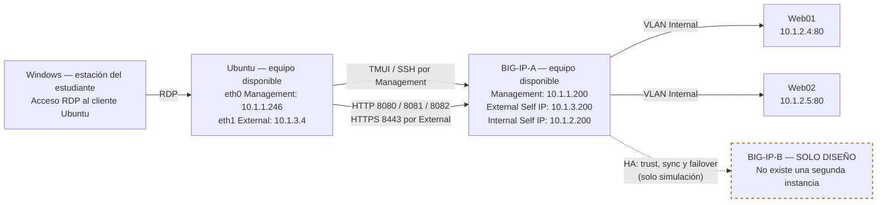
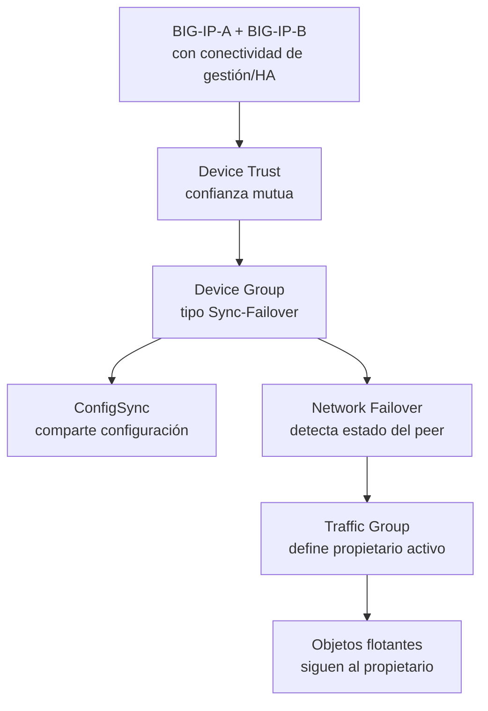
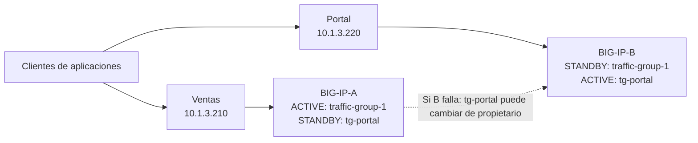
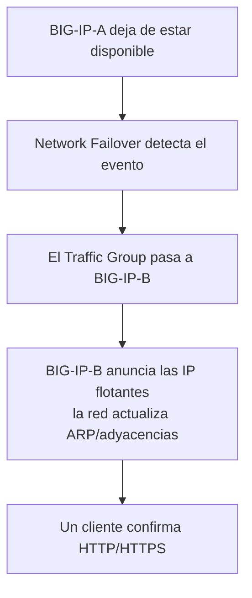
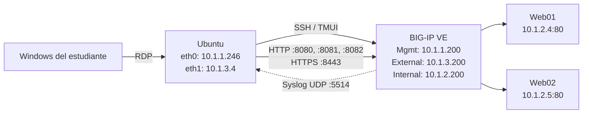

# Laboratorio 6 — Alta disponibilidad, Device Trust y ConfigSync

## Metadatos

| Campo | Valor |
|---|---|
| Duración | **60 minutos** |
| Complejidad | Media-alta |
| Nivel de Bloom | Aplicar, analizar y evaluar |
| Plataforma | **F5 BIG-IP VE, topología existente de los laboratorios 1–5**; consultar la versión instalada con `show sys version` |
| Modalidad | **Individual, autoformativa**: observación real + decisiones de arquitectura + diagnóstico de casos simulados |
| Requisitos | Laboratorios 1 a 5 completados; **un solo BIG-IP VE**, Ubuntu y dos servidores HTTP |
| Resultado | Diseñar y diagnosticar una solución HA sin desplegar un segundo BIG-IP ni interrumpir el pod |

## Descripción general

Tu organización dispone de un BIG-IP VE que publica aplicaciones HTTP/HTTPS hacia Web01 y Web02. Los servicios funcionan, pero **BIG-IP es un punto único de falla**. Debes proponer una solución **Active/Standby**, analizar cómo funcionaría el failover y demostrar, mediante evidencias, que sabes diferenciar problemas de sincronización, propiedad del tráfico y conectividad entre clientes, BIG-IP y servidores web.

**Esta no es una lectura pasiva ni una instalación ficticia.** Comprobarás elementos existentes en tu BIG-IP, tomarás decisiones sobre una segunda instancia **hipotética**, interpretarás salidas TMSH y resolverás incidentes usando evidencias. En los casos simulados, **no debes ejecutar los comandos que modifican HA**: forman parte del expediente de diagnóstico.

### Objetivos de aprendizaje

Al completar el laboratorio podrás:

1. Localizar los objetos y direcciones reales de tu BIG-IP y distinguir configuración existente de diseño propuesto.
2. Diferenciar **Device Trust, Device Group Sync-Failover, ConfigSync, Network Failover, Traffic Groups** y **connection/persistence mirroring**.
3. Seleccionar direcciones **locales** y **flotantes** y explicar qué debe acompañar a una aplicación durante failover.
4. Distinguir **Force to Standby** de **Force Offline** y decidir cuándo utilizarlos.
5. Diagnosticar **Changes Pending, Sync Failed**, fallas del peer y aplicaciones inaccesibles tras failover.
6. Validar la continuidad del tráfico después de un failover mediante Virtual Addresses, Floating Self IP, ARP y rutas de retorno.
7. Diseñar un caso **Active/Active** mediante dos Traffic Groups sin confundirlo con el balanceo de servidores web.

## Topología de referencia de los laboratorios 1–5

Utilizarás **la misma topología, direcciones IP, interfaces y aplicaciones** de los laboratorios 1–5, sin modificar ningún recurso. Solo BIG-IP-A está disponible para consultas reales; BIG-IP-B existe **exclusivamente en los casos de diseño y diagnóstico**.



| Elemento | Dirección / condición |
|---|---|
| BIG-IP-A — Management | `10.1.1.200/24` |
| Ubuntu — `eth0` Management / `eth1` External | `10.1.1.246/24` / `10.1.3.4/24` |
| BIG-IP-A — interfaz 1.1 / VLAN External, interfaz 1.2 / VLAN Internal | Self IP `10.1.3.200/24` / `10.1.2.200/24` |
| Web01 / Web02 | `10.1.2.4:80` / `10.1.2.5:80` |
| Laboratorio 3 | Servicio HTTP `10.1.3.200:8080` |
| Laboratorio 4 | Servicio HTTP `10.1.3.200:8081` |
| Laboratorio 5 | HTTP `10.1.3.200:8082` y HTTPS `10.1.3.200:8443` |
| BIG-IP-B | **No está disponible.** Sus direcciones serán exclusivamente ejemplos de diseño. |

> **Reglas de seguridad:** no modifiques Management, VLAN, Self IP, Device Trust, Device Groups, Traffic Groups, interfaces ni objetos LTM. No ejecutes `run sys failover ...`, `run cm config-sync ...`, `modify net interface ...` ni `force-full-load-push`. En el equipo disponible solo ejecutarás **consultas de lectura**. La cuenta `adminazure` inicia directamente en TMSH: utiliza `show ...` y `list ...` sin anteponer `tmsh`.

## Plan de trabajo

| Etapa | Actividad | Tiempo |
|---|---|---:|
| 1 | Auditar el BIG-IP existente y detectar el punto único de falla | 8 min |
| 2 | Diseñar el segundo BIG-IP y la relación de confianza/sincronización | 10 min |
| 3 | Resolver el problema de direcciones flotantes y continuidad | 8 min |
| 4 | Tomar decisiones operativas de ConfigSync y failover | 10 min |
| 5 | Diagnosticar tres incidentes con evidencias TMSH simuladas | 14 min |
| 6 | Diseñar Active/Active y validar la continuidad de red tras failover | 10 min |
| **Total** | | **60 min** |

---

## Etapa 1. Investiga tu BIG-IP: ¿dónde está el punto único de falla? (8 min)

**Contexto.** Los laboratorios anteriores demostraron balanceo HTTP, SNAT, persistencia, perfiles HTTP/TCP, TLS e iRules. Sin embargo, si la instancia BIG-IP deja de estar disponible, Web01 y Web02 no reciben tráfico a través de los Virtual Servers publicados.

### 1.1 Consultas reales y seguras

1. Desde **Windows, accede a Ubuntu mediante RDP**. En Ubuntu, abre una terminal y establece SSH con `ssh adminazure@10.1.1.200`. La sesión de esta cuenta inicia directamente en TMSH.
2. Ejecuta los siguientes comandos **sin modificar configuración**:

```text
show sys version
list net self
list net vlan
list ltm virtual
show cm failover-status
show cm sync-status
list cm device
list cm device-group
list cm traffic-group
```

### 1.1.1 Ejemplos de resultados esperados (lectura guiada)

Los siguientes son **ejemplos orientativos y abreviados**, construidos para un **BIG-IP independiente** con las configuraciones acumuladas de los laboratorios 1–5. **No son capturas del pod ni salidas literales garantizadas**: pueden cambiar el hostname, el formato, las VLAN, los nombres de objetos y la versión. Los renglones entre corchetes (`[ ... ]`) son explicaciones, **no texto que deba imprimir TMSH**.

**A. Versión y Self IP: `show sys version` / `list net self`**

```text
# show sys version — ejemplo abreviado
Sys::Version
Main Package
  Product BIG-IP
  Version 21.0.0.3       [ejemplo de la versión observada en la configuración existente]

# list net self — ejemplo abreviado
net self /Common/self_external {
    address 10.1.3.200/24
    vlan /Common/External
    [otras propiedades omitidas]
}
net self /Common/self_internal {
    address 10.1.2.200/24
    vlan /Common/Internal
    [otras propiedades omitidas]
}
```

**Qué revisar:** las Self IP usan nuestras redes de tráfico. **No son Floating Self IP de un segundo equipo**; sus nombres reales pueden ser distintos. Si aparece otra versión, registra la que devuelve tu sistema.

**B. VLAN y Virtual Servers: `list net vlan` / `list ltm virtual`**

```text
# list net vlan — estructura ilustrativa resumida
net vlan /Common/External {
    interfaces { 1.1 { tagged } }  [modo tagged/untagged: verificar en el pod]
}
net vlan /Common/Internal {
    interfaces { 1.2 { tagged } }  [modo tagged/untagged: verificar en el pod]
}

# list ltm virtual — fragmentos ilustrativos, no un volcado completo
ltm virtual /Common/vs_lab05_http {
    destination /Common/10.1.3.200:8082
    profiles { /Common/http_lab05_xff { } /Common/tcp { } }
    [pool, SNAT y otras propiedades según configuración real]
}
ltm virtual /Common/vs_lab05_https {
    destination /Common/10.1.3.200:8443
    [otras propiedades omitidas; nombre sujeto a verificación]
}
```

**Qué revisar:** que los VIP de los laboratorios 3–5 estén en los puertos esperados (`8080`, `8081`, `8082`, `8443`). La salida real de `list ltm virtual` normalmente es mucho más larga. La etiqueta `tagged` se muestra solo para explicar la estructura; **no infieras el etiquetado real de las interfaces a partir de este ejemplo**.

**C. Estado HA y ConfigSync: `show cm failover-status` / `show cm sync-status`**

```text
# show cm failover-status — lectura simplificada
CM::Failover Status
Status  ACTIVE          [posible estado del único BIG-IP]

# show cm sync-status — lectura simplificada
CM::Sync Status
Status  Standalone     [habitual cuando no existe otro peer de confianza]
```

**Qué revisar:** un equipo puede mostrar `ACTIVE` y al mismo tiempo `Standalone`. **ACTIVE no significa que existe un Standby**. F5 documenta el estado `Standalone` cuando el dominio de confianza contiene únicamente el dispositivo local. El formato exacto puede incluir Color, Summary y Details.

**D. Dispositivos, grupos y Traffic Groups: `list cm device` / `list cm device-group` / `list cm traffic-group`**

```text
# list cm device — estructura ilustrativa
cm device /Common/<nombre-real-del-bigip> {
    management-ip 10.1.1.200
    [otros atributos, p. ej. configsync-ip si está definida]
}

# list cm device-group — en un equipo independiente pueden
# aparecer grupos internos de confianza/sincronización, NO un par HA:
cm device-group /Common/device_trust_group {
    [propiedades y miembros del grupo administrado por el sistema]
}

# list cm traffic-group — grupos del sistema; ejemplos de nombres
cm traffic-group /Common/traffic-group-local-only {
    [propiedades omitidas]
}
cm traffic-group /Common/traffic-group-1 {
    [puede figurar sin que exista un peer ni IP flotantes utilizables]
}
```

**Qué revisar:** que `list cm device` **no incluya BIG-IP-B**, que **no exista un Device Group Sync-Failover operativo con dos dispositivos**, y que ver `traffic-group-1` **no demuestra HA**. **No esperes que `list cm device-group` esté completamente vacío**: BIG-IP puede mostrar grupos internos creados por el sistema.

> **Si un comando produce una salida diferente**, no la fuerces a coincidir. Registra la primera línea relevante y anota qué indica sobre tu entorno. Estos ejemplos no autorizan a cambiar direcciones ni a crear objetos faltantes.

3. En **TMUI**, localiza **Network → Self IPs**, **Local Traffic → Virtual Servers → Virtual Server List** y **Device Management → Overview / Devices / Device Groups**. La disponibilidad exacta de apartados puede variar según versión y estado del sistema.
4. En Ubuntu ejecuta una solicitud a una aplicación del Laboratorio 5:

```bash
curl --noproxy '*' -sS -o /dev/null -w 'HTTP %{http_code}\n' \
  'http://10.1.3.200:8082/'
```

> **Interpretación:** que el equipo muestre `ACTIVE`, `standalone`, un grupo local o un estado de sincronización no equivale a tener un par HA operativo. **No esperes ver BIG-IP-B ni `In Sync` con un peer inexistente.** Registra el estado real, no el que aparece en los casos simulados.

### 1.2 Evidencia y decisión

Completa la tabla:

| Comprobación | Dato observado en tu BIG-IP | ¿Afectaría a la publicación si falla este equipo? |
|---|---|---|
| Versión BIG-IP | | |
| Self IP External / Internal | | |
| Virtual Server de Lab 5 | | |
| Estado de failover | | |
| Dispositivos HA adicionales | | |

**Reto.** Si Web01 y Web02 siguen activos pero BIG-IP-A se apaga, ¿por qué una solicitud a `10.1.3.200:8082` podría fallar? Responde diferenciando **disponibilidad de los servidores** y **disponibilidad del punto de entrada**.

**Criterio de éxito:** identificaste al BIG-IP como punto único de falla y documentaste al menos tres elementos consultados realmente.

---

## Etapa 2. Diseña el par HA: confianza, grupos y comunicación (10 min)

### 2.1 El cambio de arquitectura

La empresa aprueba un segundo BIG-IP VE, denominado **BIG-IP-B**. **No se despliega en este ejercicio.** La arquitectura propuesta debe tener una instancia por dispositivo, direcciones de administración y Self IP propias, conectividad permitida para HA y capacidad suficiente para asumir el tráfico completo.

| Componente | BIG-IP-A (real) | BIG-IP-B (propuesto) |
|---|---|---|
| Management | `10.1.1.200` | `10.1.1.201` **hipotética** |
| Self IP External **local** | `10.1.3.200` | `10.1.3.201` **hipotética** |
| Self IP Internal **local** | `10.1.2.200` | `10.1.2.201` **hipotética** |
| Comunicación HA | Self IP local en red validada | Self IP local alcanzable desde A |
| Software / módulos | Consultados en Etapa 1 | Compatibilidad y capacidad por validar |

**Advertencia de diseño:** las direcciones `.201` no están reservadas. No intentes configurarlas. Antes de un despliegue real se deben validar disponibilidad de direcciones, VLAN, conectividad entre interfaces, enrutamiento, seguridad de puertos y método de failover.



### 2.2 Desafío de secuenciación

Ordena estas acciones del **1 al 6**. Algunas comprobaciones se repiten durante la implementación real:

| Acción de implementación | Orden |
|---|:---:|
| Crear un Device Group `dg_lab06` de tipo Sync-Failover con A y B | ___ |
| Verificar compatibilidad de versión, módulos, licencias, conectividad y hora | ___ |
| Configurar direcciones **locales** de ConfigSync y failover en ambos dispositivos | ___ |
| Establecer Device Trust entre los dos BIG-IP | ___ |
| Efectuar la sincronización inicial **desde el dispositivo que contiene la configuración autorizada** | ___ |
| Verificar Traffic Groups, estado de sincronización y mecanismos de failover | ___ |

### 2.3 Selecciona el componente adecuado

Relaciona cada necesidad con **Device Trust / ConfigSync / Network Failover / Traffic Group / Mirroring**:

| Necesidad | Componente |
|---|---|
| Autenticar mutuamente a los dispositivos | ___ |
| Replicar objetos de configuración | ___ |
| Detectar que un peer ha dejado de estar disponible | ___ |
| Transferir la propiedad de los objetos flotantes | ___ |
| Replicar determinados estados de conexión o persistencia en tiempo de ejecución | ___ |

**Pregunta de ingeniería:** ¿por qué **ConfigSync** no sustituye a **Network Failover**? Escribe una frase para cada mecanismo.

**Criterio de éxito:** has definido una secuencia coherente y no confundiste sincronización de configuración con transferencia de tráfico.

---

## Etapa 3. ¿Qué debe moverse cuando falla BIG-IP-A? (8 min)

### 3.1 Clasificación: local o flotante

En un diseño HA convencional, las direcciones locales identifican a cada dispositivo. Los objetos flotantes relacionados con la publicación se asocian a un Traffic Group. En nuestro equipo actual, `10.1.3.200` y `10.1.2.200` son **Self IP existentes de BIG-IP-A**: no los reclasifiques ni conviertas en flotantes durante el laboratorio.

**Diseño hipotético, independiente de la configuración actual:** la empresa decide publicar la aplicación con la dirección de servicio `10.1.3.210` y utilizar `10.1.2.210` como Floating Self IP para un diseño de retorno que la necesite. **Estas direcciones son ejemplos didácticos; no están configuradas ni reservadas.**

| Objeto del nuevo diseño | Tipo que propones (local / flotante / compartido no flotante) | ¿Por qué? |
|---|---|---|
| Management de BIG-IP-A: `10.1.1.200` | | |
| Management hipotético de BIG-IP-B: `10.1.1.201` | | |
| Self IP local de A: `10.1.2.200` | | |
| Self IP local hipotético de B: `10.1.2.201` | | |
| Dirección publicada de la aplicación: `10.1.3.210` | | |
| Floating Self IP para retorno: `10.1.2.210` | | |
| Pool con Web01 y Web02 | | |

> **Pista:** los objetos de configuración del pool se sincronizan, pero el pool **no se convierte en una IP flotante**. Los Traffic Groups administran la propiedad de objetos flotantes como Virtual Addresses, Floating Self IP y determinadas SNAT translations.

### 3.2 Caso del retorno de tráfico

En el **caso hipotético tradicional**, Web01 y Web02 utilizan `10.1.2.210` como puerta de enlace hacia redes externas, y esta dirección pertenece al mismo Traffic Group que la dirección de la aplicación `10.1.3.210`.

1. BIG-IP-A tiene el Traffic Group activo. ¿Por qué llegan las respuestas de los servidores a A?
2. A falla y B asume el Traffic Group. ¿Qué ocurriría si la puerta de enlace siguiera únicamente en A?
3. ¿Cambiaría tu respuesta si la aplicación utiliza **SNAT AutoMap**, como en los laboratorios 3–5? Explica la diferencia entre **retorno por gateway flotante** y **retorno al Self IP usado como origen SNAT**, y qué sucede con las conexiones existentes durante una conmutación.

**Criterio de éxito:** distingues los objetos que deben seguir al servicio de los que identifican a una instancia.

---

## Etapa 4. Sala de operaciones: ¿qué acción ejecutarías? (10 min)

**Todos los estados siguientes son SIMULADOS; no ejecutes los comandos de cambio.** Puedes comparar los comandos con la referencia TMSH del material del curso.

### Escenario A — Primera sincronización

- BIG-IP-A ya contiene `vs_lab05_http`, `pool_lab05` y el perfil `http_lab05_xff`.
- BIG-IP-B acaba de incorporarse, pero no tiene aún la configuración de aplicación.
- El Device Group muestra `Awaiting Initial Sync`.

**Decisión:** ¿desde cuál dispositivo enviarías la configuración y por qué? ¿Qué comprobación harías **antes** de presionar **Sync Device to Group**?

Comando de referencia **no ejecutar**:

```text
run cm config-sync to-group dg_lab06
```

### Escenario B — Cambio pendiente

**Evidencia simulada:**

```text
BIG-IP-A: ConfigSync Status = Changes Pending
BIG-IP-B: ConfigSync Status = Awaiting Sync
Último cambio autorizado: nuevo perfil HTTP en BIG-IP-A
```

Selecciona la acción adecuada y justifica:

- A. Sincronizar desde B hacia el grupo.
- B. Inspeccionar el cambio y sincronizar desde A hacia el grupo.
- C. Ejecutar `Force Offline` en A.

### Escenario C — Mantenimiento planeado

BIG-IP-A está Active, BIG-IP-B Standby y la empresa desea realizar mantenimiento en A.

**Evidencia simulada:**

```text
BIG-IP-A: ACTIVE, tráfico estable
BIG-IP-B: STANDBY, disponible y elegible
ConfigSync: In Sync
```

Completa:

| Acción | Objetivo | ¿B puede hacerse Active? | ¿Qué debe comprobarse después? |
|---|---|---|---|
| Force to Standby en A | | | |
| Force Offline en A | | | |

Comandos de referencia **no ejecutar**:

```text
run sys failover standby
run sys failover offline
run sys failover online
```

**Criterio de éxito:** eliges primero un peer sano y una fuente de configuración autorizada; no recurres automáticamente a sincronización forzada.

---

## Etapa 5. Centro de diagnóstico: tres incidentes (14 min)

**Método:** identifica el síntoma, cita la evidencia, formula una hipótesis, decide qué comprobación harías y propone la corrección. Las siguientes salidas son **casos didácticos simulados**, no capturas de tu BIG-IP ni registros literales garantizados para todas las versiones.

### Incidente 1 — Los dos dispositivos parecen Active

El servicio dejó de responder tras una falla de conectividad HA. El tablero de administración reporta:

```text
[SIMULACIÓN — evidencia resumida]
BIG-IP-A: traffic-group-1 = ACTIVE
BIG-IP-B: traffic-group-1 = ACTIVE
Comunicación de Network Failover entre peers: NO DISPONIBLE
ConfigSync previo al incidente: In Sync
```

Responde:

1. ¿Cómo se denomina esta situación potencialmente peligrosa?
2. ¿Por qué `In Sync` no garantiza que un solo dispositivo reclame la propiedad del tráfico?
3. ¿Qué dos comprobaciones de red/HA priorizarías?
4. ¿Qué medida de contención planearías **antes** de permitir que ambos equipos respondan por la misma dirección flotante?

### Incidente 2 — Configuración diferente: ¿qué harías primero?

```text
[SIMULACIÓN — evidencia resumida]
BIG-IP-A: ConfigSync = Changes Pending
BIG-IP-B: ConfigSync = Sync Failed
BIG-IP-A: pool_lab05 -> Web01:80, Web02:80
BIG-IP-B: pool_lab05 -> Web01:80
Evento: intento de sincronización rechazado; revisar detalle de validación
```

Responde:

1. ¿Es suficiente esta evidencia para afirmar cuál es la **causa raíz exacta** del `Sync Failed`?
2. ¿Qué dispositivo **parece** contener la definición esperada del pool y qué validarías antes de declararlo autoritativo?
3. ¿Qué consultarías en Device Management / registros antes de reintentar la sincronización?
4. ¿Por qué no debes ejecutar inmediatamente `force-full-load-push`?

> Un `Sync Failed` puede deberse a distintos problemas. **No es correcto asegurar que una discrepancia de pools, por sí sola, provoque siempre ese estado.** La evidencia del caso es deliberadamente insuficiente para cerrar el diagnóstico sin revisar el error detallado.

### Incidente 3 — El peer es Active, pero los usuarios no llegan al Virtual Server (caso hipotético de red L2)

```text
[SIMULACIÓN — evidencia resumida]
BIG-IP-A: indisponible
BIG-IP-B: ACTIVE para traffic-group-1
ConfigSync antes de la falla: In Sync
Web01 10.1.2.4:80: disponible
Web02 10.1.2.5:80: disponible
Clientes: no pueden acceder al Virtual Address 10.1.3.210
Gateway del escenario simulado: la tabla ARP conserva la MAC que anunciaba BIG-IP-A
```

Responde:

1. ¿El problema apunta principalmente a **ConfigSync**, **salud del pool** o **actualización de la resolución de direcciones de red**?
2. ¿Qué revisarías en el estado del Traffic Group y en la tabla ARP del gateway o switch de capa 3?
3. ¿Qué función tienen los anuncios **gratuitous ARP** al transferir direcciones flotantes en IPv4?
4. ¿Por qué ver `ACTIVE` en BIG-IP-B no basta para demostrar disponibilidad extremo a extremo?

### Matriz de diagnóstico

| Incidente | Síntoma principal | Evidencia más importante | Primera comprobación | Acción propuesta |
|---|---|---|---|---|
| 1 | | | | |
| 2 | | | | |
| 3 | | | | |

**Criterio de éxito:** tus tres decisiones se apoyan en evidencia; distingues fallas de HA, sincronización y aprendizaje de direcciones en la red.

---

## Etapa 6. Desafío final: Active/Active y failover en red local (10 min)

### 6.1 ¿Cómo serían dos dispositivos activos a la vez?

La empresa quiere distribuir dos aplicaciones entre ambos BIG-IP, sin perder capacidad de recuperación si uno falla:

| Servicio hipotético | Virtual Address | Traffic Group | Propietario normal |
|---|---|---|---|
| Sitio de ventas | `10.1.3.210` | `traffic-group-1` | BIG-IP-A |
| Portal interno | `10.1.3.220` | `tg-portal` | BIG-IP-B |

**Las IP son ejemplos de diseño y no existen en el pod.**



Responde:

1. Si BIG-IP-B falla, ¿qué dispositivo debería asumir `tg-portal`, suponiendo que sea elegible?
2. ¿Significa Active/Active que Web01 siempre recibe tráfico de A y Web02 siempre de B? Justifica.
3. Dos Virtual Servers utilizan `10.1.3.210`, uno en `:80` y otro en `:443`. ¿Pueden asignarse a diferentes Traffic Groups conservando **el mismo Virtual Address**? Explica.
4. ¿Por qué cada BIG-IP debe tener capacidad suficiente para recibir los servicios del otro después del failover?

### 6.2 La última dependencia: la red debe aprender el cambio

En un diseño HA con direcciones flotantes, no basta con que BIG-IP-B asuma el Traffic Group. Los equipos de red deben **enviar el tráfico hacia el nuevo propietario** de las direcciones flotantes y las respuestas deben tener un camino válido de retorno.

Completa la secuencia de recuperación:



**Desafío de validación:** escribe **cuatro evidencias**, en orden, para demostrar que la solución HA funciona realmente:

1. Evidencia del estado de los dispositivos y propietario del Traffic Group: __________
2. Evidencia de ConfigSync y de que la configuración del servicio existe en BIG-IP-B: __________
3. Evidencia de la resolución ARP/adyacencia y de la ruta de retorno: __________
4. Evidencia del cliente (`curl` o navegador), incluido el tiempo real de recuperación observado: __________

**Criterio de éxito:** distingues los planos de *configuración, control HA, aprendizaje de red y tráfico de aplicación*.

---

## Evaluación final: comprueba tu capacidad para operar HA

Marca los puntos que puedes **justificar con tus respuestas**, no solo recordar:

- [ ] Distingo las IP locales de las direcciones de servicio flotantes.
- [ ] Explico qué problemas resuelven Device Trust, Sync-Failover Device Group y ConfigSync.
- [ ] Distingo Network Failover de connection/persistence mirroring.
- [ ] Selecciono la dirección correcta de la primera sincronización.
- [ ] Puedo decidir entre Force to Standby y Force Offline.
- [ ] Reconozco que `Changes Pending` y `Sync Failed` requieren diagnósticos diferentes.
- [ ] Identifico un posible *split-brain* y no intento resolverlo sincronizando a ciegas.
- [ ] Explico por qué también deben comprobarse la resolución ARP y las rutas después de mover un Traffic Group.
- [ ] Diseñé correctamente dos Traffic Groups para Active/Active.

**Resultado mínimo esperado:** resolver correctamente **al menos 7 de los 9 criterios**, incluyendo obligatoriamente los relativos a ConfigSync, incidentes y conectividad de red. Si no logras justificar alguno, revisa las soluciones antes de cerrar la actividad.

---

## Soluciones razonadas — respuestas de todas las actividades

**Instrucción de autoevaluación:** responde primero sin consultar esta sección. Estas son **soluciones de referencia**, no resultados que ya se hayan obtenido en el BIG-IP del alumno. Los datos reales de Etapa 1 deben copiarse del pod, no de los ejemplos.

### Etapa 1 — Consultas, tabla y punto único de falla

**1.1.** Las nueve consultas son de solo lectura. Una lectura esperable, **no obligatoria**, es: BIG-IP con versión instalada (en nuestro entorno se observó `21.0.0.3`), Self IP `10.1.3.200/24` y `10.1.2.200/24`, VLAN External/Internal, VIP de Lab 5 en `:8082` y `:8443`, un dispositivo local, sin peer HA y estado de sincronización `Standalone`. Puede existir un `traffic-group-1` o un Device Group interno sin que exista un clúster de dos equipos.

**1.2. Tabla modelo** (sustituir cada ejemplo por el dato realmente visto):

| Comprobación | Ejemplo de dato observado | ¿Afectaría a la publicación si falla A? |
|---|---|---|
| Versión BIG-IP | `21.0.0.3` *(solo referencia)* | Sí: el equipo que ejecuta LTM dejaría de operar; la versión no es la causa del SPOF |
| Self IP External / Internal | `10.1.3.200/24` / `10.1.2.200/24` | Sí: pertenecen a esta instancia y no tienen reemplazo en el pod |
| Virtual Server de Lab 5 | `10.1.3.200:8082`, `vs_lab05_http` | Sí: el listener de entrada dejaría de responder |
| Estado de failover | `ACTIVE` con condición `Standalone` posible | Sí: no hay segundo BIG-IP que pueda asumir el servicio |
| Dispositivos HA adicionales | Ninguno; solo equipo local | Sí: confirma ausencia de redundancia de BIG-IP |

**Reto:** Web01 y Web02 siguen disponibles dentro de `10.1.2.0/24`, pero los clientes dependen del Virtual Server de A. Al apagarse A, desaparece el punto de entrada y la función de proxy/balanceo. Tener dos *pool members* tolera la falla de un servidor web, **no** la del balanceador.

### Etapa 2 — Secuencia, conceptos y razonamiento

**2.2. Orden de las seis acciones (en el orden en que aparecen en la tabla del ejercicio):** **4, 1, 2, 3, 5, 6**.

1. Verificar compatibilidad de software, módulos, licencia, reloj y conectividad.
2. Configurar/validar las Self IP **locales** y las direcciones para ConfigSync y comunicación de failover.
3. Establecer Device Trust.
4. Crear Device Group **Sync-Failover** con A y B.
5. Confirmar la configuración autoritativa y ejecutar la sincronización inicial desde ella.
6. Verificar estado de sincronización, propiedad de Traffic Groups y mecanismos de failover, incluida la conectividad entre equipos y segmentos de red.

La secuencia es pedagógica: en implementaciones reales pueden repetirse validaciones o ajustarse el orden de parámetros de ConfigSync según versión y procedimiento.

**2.3. Tabla de correspondencias completa:**

| Necesidad | Componente |
|---|---|
| Autenticar mutuamente a los dispositivos | **Device Trust** |
| Replicar objetos de configuración | **ConfigSync** |
| Detectar que un peer ha dejado de estar disponible | **Network Failover** |
| Transferir la propiedad de los objetos flotantes | **Traffic Group** (con el mecanismo de failover) |
| Replicar determinados estados de conexión o persistencia | **Connection/Persistence Mirroring**, cuando se habilita y es compatible |

**Pregunta de ingeniería:** ConfigSync mantiene consistentes configuraciones (VIP, pools, perfiles, etc.); Network Failover detecta disponibilidad y participa en la elección del propietario de los servicios. Un equipo puede estar `In Sync` y aun así no recibir tráfico por una falla de Network Failover, ARP o enrutamiento.

### Etapa 3 — Clasificación y retorno

**3.1. Tabla completa:**

| Objeto | Clasificación | Motivo |
|---|---|---|
| Management A `10.1.1.200` | **Local** | Administración exclusiva de A |
| Management B `10.1.1.201` | **Local hipotética** | Administración exclusiva de B; IP no reservada |
| Self IP A `10.1.2.200` | **Local** | Identifica la conexión de A con la red interna |
| Self IP B `10.1.2.201` | **Local hipotética** | Identificaría a B en esa red |
| Dirección de servicio `10.1.3.210` | **Flotante en el modelo HA tradicional** | El Virtual Address seguiría al propietario del Traffic Group y la red deberá actualizar su resolución de direcciones |
| Floating Self IP `10.1.2.210` | **Flotante hipotética** | Puede actuar como gateway de retorno y seguir al Traffic Group |
| Pool Web01/Web02 | **Compartido por ConfigSync; no es flotante como dirección IP** | Su definición se copia a ambos equipos, pero los miembros son servidores backend separados |

**3.2. Respuestas:**

1. Las respuestas llegan a A porque Web01/Web02 usan el gateway `10.1.2.210`, actualmente asociado al Traffic Group propietario A, **en el escenario hipotético de red tradicional**.
2. Si el gateway quedara únicamente en A, tras su falla el backend podría perder la ruta de retorno hacia el cliente, aun cuando B publicara el VIP.
3. Con **SNAT AutoMap** el backend responde a la Self IP origen del flujo servidor (en la configuración existente, `10.1.2.200`), no necesariamente a un gateway flotante. **Eso no garantiza continuidad después de failover**: B usa sus propios recursos y las conexiones existentes pueden requerir reconstrucción o mirroring compatible. El segmento de red debe encaminar el tráfico nuevo al propietario correcto.

### Etapa 4 — Decisiones operativas

**Escenario A:** sincronizar desde **BIG-IP-A**, después de corroborar que `vs_lab05_http`, `pool_lab05` y `http_lab05_xff` son la configuración aprobada, comparar posibles cambios locales en B y revisar el alcance del Device Group. `Awaiting Initial Sync` no significa que deba sincronizarse desde cualquier equipo.

**Escenario B:** **opción B**. Revisar el cambio HTTP autorizado y sincronizar **A → grupo**. Enviar B → grupo podría sobrescribir la definición nueva. Force Offline no resuelve diferencias de configuración.

**Escenario C. Tabla completa:**

| Acción | Objetivo | ¿B puede hacerse Active? | Qué comprobar después |
|---|---|---|---|
| **Force to Standby en A** | Solicitar conmutación planificada para que A deje de servir su Traffic Group | **Sí**, si B es elegible y el diseño funciona | Estado de A/B; propietario del Traffic Group; resolución ARP, rutas y respuesta HTTP/HTTPS; alarmas y sesiones |
| **Force Offline en A** | Excluir administrativamente A de la participación en failover durante intervención | **Sí**, si B es elegible; A no reingresa sin acción `online` | Que A quede Offline, B tome los servicios, la red entregue al destino adecuado; plan controlado de reintegración |

La primera elección para una conmutación planificada suele ser **Force to Standby**, tras validar la salud del peer. **Force Offline** se utiliza para aislar temporalmente un dispositivo; ninguno reemplaza la prueba desde el cliente. No se puede garantizar pérdida cero de sesiones.

### Etapa 5 — Respuestas a los tres incidentes

**Incidente 1**

1. Posible **split-brain**: A y B reclaman simultáneamente `traffic-group-1`.
2. `In Sync` acredita consistencia de configuración, **no** comunicación de failover ni exclusividad de propiedad.
3. Comprobar primero conectividad unicast/network failover entre Self IP locales (rutas, puertos, filtrado) y estado/elegibilidad del Traffic Group en ambos dispositivos; complementar con logs de failover.
4. Evitar anuncios o asociaciones simultáneas; definir el dispositivo autoritativo y aislar el duplicado mediante un procedimiento controlado, con plan de recuperación del tráfico y validación ARP/routing. No hacer `config-sync` a ciegas.

**Incidente 2**

1. **No**. La discrepancia visible no demuestra qué validación rechazó la sincronización.
2. **A parece** tener el pool previsto de dos servidores, pero se verifica contra el cambio aprobado y la configuración autorizada; el estado Active no lo convierte automáticamente en autoritativo.
3. Revisar `Device Management → Overview`, estado/diferencias del Device Group, detalles de error de sincronización y `/var/log/ltm`; validar conectividad y objetos que fallaron.
4. Un `force-full-load-push` puede sobrescribir cambios válidos del peer o no corregir la causa del rechazo. Corregir primero el error demostrado y sincronizar en la dirección validada.

**Incidente 3**

1. Es principalmente un problema de **resolución de direcciones y entrega de tráfico en la red local**. El servicio tiene miembros sanos y el peer es propietario del Traffic Group, pero el gateway conserva una asociación ARP obsoleta.
2. En BIG-IP: comprobar `show cm traffic-group` y que la dirección flotante corresponda al grupo activo en B. En la red: comprobar la entrada ARP para `10.1.3.210`, la MAC asociada y el alcance del segmento VLAN correspondiente.
3. Los anuncios **gratuitous ARP** ayudan a que los vecinos actualicen la asociación IP–MAC al asumir una dirección flotante IPv4. Su efectividad también depende de la infraestructura y de las políticas de red; en un caso real se examinan además el dominio L2 y las rutas de retorno.
4. `ACTIVE` acredita el estado HA, pero no confirma que los clientes alcancen el Virtual Server. Hay que comprobar aprendizaje de red, acceso a VIP y respuesta HTTP/HTTPS desde un cliente.

**Matriz de diagnóstico completa:**

| Incidente | Síntoma principal | Evidencia más importante | Primera comprobación | Acción propuesta |
|---|---|---|---|---|
| 1 | Dos dispositivos reclaman el mismo Traffic Group | A y B `ACTIVE`; Network Failover no disponible | Canal HA, estados y propiedad del grupo | Contener el conflicto, restablecer HA y asegurar un único propietario |
| 2 | ConfigSync rechazado | `Sync Failed` en B y error de validación por revisar | Mensaje detallado y configuración autorizada | Corregir causa, elegir fuente y reintentar sincronización normal |
| 3 | B toma el grupo, pero el VIP no responde | Tabla ARP del gateway mantiene MAC de A | ARP del gateway, VLAN y propietario de dirección flotante | Corregir aprendizaje de red y comprobar conectividad extremo a extremo |

### Etapa 6 — Active/Active y validación

**6.1. Respuestas:**

1. Si B falla, **A** debería asumir `tg-portal`, siempre que esté sano, sea elegible y la red dirija correctamente el tráfico.
2. **No.** Active/Active reparte **propiedad de servicios/Traffic Groups entre BIG-IP**, no asigna automáticamente Web01 a A y Web02 a B. El pool y el método de balanceo siguen determinando los backend.
3. **No con un único objeto Virtual Address**: los listeners `10.1.3.210:80` y `10.1.3.210:443` comparten la propiedad del mismo Virtual Address. Se necesita rediseñar la separación de direcciones si se pretende ubicarlos en Traffic Groups diferentes.
4. El BIG-IP sobreviviente debe soportar la **carga agregada** cuando recibe también los servicios del equipo caído; dimensionar únicamente para el 50 % de tráfico normal puede sobrecargarlo tras failover.

**6.2. Flujo:** detectar falla de A → confirmar failover y propietario en B → comprobar anuncios gratuitous ARP, actualización de vecinos y rutas de retorno → verificar VIP y backend → probar desde cliente y medir la recuperación. **No se da por hecho un tiempo fijo**.

**Cuatro evidencias, en orden:**

1. `show cm failover-status` y `show cm traffic-group` muestran un único propietario apropiado para el servicio.
2. `show cm sync-status` y comparación de la configuración pertinente indican una configuración consistente/esperada; `In Sync` no equivale a continuidad de sesiones.
3. Validación de la tabla ARP en el gateway o equipo de capa 3, MAC correspondiente al propietario actual y rutas de ida y retorno.
4. Desde Ubuntu, `curl --noproxy '*' -v http://<VIP-de-prueba>:<puerto>/` responde por el nuevo activo; registrar código HTTP, alcance, interrupción real y recuperación.

### Evaluación final — clave de autoevaluación

Los **nueve criterios** deben fundamentarse con las tablas, decisiones y diagnósticos anteriores. No basta marcar casillas; la comprensión mínima consiste en distinguir local/flotante, confianza vs. sincronización vs. failover, estado de sesión vs. configuración, dirección de sync, mantenimiento vs. aislamiento, estados de error, split-brain, actualización ARP/enrutamiento y reparto de Traffic Groups. El objetivo es justificar **7/9**, incluidos ConfigSync, incidentes y conectividad. No hay una única captura de TMSH que satisfaga los nueve.

---

## Solución de problemas de la actividad

| Situación | Qué hacer |
|---|---|
| `show cm sync-status` no presenta `In Sync` | Es normal que el pod con **un solo BIG-IP** no tenga un peer HA. Registra el estado observado y continúa con el escenario simulado. |
| No existe `vs_lab05_http` o no responde `:8082` | Revisa `list ltm virtual`, identifica la configuración real del Laboratorio 5 y utiliza su Virtual Server operativo; **no recrees objetos**. |
| No hay objetos adicionales en Device Groups | Es esperable en un equipo que no forma parte de un par HA. No intentes crear Device Trust en este laboratorio. |
| El comando aparece con `tmsh` en documentos anteriores | Si tu sesión administrativa inicia directamente en TMSH, utiliza `show ...` o `list ...`, sin prefijo `tmsh`. |
| Dudas sobre direcciones `.201` y `.210` | Son **hipotéticas** y no deben utilizarse sin revisar disponibilidad, VLAN, interfaces, ARP y enrutamiento. |
| Diferencias de menús TMUI | Consulta los objetos equivalentes en TMSH, sin realizar cambios. |

## Cierre y continuidad

Este laboratorio no ha realizado una conmutación real. Has documentado tu plataforma existente, diseñado un par HA, elegido qué objetos y estados deben mantenerse, analizado incidentes y diferenciado las verificaciones de BIG-IP de las comprobaciones de la red local. El siguiente paso en un entorno empresarial sería desplegar el segundo dispositivo en un ambiente controlado, validar prerrequisitos y ejecutar pruebas de failover con un plan de recuperación y ventanas de mantenimiento.

**No hay limpieza técnica:** todas las consultas al pod fueron de solo lectura. Se conservan las configuraciones de los laboratorios 1–5.

## Referencias oficiales

- [F5 — Device Service Clustering: conceptos, Device Trust, Device Groups y Traffic Groups](https://techdocs.f5.com/kb/en-us/products/big-ip_ltm/manuals/product/big-ip-device-service-clustering-administration-14-1-0/01.html)
- [F5 — Crear Active/Standby con la utilidad de configuración](https://techdocs.f5.com/en-us/bigip-14-1-0/big-ip-device-service-clustering-administration-14-1-0/creating-an-active-standby-configuration-using-the-configuration-utility.html)
- [F5 — Active/Active mediante Traffic Groups](https://techdocs.f5.com/en-us/bigip-14-1-0/big-ip-device-service-clustering-administration-14-1-0/creating-an-active-active-configuration-using-the-configuration-utility.html)
- [F5 — Herramientas de diagnóstico de Device Service Clustering](https://techdocs.f5.com/en-us/bigip-14-1-0/big-ip-device-service-clustering-administration-14-1-0/useful-troubleshooting-tools.html)

> Los ejemplos y las evidencias de los incidentes son material didáctico, no una afirmación de que exista un par HA operativo en el entorno de prácticas. En un despliegue real deben verificarse también la compatibilidad de la versión, la conectividad de los enlaces HA y el comportamiento de ARP, VLAN y enrutamiento.

# Laboratorio 7 — Administración y recuperación del Control Plane: UCS, usuarios, servicios, logs, estado del sistema y validación de servicios

## Metadatos

| Campo | Valor |
|---|---|
| **Duración** | **60 minutos** |
| Complejidad | Media |
| Modalidad | Individual, práctica real y verificación de resultados |
| Módulo | 4 — Administración del Control Plane |
| Alineación indicada en el laboratorio original | F5CAB4.03, F5CAB4.04, F5CAB4.05, F5CAB4.06, F5CAB4.07, F5CAB4.10 |
| Plataforma | BIG-IP VE del curso; confirmar versión mediante `show sys version` |

## Propósito

Administrarás el mismo BIG-IP de los laboratorios anteriores. **Cada actividad exige ejecutar y comprobar una operación de administración**: respaldar la configuración, probar permisos, inspeccionar servicios, enviar un mensaje Syslog a Ubuntu, correlacionar registros, identificar puertos y revertir los cambios temporales. La recuperación de una configuración completa mediante UCS se estudiará y verificará como procedimiento, **sin ejecutarla**, porque sobrescribiría los servicios construidos en los laboratorios 1–5.

> **No modificar:** IP de Management, Self IP, VLAN, Port Lockdown, interfaces, perfiles, Virtual Servers, pools ni la cuenta `adminazure`. No configurar Ubuntu como servidor DNS o NTP: en nuestra topología no está preparado para ello.

## Topología actual



**Cómo ejecutar comandos:** `adminazure@10.1.1.200` entra **directamente a TMSH**. Ejecuta `show`, `list`, `create`, `modify`, `save` sin anteponer `tmsh`. Para Linux en BIG-IP usa `run util bash`, y para regresar a TMSH, `exit`. Los comandos de Ubuntu se ejecutan en su terminal Bash.

## Distribución de los 60 minutos

| Actividad | Tiempo | Evidencia obligatoria |
|---|---:|---|
| 1. Comprobar sistema y aplicación | **5 min** | Estado Standalone/Active y prueba de VS |
| 2. Crear y descargar UCS | **10 min** | Archivo UCS creado, localizado y descargado |
| 3. Usuarios, roles y acceso | **12 min** | Operator con prueba de lectura y denegación de escritura |
| 4. NTP, DNS, SNMP y Syslog | **13 min** | Inspección de tres servicios y envío Syslog real |
| 5. Logs y auditoría | **8 min** | Evento real de seguridad y de cambio administrativo |
| 6. Puertos y servicios | **5 min** | Puertos, proceso y ACL administrativa |
| 7. Reversión y validación final | **7 min** | Objetos temporales eliminados; aplicaciones intactas |
| **Total** | **60 min** | **Todos los objetivos esenciales se comprueban** |

> **Criterio de tiempo:** cada paso contiene solo las operaciones indispensables. Si una prueba falla, registra el resultado y el dato de diagnóstico solicitado; no consumas el tiempo de las demás actividades intentando reparar servicios que no forman parte de nuestra infraestructura.

---

## Actividad 1 — Estado del BIG-IP y continuidad del servicio (5 minutos)

**En Ubuntu Bash:**

```bash
ssh adminazure@10.1.1.200
```

**En BIG-IP TMSH:**

```text
show sys version
show sys failover
show cm sync-status
show ltm virtual
```

**Ejemplos ilustrativos, no salidas garantizadas:**

```text
Sys::Version
  Product  BIG-IP
  Version  21.0.0.3

Failover Status
  ACTIVE

Cm::Sync Status
  Mode    standalone
  Status  Standalone
```

Un BIG-IP puede estar **ACTIVE** (procesando tráfico) y **Standalone** (sin par HA) simultáneamente.

**En otra terminal Ubuntu Bash:**

```bash
for p in 8080 8081 8082; do
  echo -n "HTTP $p: "
  curl --noproxy '*' -s -o /dev/null -w '%{http_code}\n' --connect-timeout 3 "http://10.1.3.200:$p/"
done
curl --noproxy '*' -ks -o /dev/null -w 'HTTPS 8443: %{http_code}\n' https://10.1.3.200:8443/
```

**Registra E1:** versión, estados, nombre de un VS y códigos HTTP iniciales. Las respuestas pueden variar por iRules o configuración previa; anota los valores reales para compararlos al finalizar.

## Actividad 2 — Respaldo UCS: crear, comprobar y descargar (10 minutos)

**Objetivo:** crear un respaldo UCS real, confirmar que está disponible y descargarlo para una eventual recuperación. No es necesario inspeccionar internamente el archivo ni calcular hashes.

### Paso 1. Crear el UCS (TMSH)

En la sesión SSH de **BIG-IP**, el usuario `adminazure` ya se encuentra en TMSH. Ejecuta **cada comando en una sola línea**:

```text
save sys config
save sys ucs lab07_control_plane.ucs
```

Espera a que finalice la creación del respaldo antes de continuar. `save sys config` guarda los cambios actuales; `save sys ucs` crea el respaldo.

### Paso 2. Comprobar que existe (TMSH)

Sin salir de TMSH, ejecuta **una sola línea**:

```text
run util bash -c "ls -lh /var/local/ucs/lab07_control_plane.ucs"
```

**Ejemplo ilustrativo** (el tamaño y la fecha cambian según el equipo):

```text
-rw------- 1 root root 14M Nov 6 14:40 /var/local/ucs/lab07_control_plane.ucs
```

Si aparece `No such file or directory`, comprueba los nombres disponibles con:

```text
run util bash -c "ls -lh /var/local/ucs/"
```

### Paso 3. Descargar desde TMUI

Desde Firefox en Ubuntu, abre la interfaz web de BIG-IP (`https://10.1.1.200`) y navega a **System > Archives**. Localiza `lab07_control_plane.ucs`, selecciónalo y haz clic en **Download**. Comprueba que el archivo se descargó en Ubuntu.

**Registra E2:** nombre del archivo, tamaño mostrado, presencia en **System > Archives** y descarga satisfactoria.

> **Seguridad:** un UCS puede contener certificados, claves y datos de configuración sensibles. No lo compartas ni lo publiques.

**Para certificación — distingue:** `save sys config` guarda la configuración; `save sys ucs` crea un respaldo; `load sys ucs` sirve para restaurarlo. **No ejecutes `load sys ucs`** durante el laboratorio, porque podría reemplazar la configuración de los laboratorios anteriores.

## Actividad 3 — Probar roles y control de acceso (12 minutos)

**En TMUI:** **System > Users > User List > Create**. Crea una cuenta temporal con contraseña nueva elegida por ti:

| Campo | Valor |
|---|---|
| User Name | `lab07_operator` |
| Role | `Operator` |
| Partition Access | Todas las particiones, si la versión lo permite |
| Shell | `tmsh` |

**En BIG-IP TMSH con `adminazure`:**

```text
list auth user lab07_operator
list auth source
```

**En una segunda terminal de Ubuntu Bash:**

```bash
ssh lab07_operator@10.1.1.200
```

**En la sesión TMSH de Operator:**

```text
show sys version
show ltm pool
create ltm pool lab07_permiso_denegado
```

El último comando es una **prueba controlada de escritura**: el rol Operator normalmente debe rechazarla por falta de autorización. Si por una configuración excepcional se crea el pool, **no lo utilices** y elimínalo después desde la cuenta `adminazure`. Registra la salida exacta, no presupongas el mensaje. Sal de Operator con `quit` o cierra su terminal.

**En Firefox:** intenta iniciar sesión con `lab07_operator` en una ventana privada y observa las secciones de TMUI a las que tiene acceso. No modifiques configuraciones con esa cuenta.

**Registra E3:** rol, shell, resultado de los dos comandos de consulta, del comando de creación y del acceso TMUI. **Explica:** un Operator puede supervisar, pero no debe administrar cambios como un Administrator.

## Actividad 4 — Servicios del Control Plane y prueba Syslog (13 minutos)

### 4.1 Inspección real de NTP, DNS y SNMP (3 min)

**En BIG-IP TMSH:**

```text
list sys ntp
list sys dns
list sys snmp
list sys syslog remote-servers
```

Completa con datos reales:

| Servicio | Configurado / no configurado | Qué **no** demuestra esa consulta |
|---|---|---|
| NTP | | Que el reloj esté sincronizado |
| DNS | | Que los nombres se resuelvan |
| SNMP | | Que un sistema de monitoreo reciba datos |

No agregues `10.1.1.246` como DNS/NTP ni alteres las políticas SNMP existentes.

### 4.2 Prueba real de Syslog remoto (10 min)

**En Ubuntu Bash, terminal A:** inicia un receptor UDP ligero, sin instalar paquetes:

```bash
python3 -u - <<'PY'
import socket
s = socket.socket(socket.AF_INET, socket.SOCK_DGRAM)
s.bind(('10.1.1.246', 5514))
print('Escuchando Syslog UDP 10.1.1.246:5514', flush=True)
try:
    while True:
        data, addr = s.recvfrom(8192)
        print(addr, data.decode(errors='replace').strip(), flush=True)
except KeyboardInterrupt:
    pass
finally:
    s.close()
PY
```

**En BIG-IP TMSH, con `adminazure`:**

```text
modify sys syslog remote-servers add { lab07_udp { host 10.1.1.246 remote-port 5514 } }
list sys syslog remote-servers
run util bash -c "logger -p local0.notice 'LAB07-SYSLOG-TEST control-plane'"
```

Busca `LAB07-SYSLOG-TEST` en Ubuntu. Un ejemplo ilustrativo:

```text
('10.1.1.200', 4xxxx) <...> LAB07-SYSLOG-TEST control-plane
```

Si no llega, comprueba que Ubuntu está escuchando en `10.1.1.246:5514`, que el destino quedó configurado y que el firewall no bloquea UDP. El reenvío puede depender de filtros del servicio. **No modifiques otras configuraciones para forzar el resultado.**

**Registra E4:** inventario NTP/DNS/SNMP y mensaje Syslog observado (o diagnóstico). Deja el receptor abierto solo hasta concluir esta prueba y luego deténlo con **Ctrl+C**.

## Actividad 5 — Auditoría y logs del sistema (8 minutos)

**En BIG-IP TMSH:**

```text
run util bash
```

**En BIG-IP Bash:**

```bash
tail -n 10 /var/log/ltm
grep -i 'lab07_operator' /var/log/secure | tail -n 5
grep -iE 'lab07_operator|lab07_udp' /var/log/audit | tail -n 8
```

Si no hay coincidencias, consulta también `tail -n 20 /var/log/secure` y `tail -n 20 /var/log/audit` para localizar el formato usado por esta versión.

| Registro | Qué se demuestra |
|---|---|
| `/var/log/ltm` | Estado y eventos operativos / LTM |
| `/var/log/secure` | Inicio o rechazo de acceso administrativo |
| `/var/log/audit` | Quién modificó objetos y cuándo |

**Registra E5:** al menos un evento de acceso y uno de cambio de configuración con **fecha/hora, archivo, operación y usuario**. Identifica una severidad visible en `/var/log/ltm` si aparece (`notice`, `warning`, `err`, etc.). No inventes mensajes.

Regresa a TMSH con `exit`.

## Actividad 6 — Puertos y servicios en escucha (5 minutos)

**En BIG-IP TMSH:**

```text
list sys sshd allow
list sys httpd allow
show sys service
run util bash
```

**En BIG-IP Bash:**

```bash
ss -lntup | head -n 25
```

Si `ss` no existe, utiliza `netstat -tulnp | head -n 25`. Regresa a TMSH con `exit`.

**Registra E6:** completa tres filas a partir de la salida real:

| Puerto/protocolo observado | Proceso | Servicio | ¿En qué dirección escucha? |
|---|---|---|---|
| | | | |
| | | | |
| | | | |

**Pregunta de examen:** ¿Por qué no necesariamente aparece `10.1.3.200:8082` en `ss`? Porque los Virtual Servers se gestionan en **TMM**; los sockets de Linux no sustituyen `show ltm virtual`.

## Actividad 7 — Reversión segura y verificación final (7 minutos)

**En BIG-IP TMSH con `adminazure`:**

```text
delete auth user lab07_operator
modify sys syslog remote-servers delete { lab07_udp }
list sys syslog remote-servers
save sys config
```

Si el comando de prueba de escritura creó inesperadamente `lab07_permiso_denegado`, elimínalo **solo si existe**:

```text
list ltm pool lab07_permiso_denegado
delete ltm pool lab07_permiso_denegado
save sys config
```

No ejecutes la eliminación de un objeto inexistente. Confirma desde TMSH que ya no existe `lab07_operator`:

```text
list auth user lab07_operator
```

Una respuesta de «objeto no encontrado» es **correcta después de eliminarlo**.

**En Ubuntu Bash:** repite la prueba de continuidad:

```bash
for p in 8080 8081 8082; do
  echo -n "HTTP $p: "
  curl --noproxy '*' -s -o /dev/null -w '%{http_code}\n' --connect-timeout 3 "http://10.1.3.200:$p/"
done
curl --noproxy '*' -ks -o /dev/null -w 'HTTPS 8443: %{http_code}\n' https://10.1.3.200:8443/
```

**Registra E7:** objetos temporales eliminados y comparación con E1. Debe preservarse el servicio de los laboratorios previos.

### Recuperación mediante UCS: decisión técnica (sin ejecutarla)

En un escenario de desastre, el comando de restauración sería:

```text
load sys ucs lab07_control_plane.ucs
```

**No ejecutes este comando.** Reemplaza la configuración y puede interrumpir el equipo; requiere respaldo válido, credenciales/material criptográfico compatibles, preparación y autorización. Esta práctica confirma que el UCS fue creado, que aparece en la interfaz y que puede descargarse; no realiza una prueba de integridad criptográfica ni una restauración integral.

---

## Lista de comprobación para el estudiante

- [ ] E1: BIG-IP Active/Standalone y VS funcionando.
- [ ] E2: UCS creado, localizado en System > Archives y descargado.
- [ ] E3: Operator probado con lectura permitida y escritura rechazada (o resultado documentado).
- [ ] E4: NTP/DNS/SNMP inspeccionados y Syslog probado hacia Ubuntu.
- [ ] E5: acceso y cambio administrativo identificados en logs.
- [ ] E6: tres puertos/procesos identificados.
- [ ] E7: objetos temporales eliminados y servicios previos intactos.

## Preguntas de examen — Autoevaluación

1. ¿Cuál es la diferencia entre `save sys config`, `save sys ucs` y `load sys ucs`?
2. ¿Por qué `ACTIVE` y `Standalone` pueden aparecer simultáneamente?
3. ¿Qué evidencia demuestra que un rol no posee permisos de escritura?
4. ¿Por qué `list sys ntp` no garantiza sincronización horaria?
5. ¿Qué diferencia hay entre configurar un destino Syslog y demostrar que un mensaje llegó?
6. ¿Qué archivos revisarías para autenticación, cambios administrativos y eventos LTM?
7. ¿Por qué los Virtual Servers pueden no aparecer en `ss -lntup`?
8. ¿Qué problema evitarías al no cargar el UCS sobre este BIG-IP?

## Respuestas y criterios de interpretación

1. `save sys config` guarda el estado de configuración; `save sys ucs` genera un respaldo UCS; `load sys ucs` restaura su contenido y puede reemplazar el estado actual.
2. `ACTIVE` describe el procesamiento local del tráfico; `Standalone` significa que no hay par HA/ConfigSync operativo.
3. Una operación de lectura permitida y una operación de creación rechazada con un mensaje de autorización, comprobadas con el usuario Operator y sin alterar objetos de producción.
4. Porque lista los servidores configurados, pero no el estado efectivo de sincronización. Para ello se necesita inspeccionar el servicio NTP y la fuente seleccionada.
5. La entrada en `sys syslog remote-servers` acredita configuración; observar `LAB07-SYSLOG-TEST` en Ubuntu demuestra recepción efectiva del mensaje.
6. `/var/log/secure` (accesos), `/var/log/audit` (acciones administrativas), `/var/log/ltm` (eventos del sistema y LTM).
7. Los listeners de Virtual Servers son gestionados por TMM, mientras `ss` examina sockets del sistema anfitrión.
8. Evitar sobrescribir la configuración de los laboratorios anteriores, perder acceso o interrumpir los Virtual Servers. La restauración exige un contexto de recuperación controlado.

## Si una prueba no funciona

| Problema | Acción de diagnóstico rápida |
|---|---|
| SSH a BIG-IP falla | Verifica `10.1.1.246` y conectividad a `10.1.1.200`; no abras ACL por tu cuenta. |
| Aparece error con `tmsh show` | Ya estás en TMSH: escribe solo `show ...`. |
| UCS no se crea | Revisa espacio libre con `run util bash -c "df -h /var/local/ucs"`; no borres otros respaldos. |
| SCP falla | Descarga desde TMUI; no modifiques el shell de `adminazure`. |
| Operator no conecta | Comprueba el shell y ACL SSHD; conserva evidencia del mensaje. |
| No llega Syslog | Valida que Ubuntu escucha en UDP 5514 y el destino está configurado; no alteres servicios externos. |
| No hay coincidencias en logs | Consulta las últimas líneas y registra el período exacto y el resultado real. |

## Recursos oficiales F5

- [F5 TMSH Reference](https://clouddocs.f5.com/cli/tmsh-reference/latest/)
- [F5 — Working with UCS archives](https://techdocs.f5.com/en-us/bigip-16-0-0/big-ip-secure-vault-administration/working-with-ucs-archives.html)
- [F5 — BIG-IP System Essentials: Archives](https://techdocs.f5.com/en-us/bigip-16-1-0/big-ip-system-essentials/archives.html)

**Resultado:** laboratorio de 60 minutos con operaciones reales de respaldo, permisos, inspección de servicios, Syslog, auditoría, puertos y reversión. Solo la restauración integral UCS queda como procedimiento analizado por seguridad.
