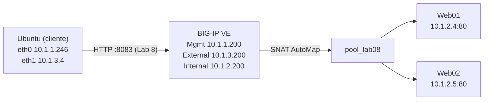
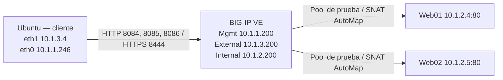

# Laboratorio 8 — Diagnóstico de red y rendimiento en BIG-IP: estadísticas, interfaces, tcpdump, drops, TCP y utilización de recursos


## Metadatos

| Campo | Valor |
|---|---|
| Duración | **60 minutos** |
| Modalidad | **Práctica individual, 100 % ejecutable en el pod** |
| Complejidad | Alta |
| Nivel | Administración y troubleshooting de BIG-IP LTM; preparación para certificación |
| Requisito | Laboratorios 1–7 completados; un único BIG-IP VE operativo |

## Objetivo

Diagnosticar un servicio HTTP en BIG-IP siguiendo **establecer línea base → localizar la falla → capturar evidencia → corregir → verificar**, utilizando TMSH, TMUI, `tcpdump`, estadísticas, registros y QKView. Al finalizar, el estudiante será capaz de distinguir un problema de disponibilidad de pool de un problema de red, observar las conexiones cliente/servidor y justificar sus conclusiones mediante evidencia.

> **Alcance real:** todas las pruebas obligatorias se realizan con los equipos disponibles. No se presupone acceso a Web01/Web02, una segunda instancia BIG-IP, Wireshark, `ab` ni una cuenta de iHealth. El análisis en iHealth es una ampliación opcional fuera de los 60 minutos. La generación de QKView sí forma parte de la práctica.

## Topología existente



**Objetos existentes que no deben alterarse:** Virtual Servers de laboratorios anteriores en `10.1.3.200:8080`, `:8081`, `:8082` y `:8443` (según los objetos configurados en cada pod), y sus pools, monitores y perfiles. Se creará un servicio **independiente en `:8083`**.

| Acceso | Datos |
|---|---|
| BIG-IP TMUI | `https://10.1.1.200` desde Ubuntu |
| BIG-IP SSH | `ssh adminazure@10.1.1.200` |
| Cliente de pruebas | Terminal Ubuntu |
| Backend | Web01 `10.1.2.4:80` y Web02 `10.1.2.5:80` |

**Cómo interpretar las consolas:** `adminazure` inicia sesión directamente en **TMSH**. En TMSH se escriben `show`, `list`, `create`, `modify`, `delete` sin anteponer `tmsh`. Para utilizar Linux: `run util bash`; para regresar: `exit`. En las secciones se indica explícitamente dónde ejecutar cada comando. Todos los comandos son de una sola línea.

## Distribución de tiempo

| Etapa | Actividad | Tiempo |
|---|---|---:|
| 1 | Crear el servicio aislado y comprobar HTTP | 10 min |
| 2 | Línea base de CPU, memoria, interfaces y conexiones | 7 min |
| 3 | Captura `tcpdump`: cliente, VIP y backend | 10 min |
| 4 | Provocar, diagnosticar y corregir dos fallas | 16 min |
| 5 | Prueba concurrente de límite de conexiones del VS | 7 min |
| 6 | QKView, validación final y limpieza | 10 min |
| **Total** | | **60 min** |

---

## Etapa 1. Preparar un servicio de diagnóstico independiente — 10 min

**Objetivo:** aislar los experimentos para no modificar los Virtual Servers de los laboratorios anteriores.

### 1.1 Comprobar conectividad (Ubuntu Bash)

```bash
curl --noproxy '*' -s -o /dev/null -w 'Web01 HTTP=%{http_code}\n' http://10.1.2.4/
curl --noproxy '*' -s -o /dev/null -w 'Web02 HTTP=%{http_code}\n' http://10.1.2.5/
```

**Esperado:** `HTTP=200` en ambos. Si Ubuntu no tiene ruta hacia la red interna, **no cambies rutas**: ejecuta estas mismas pruebas desde BIG-IP TMSH mediante `run util bash -c "curl -I http://10.1.2.4/"` y repite para `.5`.

### 1.2 Crear los objetos (BIG-IP TMSH)

Antes de cada `create`, comprueba que el objeto no exista; si ya fue creado por una ejecución anterior, **no lo dupliques**:

```text
list ltm pool pool_lab08
list ltm monitor http mon_lab08
list ltm virtual vs_lab08_http
```

Si aparecen como inexistentes, ejecuta en este orden:

```text
create ltm monitor http mon_lab08 defaults-from http
create ltm pool pool_lab08 members add { 10.1.2.4:80 10.1.2.5:80 } monitor mon_lab08 load-balancing-mode round-robin
create ltm virtual vs_lab08_http destination 10.1.3.200:8083 ip-protocol tcp pool pool_lab08 profiles add { tcp http } source-address-translation { type automap }
```

> Si un objeto ya existe, **consulta su configuración** con `list` antes de continuar. No reemplaces un objeto de otro laboratorio.

### 1.3 Validar (BIG-IP TMSH y Ubuntu)

```text
show ltm pool pool_lab08 members
show ltm virtual vs_lab08_http
```

Desde **Ubuntu**:

```bash
curl --noproxy '*' -s -w '\nHTTP %{http_code}\n' http://10.1.3.200:8083/
```

**Esperado:** respuesta `WEB01` o `WEB02` y HTTP `200`; los dos members deben estar `available`. En TMUI utiliza **Local Traffic → Network Map** para identificar `vs_lab08_http`, `pool_lab08` y los miembros.

**Evidencia:** nombre del VS, dirección:puerto, pool y estado de sus miembros.

---

## Etapa 2. Interpretar CPU, memoria, interfaces y estado del servicio — 7 min

**Objetivo:** obtener una línea base de BIG-IP y saber **qué número buscar, dónde encontrarlo y qué significa**. Solo se anotan los campos indicados; no copies las salidas completas. Los valores de ejemplo se obtuvieron de un BIG-IP de este curso y **pueden variar en tu pod**.

> **Importante:** esta etapa es de **observación**. No cambies parámetros de CPU, memoria, interfaces ni discos. Si un valor llama tu atención, regístralo como *indicio*, no como falla demostrada.

### 2.1 CPU: identificar utilización actual y núcleos — 2 min

En la consola **TMSH**:

```text
show sys cpu
```

Busca **dos lugares** en la salida:

**A. Primera tabla: `System CPU Usage(%)`**

```text
System CPU Usage(%)  Current  Average  Max(since ...)
Utilization                4        4             48
```

- **Current:** utilización global actual. Anota este valor.
- **Average:** promedio mostrado por BIG-IP. Es una referencia, no necesariamente el promedio de esta actividad.
- **Max:** máximo desde la fecha que indica el encabezado; **no significa** que la CPU esté actualmente al 48 %.

**B. Sección `Sys::Host CPUs`**

```text
CPU: 1 ...
User                      9
System                    3
Idle                     84
Iowait                    0
Util% (last 5 sec)       12
```

Busca el campo **`Util% (last 5 sec)`** de cada CPU (`CPU: 0`, `CPU: 1`, etc.) e identifica **el núcleo más ocupado**. `Idle` es tiempo inactivo e `Iowait` es espera de operaciones de entrada/salida. No necesitas transcribir todos los núcleos.

**Ejemplo real:** CPU global actual **4 %**, CPU individual más ocupada **12 %**. **Interpretación:** no se observa saturación de CPU en ese momento. Esta salida de CPU de host no reemplaza la medición específica de TMM.

### 2.2 Memoria: separar TMM, otros procesos y swap — 2 min

```text
show sys memory
```

**Detente en el encabezado** `Memory Used(%)`. No necesitas revisar las cientos de líneas de `Sys::SubSystem Memory`.

```text
Memory Used(%)     Current  Average  Max(...)
TMM Memory Used          5        5       5
Other Memory Used       97       97      97
Swap Used               28       15      29
```

| Campo | ¿Qué significa? | Ejemplo real | ¿Qué anotar? |
|---|---|---:|---|
| `TMM Memory Used` | Memoria asignada a procesamiento de tráfico | **5 %** | Porcentaje actual |
| `Other Memory Used` | Memoria usada fuera de TMM | **97 %** | Porcentaje actual; señalar si es alto |
| `Swap Used` | Espacio de intercambio ocupado | **28 %** | Porcentaje actual; observar si aumenta con el tiempo |

En la sección `Sys::Host Memory (bytes)` también puedes consultar los tamaños:

```text
TMM:   Total 3.8G    Used 199.2M
Other: Total 27.5G   Used 26.6G
Total: Total 31.4G   Free 4.5G
Swap:  Total 999.9M Used 278.7M
```

**Interpretación del ejemplo:** TMM tiene poco consumo; `Other Memory Used` está en **97 %** y el swap en **28 %**. Ambos merecen seguimiento, **pero no demuestran por sí solos** que exista una fuga de memoria o degradación: es necesario investigar cachés, procesos, evolución temporal y actividad de swap.

### 2.3 Disco e interfaces: buscar espacio disponible y errores — 1 min

En TMSH:

```text
show sys disk
show net interface 1.1
show net interface 1.2
```

**Atención:** `show sys disk` muestra tamaños configurados de volúmenes/directorios y **no el porcentaje de espacio usado**. Para ver el espacio libre real, ejecuta desde TMSH en una sola línea:

```text
run util bash -c "df -h"
```

En `df -h`, busca **`Use%`** y **`Avail`** para las particiones que correspondan a `/var`, `/shared` y `/config` (pueden aparecer bajo otros puntos de montaje). Registra la partición con **mayor `Use%`**; si no se distingue algún montaje, consigna el que ves, sin inventar porcentajes.

En las interfaces, localiza estas columnas:

```text
Name  Status   Bits In   Bits Out   Pkts In   Pkts Out   Drops   Errs   Media
1.1     up       32.1M      24.4M     39.7K      43.8K        0      0   10000T-FD
1.2     up       97.9K     126.5K       133        160        0      0   10000T-FD
```

- `Status up`: interfaz operativa.
- `Pkts In/Out`: contadores acumulados de tráfico; deberían aumentar con nuevas solicitudes.
- `Drops` y `Errs`: anota los valores iniciales. Lo importante es si **aumentan**, no solo que sean diferentes de cero.
- `Media 10000T-FD`: velocidad/duplex informados; no debes modificar este ajuste.

### 2.4 Estado del servicio y breve prueba — 2 min

En TMSH:

```text
show ltm virtual vs_lab08_http
show ltm pool pool_lab08 members
```

Identifica si el Virtual Server está **`available` / `enabled`**, cuántos Pool Members aparecen disponibles y el contador de conexiones **totales** (si se muestra). Las conexiones **actuales** pueden estar en cero aun cuando el servicio funcione.

En **Ubuntu Bash**, genera diez solicitudes:

```bash
for i in $(seq 1 10); do curl --noproxy '*' -s -o /dev/null http://10.1.3.200:8083/; done
```

Vuelve a consultar en TMSH:

```text
show ltm virtual vs_lab08_http
show net interface 1.1
show net interface 1.2
```

Observa si aumentaron las conexiones **totales** o los contadores de paquetes. **No es obligatorio que CPU o memoria cambien:** diez solicitudes HTTP simples pueden ser demasiado breves para verse reflejadas en su intervalo de muestreo.

### 2.5 Hoja de registro: anota solamente lo siguiente

| Indicador (comando) | Ejemplo real / referencia | Tu valor inicial | Tu valor posterior (si aplica) | Interpretación breve |
|---|---|---|---|---|
| CPU global `Current` (`show sys cpu`) | 4 % | ____ | — | ¿Baja o elevada en esta muestra? ____ |
| CPU individual más ocupada: `Util%` | CPU 1: 12 % | CPU __: __ % | — | ¿Un núcleo sobresale? ____ |
| `TMM Memory Used` | 5 % | ____ % | — | ¿TMM muestra presión evidente? ____ |
| `Other Memory Used` | 97 % | ____ % | — | ¿Requiere seguimiento? ____ |
| `Swap Used` | 28 % | ____ % | — | ¿Dato de ocupación, no de actividad? ____ |
| Disco: mayor `Use%` (`df -h`) | **No se obtiene de `show sys disk`** | Montaje __ / __ % | — | ¿Hay poco espacio disponible? ____ |
| Interfaz `1.1`: `Status / Drops / Errs` | `up / 0 / 0` | ____ / ____ / ____ | ____ / ____ / ____ | ¿Aumentaron drops/errores? ____ |
| Interfaz `1.2`: `Status / Drops / Errs` | `up / 0 / 0` | ____ / ____ / ____ | ____ / ____ / ____ | ¿Aumentaron drops/errores? ____ |
| VS `vs_lab08_http`: estado / total de conexiones | `available` (si hay backend sano) | ____ / ____ | ____ / ____ | ¿Procesó tráfico? ____ |
| Pool `pool_lab08`: miembros disponibles | 2 de 2 | ____ de 2 | — | ¿Servicio disponible? ____ |

**Conclusión de la Etapa 2 (completa una frase):** “Mi BIG-IP muestra CPU __ %, memoria TMM __ %, Other Memory __ %, swap __ %, interfaces __, y el servicio HTTP __. El indicador que revisaría con más detalle es __ porque __”.

**Criterio de logro:** identificaste correctamente los campos y registraste un valor real por indicador. No se califica que todos los porcentajes sean bajos, sino **que interpretes los datos sin confundir ocupación, actividad y disponibilidad**.

---

## Etapa 3. Capturar el tráfico HTTP completo — 10 min

**Objetivo:** distinguir el flujo **cliente → Virtual Server** del flujo **BIG-IP → Pool Member**, como se practicó anteriormente con SNAT AutoMap y X-Forwarded-For.

### 3.1 Iniciar la captura (BIG-IP Bash, terminal SSH A)

Desde TMSH:

```text
run util bash
```

En Bash ejecuta **una sola línea**:

```bash
tcpdump -nni 0.0 -s 0 -w /var/tmp/lab08_flujo.pcap 'tcp and ((host 10.1.3.4 and port 8083) or (host 10.1.2.4 and port 80) or (host 10.1.2.5 and port 80))'
```

Deja la captura en ejecución. **No elimines el filtro:** evita capturar tráfico innecesario en `0.0`.

### 3.2 Generar las solicitudes (Ubuntu Bash)

Abre otra terminal en Ubuntu:

```bash
for i in $(seq 1 12); do curl --noproxy '*' -s -o /dev/null "http://10.1.3.200:8083/?lab08=$i"; done
```

Regresa a la captura de BIG-IP y detenla con **Ctrl+C**.

### 3.3 Examinar el PCAP sin Wireshark (BIG-IP Bash)

```bash
ls -lh /var/tmp/lab08_flujo.pcap
tcpdump -nn -r /var/tmp/lab08_flujo.pcap | head -25
```

Para encontrar el identificador HTTP, en Bash:

```bash
tcpdump -nn -A -r /var/tmp/lab08_flujo.pcap 2>/dev/null | grep -B 8 -A 12 'lab08='
```

El parámetro `-B 8` muestra las ocho líneas **anteriores** a `lab08=` (incluida normalmente la línea IP origen → destino); `-A 12` muestra las doce **posteriores**. Si una cabecera o la línea IP queda fuera de la ventana, amplía `-B` o consulta el PCAP sin `grep`. Esta prueba solo mostrará los paquetes realmente presentes en el archivo.

**Debes identificar:**

- Cliente `10.1.3.4` → VIP `10.1.3.200:8083`.
- BIG-IP `10.1.2.200` → Web01 `10.1.2.4:80` o Web02 `10.1.2.5:80`, si SNAT AutoMap se aplica al flujo.
- Una solicitud `GET /?lab08=`. Las solicitudes `GET / HTTP/1.0` sin marcador pueden proceder de los Health Monitors.

**Importante:** `tcpdump` de un flujo HTTP no cifrado permite examinar cabeceras; el `X-Forwarded-For` solo aparecerá si el perfil HTTP aplicado al VS tiene activada su inserción. El laboratorio 8 **no depende de esa cabecera**, pero se puede recordar la prueba del Laboratorio 5.

**Evidencia:** anota dos pares origen/destino y explica por qué son diferentes. Opcional: descarga el PCAP y ábrelo en Wireshark para observar `tcp.flags.syn==1` y `tcp.flags.reset==1`; no es requisito.

---

## Etapa 4. Diagnosticar dos fallas reales y recuperarlas — 16 min

**Regla:** modifica solo `mon_lab08`, `pool_lab08` y `vs_lab08_http`. No alteres el monitor HTTP predeterminado ni los objetos de laboratorios anteriores.

### Caso A — El monitor declara indisponible una aplicación que sí responde (8 min)

**1. Introducir la falla (BIG-IP TMSH):**

```text
modify ltm monitor http mon_lab08 recv "LAB08_CADENA_INEXISTENTE"
```

**2. Esperar al menos un ciclo de monitorización; comprobar:**

```text
show ltm pool pool_lab08 members
show ltm virtual vs_lab08_http
list ltm virtual vs_lab08_http connection-limit
```

Desde Ubuntu:

```bash
curl --noproxy '*' -s -o /dev/null -w 'HTTP=%{http_code} ERROR=%{errormsg}\n' --connect-timeout 3 --max-time 6 http://10.1.3.200:8083/
```

**Resultado:** los miembros pueden pasar a `offline`, por lo que el VS pierde disponibilidad. El cliente podría recibir reset, timeout u otro error; **no hay un único síntoma garantizado**.

**3. Localizar la causa (BIG-IP TMSH):**

```text
list ltm monitor http mon_lab08 recv
list ltm pool pool_lab08 monitor
```

**4. Corregir y volver a verificar:**

```text
modify ltm monitor http mon_lab08 recv none
show ltm pool pool_lab08 members
```

Espera a que los Health Monitors vuelvan a marcar ambos miembros como disponibles. Desde Ubuntu repite el `curl` y confirma HTTP `200`.

**Pregunta:** ¿por qué `Web01` puede responder HTTP 200 y simultáneamente aparecer `offline` dentro del pool?

### Caso B — Un member está deshabilitado administrativamente (8 min)

**1. Deshabilitar solo Web02 dentro del pool de prueba (BIG-IP TMSH):**

```text
modify ltm pool pool_lab08 members modify { 10.1.2.5:80 { session user-disabled } }
show ltm pool pool_lab08 members
```

**2. Generar diez solicitudes desde Ubuntu:**

```bash
for i in $(seq 1 10); do curl --noproxy '*' -s http://10.1.3.200:8083/; echo; done
```

**Esperado:** normalmente todas las respuestas nuevas procederán de Web01, siempre que esté disponible y no exista persistencia. **Deshabilitar un member no equivale a apagar el servidor**: el VS puede seguir atendiendo solicitudes.

**3. Recuperar y verificar (BIG-IP TMSH):**

```text
modify ltm pool pool_lab08 members modify { 10.1.2.5:80 { session user-enabled } }
show ltm pool pool_lab08 members
```

Desde Ubuntu, repite las diez peticiones para comprobar que Web01 y Web02 vuelven a participar. No se exige alternancia exacta si hay conexiones reutilizadas.

**Preguntas:** ¿qué diferencia hay entre `session user-disabled` y un member marcado `offline` por un monitor? ¿Cuál prueba describe un problema administrativo y cuál un problema de disponibilidad?

---

## Etapa 5. Comprobar un límite REAL de conexiones simultáneas — 7 min

**Objetivo:** demostrar con conexiones reales que `connection-limit` establece un máximo de conexiones simultáneas y **no** un máximo de solicitudes acumuladas. No necesitas instalar `ab`, `nc` ni otra herramienta: solo Ubuntu Bash y TMSH. El límite se aplicará exclusivamente a `vs_lab08_http` (`10.1.3.200:8083`), sin afectar los Virtual Servers anteriores.

> **Por qué se usa el límite del Virtual Server:** si limitamos únicamente Web01, BIG-IP puede enviar las conexiones adicionales a Web02 y todas las solicitudes responderían correctamente. En el VS el efecto es más sencillo de medir: todas las conexiones entrantes comparten el mismo límite. En el examen, distingue *VS connection limit*, *pool member connection limit* y *connection rate limit*.

### 5.1 Verificar el valor inicial y localizar los contadores — 1 min

**BIG-IP TMSH:**

```text
list ltm virtual vs_lab08_http connection-limit
show ltm virtual vs_lab08_http
```

Busca **`connection-limit`** (normalmente `0`, sin límite) y en las estadísticas **conexiones actuales (`Current Connections`)** frente a **conexiones totales (`Total Connections`)**. Si el límite inicial no es `0`, anota su valor para restaurarlo exactamente al terminar.

### 5.2 Prueba A: ocho conexiones simultáneas SIN límite — 2 min

**En Ubuntu Bash, terminal A**, ejecuta este bloque. Cada proceso abre su propio socket TCP, envía una petición HTTP y mantiene abierto el descriptor durante 12 segundos:

```bash
for i in $(seq 1 8); do
  ( exec 3<>/dev/tcp/10.1.3.200/8083 || exit
    printf 'GET /?limite=%s HTTP/1.1\r\nHost: 10.1.3.200\r\nConnection: keep-alive\r\n\r\n' "$i" >&3
    echo "Socket $i iniciado"
    sleep 12
    exec 3<&-
    exec 3>&-
  ) &
done
wait
```

**Mientras está en ejecución**, en la terminal SSH de BIG-IP (TMSH), ejecuta inmediatamente:

```text
show ltm virtual vs_lab08_http
show sys connection cs-server-addr 10.1.3.200 cs-server-port 8083
```

**Observa:** el número de conexiones del lado cliente y el contador de conexiones actuales. Una solicitud `GET` puede terminar aunque el socket siga abierto; por ello registra lo que realmente muestre BIG-IP, no supongas que los ocho sockets permanecerán activos los 12 segundos. Es posible que el backend o el perfil TCP/HTTP cierre antes algunas conexiones.

### 5.3 Prueba B: limitar el Virtual Server a dos conexiones — 2 min

**En BIG-IP TMSH:**

```text
modify ltm virtual vs_lab08_http connection-limit 2
list ltm virtual vs_lab08_http connection-limit
```

**Repite el mismo bloque de ocho sockets** de la prueba A desde Ubuntu. Mientras se ejecuta, observa de nuevo en BIG-IP:

```text
show ltm virtual vs_lab08_http
show sys connection cs-server-addr 10.1.3.200 cs-server-port 8083
```

**Compara A frente a B:** el límite configurado es `2`. BIG-IP no debe admitir más conexiones concurrentes de las permitidas para ese VS; las conexiones excedentes pueden rechazarse, permanecer pendientes o experimentar un timeout, según el procesamiento TCP y el momento exacto de medición. Que Bash imprima «Socket iniciado» **no confirma por sí solo que la petición HTTP haya sido procesada**. La evidencia decisiva es la combinación de estadísticas del VS, tabla de conexiones y comportamiento de las solicitudes. <u>No se exige un número fijo de errores.</u>

| Evidencia que debes anotar | Prueba A: sin límite | Prueba B: límite 2 |
|---|---|---|
| `connection-limit` configurado | ____ | `2` |
| Máximo de `Current Connections` observado | ____ | ____ |
| Entradas client-side visibles en `show sys connection` | ____ | ____ |
| ¿Hubo conexiones rechazadas, pendientes o cerradas? | ____ | ____ |
| ¿Se incrementó `Total Connections`? | ____ | ____ |

**Si las conexiones se cierran tan rápido que no puedes contar ninguna:** repite la prueba mientras observas inmediatamente las estadísticas; toma como resultado válido la configuración del límite y explica que un HTTP `GET` breve no garantiza conexiones concurrentes persistentes. **No inventes un rechazo que no ocurrió.**

### 5.4 Restaurar la configuración y comprobar HTTP — 2 min

**En BIG-IP TMSH**, vuelve al valor inicial (si era `0`):

```text
modify ltm virtual vs_lab08_http connection-limit 0
list ltm virtual vs_lab08_http connection-limit
```

**En Ubuntu Bash:**

```bash
curl --noproxy '*' -s -o /dev/null -w 'HTTP=%{http_code}\n' http://10.1.3.200:8083/
```

**Esperado:** `HTTP=200`; `connection-limit 0` significa **sin límite explícito configurado**. Si el valor inicial era distinto de `0`, restaura ese valor en lugar de `0`.

**Responde:**

1. ¿Por qué enviar 100 solicitudes secuenciales no demuestra un límite de 2 conexiones simultáneas?
2. ¿Por qué limitar solo Web01 no garantiza errores si Web02 sigue disponible?
3. ¿Qué diferencia existe entre `connection-limit 2` y una limitación de dos conexiones *por segundo*?

**Criterio de éxito:** configuraste el límite, generaste conexiones concurrentes con herramientas existentes, observaste los contadores y recuperaste el funcionamiento del servicio. La evidencia y su interpretación importan más que provocar un error concreto.

---

## Etapa 6. Generar QKView, validar y limpiar — 10 min

### 6.1 Generar diagnóstico (BIG-IP Bash)

Desde TMSH, entra a Bash:

```text
run util bash
```

Genera un archivo QKView (puede tomar varios minutos):

```bash
qkview -f /var/tmp/lab08.qkview
```

Comprueba su existencia:

```bash
ls -lh /var/tmp/lab08.qkview
```

Si el comando muestra una ruta de salida distinta, **usa la que muestre el propio sistema**. No se exige un tamaño fijo: varía por versión, módulos y logs. No abras ni publiques el contenido del QKView: puede contener información sensible.

**iHealth:** el estudiante debe saber que un QKView puede cargarse en <https://ihealth.f5.com/> para obtener diagnósticos; la carga no es obligatoria porque requiere cuenta y procesamiento externo. La práctica obligatoria es **generar y localizar** el archivo.

### 6.2 Inspeccionar los últimos eventos (BIG-IP Bash)

```bash
tail -20 /var/log/ltm
```

Busca eventos de health monitor y cambios en la disponibilidad del pool. **No confundas un evento histórico con una falla que continúa activa.** Regresa a TMSH con `exit`.

### 6.3 Validar estado final (BIG-IP TMSH)

```text
show ltm pool pool_lab08 members
list ltm pool pool_lab08 members
show ltm virtual vs_lab08_http
list ltm virtual vs_lab08_http connection-limit
```

Desde Ubuntu:

```bash
curl --noproxy '*' -s -w '\nHTTP=%{http_code}\n' http://10.1.3.200:8083/
```

**Esperado:** HTTP `200`, los dos members `available`, `connection-limit` del VS restaurado a su valor inicial, sin `user-disabled`, con el monitor recuperado.

### 6.4 Limpiar solo objetos del Lab 8 (BIG-IP TMSH)

Una vez registrada la evidencia, elimina el servicio temporal **en este orden**:

```text
delete ltm virtual vs_lab08_http
delete ltm pool pool_lab08
delete ltm monitor http mon_lab08
save sys config
```

Para evitar llenar el disco, puedes eliminar las capturas y el QKView en **BIG-IP Bash** después de anotar el resultado:

```text
run util bash
```

```bash
rm -f /var/tmp/lab08_flujo.pcap /var/tmp/lab08.qkview
```

```bash
exit
```

**No borres archivos UCS ni perfiles, pools o VS creados en otros laboratorios.**

---

## Hoja de evidencias y criterios de aprobación

| Competencia | Evidencia mínima | Hecho |
|---|---|---|
| Crear y validar servicio LTM independiente | HTTP 200 en `:8083` y dos members `available` | ☐ |
| Línea base | CPU, memoria, disco, errores/drops de interfaces | ☐ |
| Flujo de datos | PCAP con dos lados del flujo y una petición marcada | ☐ |
| Health Monitor | Evidencia de member down, causa y corrección | ☐ |
| Control administrativo | Member deshabilitado/habilitado y efecto en tráfico | ☐ |
| Rendimiento | Pruebas A/B de conexiones simultáneas, límite del VS en 2 y restauración | ☐ |
| Diagnóstico | QKView creado, logs consultados y entorno limpio | ☐ |

**Cierre técnico (responder en una o dos líneas cada uno):**

1. Si Web01 responde por HTTP directamente, pero el pool lo muestra `offline`, ¿qué revisarías primero?
2. Si un Virtual Server recibe conexiones, pero los members no muestran actividad, ¿cuáles son tres comprobaciones prioritarias?
3. ¿Por qué `10.1.3.4 → 10.1.3.200:8083` y `10.1.2.200 → 10.1.2.4:80` son dos conexiones diferentes?
4. ¿Cuál es la diferencia entre `configured state` y `availability state`?
5. ¿Qué aporta un QKView y qué no puede sustituir?

## Solucionario

1. **Member offline pese a HTTP 200:** examinar el monitor asociado, `send`/`recv`, puerto, intervalo/timeout y respuesta real. Un monitor con `recv` incorrecto puede marcar `offline` un backend sano.
2. **VS con conexiones, members sin actividad:** confirmar pool realmente asociado al VS, estado/monitor de los miembros y perfiles o políticas que afecten la selección; verificar tabla de conexiones y captura de ambos lados para determinar si BIG-IP abre la conexión al servidor.
3. **Dos conexiones:** BIG-IP LTM Standard opera como **Full Proxy**, con lado cliente y lado servidor. SNAT AutoMap puede usar `10.1.2.200` como origen de la conexión al backend.
4. **Configurado vs. disponible:** la configuración administrativa (`enabled`, `disabled`, `user-disabled`) no equivale al estado observado por monitores o accesibilidad (`available`, `offline`, `unknown`).
5. **QKView:** reúne configuración, estadísticas y registros para diagnóstico, soporte y análisis en iHealth; **no corrige automáticamente** la falla ni sustituye pruebas de conectividad, capturas y validaciones.
6. **Caso A:** `recv "LAB08_CADENA_INEXISTENTE"` no coincide con la respuesta de Apache; restaurar `recv none` permite que el monitor HTTP predeterminado considere correcta una respuesta adecuada según sus criterios.
7. **Caso B:** `user-disabled` evita nuevas selecciones del member dentro de ese pool; al habilitarlo otra vez puede volver a ser seleccionado. El estado de monitor es un criterio separado.
8. **Límite de conexiones (Etapa 5):** `connection-limit 2` en el Virtual Server limita las conexiones simultáneas del VS; `0` elimina el límite explícito. Los contadores `Current Connections` muestran actividad puntual y `Total Connections` acumula conexiones históricas. Una secuencia de 100 solicitudes no demuestra simultaneidad. Si se limita solo Web01, Web02 puede seguir recibiendo conexiones. El límite de conexiones simultáneas no es equivalente a un *connection rate limit*, que controla la tasa de conexiones nuevas por unidad de tiempo. La presencia de `Socket iniciado` en Bash no garantiza que BIG-IP completó el HTTP.
9. **Drops/errores:** un contador acumulado no demuestra degradación actual; hay que medir su variación y correlacionarla con síntomas.

## Diagnóstico rápido

| Problema | Revisión |
|---|---|
| `create` indica que el objeto ya existe | Utiliza `list` y no lo recrees sin revisar su contenido |
| HTTP `:8083` no responde | `show ltm virtual vs_lab08_http`, `show ltm pool pool_lab08 members`, SNAT AutoMap y conectividad desde Ubuntu |
| `tcpdump` muestra solo Health Monitors | Identifica `?lab08=` en el PCAP y utiliza el filtro que incluye `:8083` |
| No hay RST en el PCAP | Es normal: no todas las fallas producen reset; documenta el comportamiento real |
| `show sys cpu` no sube con 60 solicitudes | La carga es muy pequeña y breve; la métrica puede muestrearse después del pico |
| La prueba de límite no muestra conexiones simultáneas | HTTP/Apache puede cerrar sesiones antes de los 12 s; repite y observa la tabla en tiempo real, sin deducir falsamente que el límite falló |
| `qkview` tarda o falla | Verifica espacio libre con `show sys disk`, revisa el mensaje concreto, no repitas indiscriminadamente |
| QKView no aparece en la ruta propuesta | Lee la ruta informada por `qkview` y comprueba con `ls` |

## Referencias oficiales

- [Referencia TMSH de BIG-IP](https://clouddocs.f5.com/cli/tmsh-reference/latest/)
- [Referencia de administración de pools y connection-limit](https://clouddocs.f5.com/cli/tmsh-reference/v16/modules/ltm/ltm_pool.html)
- [Capturas tcpdump: capacitación F5](https://clouddocs.f5.com/training/community/adc/html/class4/module1/lab01.html)
- [F5 iHealth](https://ihealth.f5.com/)

**Alcance de certificación:** este laboratorio desarrolla habilidades prácticas de troubleshooting, pero **ningún laboratorio por sí solo garantiza aprobar una certificación**. Debe complementarse con los dominios oficiales del examen, teoría, práctica y evaluación.


# Laboratorio 9 — Troubleshooting integral de una aplicación: Virtual Server, Pool, Health Monitor, Persistence, Profiles, Priority Groups, límites y análisis del tráfico de extremo a extremo

## Datos generales

| Campo | Valor |
|---|---|
| Duración total | **60 minutos** |
| Nivel | Administración BIG-IP; complemento práctico para F5CAB1–F5CAB5 |
| Modalidad | **Configurar por GUI (TMUI) y validar mediante CLI (TMSH)** |
| Prerrequisito | Laboratorios 1–8 finalizados; BIG-IP VE, Ubuntu y Web01/Web02 operativos |
| Alcance | **Sin HA. Sin instalaciones adicionales. Sin SSH a los backends.** |

## Objetivo

Demostrar, con resultados **observables desde Ubuntu y medibles en TMSH**, tipos de Virtual Server, selección de tráfico, expiración TCP, prioridad con conmutación de miembros, persistencia mediante cookies, diagnóstico de fallas de monitor y publicación, y una falla SSL reproducible sobre un Virtual Server exclusivo. **La configuración se realiza exclusivamente mediante TMUI; TMSH se usa para consultar y verificar.** No se requiere instalar herramientas y no se accede por SSH a los backends.

> **Regla de esta versión:** una actividad solo se considera demostrada cuando existe evidencia de **antes → cambio → después → restauración**. Configurar un campo y leer ese mismo campo no demuestra comportamiento. Se probará **Client SSL** en una VIP HTTPS exclusiva: primero funcionará, después fallará al retirar su perfil y finalmente volverá a funcionar al restaurarlo. **Server SSL hacia Web01/Web02** requiere un backend HTTPS, por lo que no se simulará su funcionamiento.

## Topología de trabajo



| Componente | Dirección | Uso |
|---|---|---|
| Acceso GUI desde Firefox en Ubuntu | `https://10.1.1.200` | Configuración de objetos |
| SSH a BIG-IP | `ssh adminazure@10.1.1.200` | Validación CLI; inicia en **TMSH** |
| Ubuntu cliente | `10.1.3.4` | `curl`, Bash y prueba TCP |
| BIG-IP Self IP externa | `10.1.3.200` | La IP existente, compartida en diferentes puertos |
| BIG-IP Self IP interna | `10.1.2.200` | SNAT AutoMap |
| Web01 / Web02 | `10.1.2.4:80` / `10.1.2.5:80` | Servidores de aplicación |

**Convenciones:** en la consola TMSH escribe los comandos `list`, `show` y `show sys ...` **sin** prefijo `tmsh`. Los comandos con `curl` y `/dev/tcp` se ejecutan **en Ubuntu**, no en TMSH. En TMUI los nombres de menús pueden variar ligeramente entre versiones; usa la sección equivalente.

**Protección del entorno:** no modifiques los Virtual Servers `:8080`, `:8081`, `:8082`, `:8083` ni `:8443`, sus pools, ni las interfaces físicas o rutas existentes. El puerto `8444` se reserva para la prueba SSL si está libre. Este laboratorio crea objetos con el sufijo `_lab09`. No cambies la IP de administración, el puerto *lockdown*, la licencia ni el volumen de arranque. **No ejecutes Activate/Reboot/Install.**

## Plan de 60 minutos

| Etapa | Experimento | Min |
|---|---|---:|
| 1 | Reconocer VLAN, interfaz, software y rutas | 5 |
| 2 | Comparar Standard / FastL4 / Reject con tráfico real | 9 |
| 3 | Probar precedencia específico/wildcard cuando exista IP libre | 6 |
| 4 | Medir una sesión que vence por TCP Idle Timeout | 9 |
| 5 | Probar Priority Group Activation y failover Web01 → Web02 | 8 |
| 6 | Comparar Round Robin frente a Cookie Persistence | 7 |
| 7 | Resolver dos fallas reproducibles: monitor y VS deshabilitado | 7 |
| 8 | Provocar y corregir una falla Client SSL; limpiar y verificar | 9 |
| **Total** | | **60** |

---

## Etapa 1. Inspeccionar sin alterar el sistema — 5 min

**Pregunta que resuelve:** antes de publicar tráfico, ¿qué red, recursos y versión de software tiene realmente BIG-IP?

### 1.1 Explorar desde TMUI (3 min)

1. Abre `https://10.1.1.200` e inicia sesión.
2. Ve a **Network > Interfaces**: localiza `1.1` (External) y `1.2` (Internal); anota estado y velocidad reportada. **No cambies Media/duplex**.
3. Ve a **Network > VLANs** y abre `External` e `Internal`; identifica en qué interfaz está cada VLAN y si sus miembros son *Tagged* o *Untagged*. Ve después a **Network > Self IPs** y reconoce `10.1.3.200` / `10.1.2.200`.
4. Ve a **Network > Routes** y revisa la ruta predeterminada, si existe. **No crees ni borres rutas**.
5. Ve a **System > License** (o la sección License del sistema) y anota el tipo/estado de licencia y módulos que aparezcan; después **System > Software Management > Boot Locations**. Identifica volumen **activo** y otros volúmenes, si existen. **No pulses Activate**.

### 1.2 Verificar desde TMSH (2 min)

```text
show net interface 1.1
show net interface 1.2
list net vlan External
list net vlan Internal
list net self
list net route
show sys version
show sys license
show sys software status
```

> **Nota:** si `show sys software status` presenta un formato distinto o no está disponible, utiliza exclusivamente la pantalla **Boot Locations** para registrar el volumen activo. Un equipo puede tener un solo volumen de arranque. Ver la licencia no significa modificarla.

**Anota:** interfaz externa `_____`, modo Tagged/Untagged `_____`, ruta predeterminada `_____ / no existe`, versión `_____`, licencia `_____`, volumen activo `_____`.

**Interpreta:** ¿por qué no corresponde instalar una imagen ni activar otro volumen en una práctica de 60 minutos con un solo equipo compartido?

---

## Etapa 2. Comparar tres tipos de Virtual Server — 9 min

**Pregunta que resuelve:** ¿por qué un Standard VS, un Performance L4 y un Reject VS no deben utilizarse indistintamente?

### 2.1 Crear un pool exclusivo desde TMUI (3 min)

1. **Local Traffic > Pools > Pool List > Create**.
2. **Name:** `pool_lab09`.
3. **Health Monitors:** selecciona inicialmente el monitor HTTP incorporado `http`. **No lo modifiques**, pues puede estar usado por otros pools. En la Etapa 7 crearás un monitor exclusivo `mon_lab09_http` para diagnosticar una falla sin afectar otros laboratorios.
4. **Load Balancing Method:** `Round Robin`.
5. **New Members:** añade `10.1.2.4` puerto `80` y `10.1.2.5` puerto `80` (pulsa **Add** después de cada uno); termina en **Finished**. Mantén los dos con **Priority Group 0** y **Priority Group Activation Disabled** hasta la Etapa 7.
6. En TMSH valida:

```text
list ltm pool pool_lab09
show ltm pool pool_lab09 members
```

**Esperado:** dos members disponibles tras completar sus comprobaciones. Si no lo están, no continúes con las pruebas de tráfico; revisa monitor y IP, sin modificar Web01/Web02.

### 2.2 Crear Standard VS — HTTP de aplicación (3 min)

1. **Local Traffic > Virtual Servers > Virtual Server List > Create**.
2. **Name:** `vs_lab09_standard`; **Type:** `Standard`; **Destination:** `10.1.3.200`; **Service Port:** `8084`; **Protocol:** `TCP`.
3. Cambia **Configuration** a `Advanced` si es necesario. Selecciona **HTTP Profile:** `http` y **TCP Profile:** `tcp` (Client y Server cuando la pantalla los muestre).
4. **Source Address Translation:** `Auto Map` (SNAT); **Default Pool:** `pool_lab09`.
5. Guarda con **Finished**.
6. CLI:

```text
list ltm virtual vs_lab09_standard
show ltm virtual vs_lab09_standard
```

7. Ubuntu:

```bash
curl --noproxy '*' -sS -w '\nHTTP %{http_code}\n' http://10.1.3.200:8084/
```

**Esperado:** contenido Web01 o Web02, código HTTP `200`.

### 2.3 Crear Performance (Layer 4) — transporte (2 min)

1. Crea otro VS: **Name** `vs_lab09_fastl4`, **Type** `Performance (Layer 4)`, **Destination** `10.1.3.200`, **Service Port** `8085`, **Protocol** TCP.
2. En **Configuration: Advanced**, verifica **Protocol Profile (Client)** = `fastL4` (o perfil incorporado equivalente). Elige **Default Pool** `pool_lab09` y **Source Address Translation** `Auto Map`.
3. Termina; valida:

```text
list ltm virtual vs_lab09_fastl4
show ltm virtual vs_lab09_fastl4
```

4. Ubuntu:

```bash
curl --noproxy '*' -sS -w '\nHTTP %{http_code}\n' http://10.1.3.200:8085/
```

**Esperado:** respuesta HTTP del backend cuando la configuración de FastL4 y SNAT permite la comunicación. **No esperes un HTTP Profile en este VS**: trabaja en L4, no hace inspección HTTP como el Standard con perfil HTTP.

### 2.4 Crear Reject — rechazo deliberado (1 min)

1. Crea un VS: `vs_lab09_reject`, **Type:** `Reject`, **Destination** `10.1.3.200`, **Port** `8086`, **Protocol** `TCP`.
2. Finaliza; **este VS no necesita pool**.
3. TMSH:

```text
list ltm virtual vs_lab09_reject
```

4. Ubuntu:

```bash
curl --noproxy '*' -v --connect-timeout 3 --max-time 5 http://10.1.3.200:8086/
```

**Esperado:** la conexión **no** obtiene la página Web01/Web02. Puede verse rechazo/reset; el mensaje exacto depende del tráfico y del cliente.

**Completa la tabla:**

| Tipo | Puerto | ¿Tiene pool? | ¿Devuelve Web01/Web02? | Principal decisión de uso |
|---|---:|---|---|---|
| Standard | 8084 | Sí | | |
| Performance L4 | 8085 | Sí | | |
| Reject | 8086 | No | | |

---

## Etapa 3. Precedencia de VS específicos y wildcard — 6 min

**Pregunta que resuelve:** cuando dos VS pueden coincidir con el mismo destino, ¿cuál recibe la conexión?

> **Aislamiento obligatorio:** para no interceptar los puertos de los laboratorios previos, usa la IP **adicional** `10.1.3.201`, **solo si el instructor confirma que está libre y reservada para este laboratorio**. Nunca crees un wildcard `10.1.3.200:*`. Si `10.1.3.201` no está disponible, realiza únicamente la comparación de configuraciones y contesta el escenario; no actives un wildcard en la IP compartida.

### 3.1 Preparar y configurar desde TMUI (4 min)

1. El instructor confirma que `10.1.3.201` está disponible. En **Local Traffic > Virtual Servers > Create**, crea `vs_lab09_wildcard`, **Type: Reject**, **Destination: `10.1.3.201`**, **Service Port: `* All Ports` (puerto 0)** y **Protocol: TCP**. Finaliza.
2. Crea `vs_lab09_especifico`, **Type: Standard**, **Destination: `10.1.3.201`**, **Service Port: `8087`**, **Protocol: TCP**, **HTTP Profile: `http`**, **Default Pool: `pool_lab09`**, **SNAT: Auto Map**.
3. Confirma por TMSH que los **dos destinos** coinciden en dirección, pero **uno tiene puerto específico y el otro acepta todos los puertos**:

```text
list ltm virtual vs_lab09_wildcard
list ltm virtual vs_lab09_especifico
show ltm virtual vs_lab09_wildcard
show ltm virtual vs_lab09_especifico
```

### 3.2 Probar desde Ubuntu (2 min)

```bash
curl --noproxy '*' -sS -w '\nHTTP %{http_code}\n' --max-time 5 http://10.1.3.201:8087/
curl --noproxy '*' -v --connect-timeout 3 --max-time 5 http://10.1.3.201:8088/
```

**Esperado, si la IP está libre, se anuncia correctamente y los VS están disponibles:** `:8087` muestra Web01/Web02 porque gana la coincidencia **específica**; `:8088` es rechazado por el **wildcard**. Si no hay respuesta en ninguno, verifica primero ARP, disponibilidad y que el cliente realmente alcance la IP adicional; no atribuyas el fallo a la precedencia antes de comprobar la conectividad.

**Anota:** `8087 -> VS ________`, `8088 -> VS ________`. **Conclusión:** el VS específico tiene prioridad sobre el wildcard correspondiente; la coincidencia efectiva también depende de protocolo, dirección, ruta, VLAN y otras condiciones.

---

## Etapa 4. Demostrar TCP Idle Timeout con dos mediciones — 9 minutos

**Problema real:** un usuario abre una conexión TCP hacia un servicio y no termina de enviar su petición HTTP. ¿Cuándo decide BIG-IP cerrar una conexión inactiva?

**Resultado que debes obtener:** una solicitud con pausa de **2 segundos** recibe HTTP 200; la misma solicitud con pausa de **9 segundos** falla cuando el perfil cliente tiene `idle-timeout 5`. Antes de asignar el perfil corto, ambas deberían completar la solicitud.

### 4.1 Prueba de referencia, sin cambiar nada — Ubuntu (2 min)

En **Ubuntu Terminal** pega este bloque. Usa Python 3, que ya forma parte de la estación; **no instales paquetes**.

```bash
python3 - <<'PY'
import socket, time
host, port = '10.1.3.200', 8084
for pausa in (2, 9):
    try:
        with socket.create_connection((host, port), timeout=4) as s:
            s.settimeout(4)
            s.sendall(b'GET /?lab09_tcp=1 HTTP/1.1\r\nHost: 10.1.3.200\r\n')
            time.sleep(pausa)  # Cabeceras incompletas: no se envia la linea vacia
            s.sendall(b'Connection: close\r\n\r\n')
            data = s.recv(512)
            print(f'Pausa {pausa}s: {data.splitlines()[0].decode(errors="replace") if data else "conexion cerrada"}')
    except (OSError, TimeoutError) as e:
        print(f'Pausa {pausa}s: fallo: {type(e).__name__}: {e}')
PY
```

**Qué ver:** en ambas pruebas normalmente aparecerá `HTTP/1.1 200 OK` o `HTTP/1.0 200 OK`. Si alguna falla antes de cambiar el perfil, **no continúes**: confirma que `vs_lab09_standard` entrega HTTP 200 con `curl` y que no hay otro timeout configurado.

**Registra:** pausa 2 s: `_____`; pausa 9 s: `_____`.

### 4.2 Configurar el límite en TMUI — BIG-IP (2 min)

1. En Firefox: **Local Traffic > Profiles > Protocol > TCP > Create**.
2. **Name:** `tcp_lab09_corto`. **Parent Profile:** `tcp`.
3. Activa **Custom** en **Idle Timeout** y asigna **5 segundos**. No alteres otros parámetros. **Finished**.
4. Abre **Local Traffic > Virtual Servers > Virtual Server List > vs_lab09_standard > Properties**.
5. Cambia **Configuration** a **Advanced**. En **Protocol Profile (Client)** selecciona `tcp_lab09_corto`; conserva el perfil de servidor actual. Pulsa **Update**.
6. En la terminal SSH del BIG-IP (ya en **TMSH**):

```text
list ltm profile tcp tcp_lab09_corto idle-timeout
list ltm virtual vs_lab09_standard profiles
```

**Qué comprobar:** aparece `idle-timeout 5` y `tcp_lab09_corto` asignado al **lado cliente**. Si no se ve el perfil en el VS, no hagas la segunda medición hasta corregir la asociación.

### 4.3 Repetir exactamente la misma prueba — Ubuntu (3 min)

Repite **sin cambiar nada** el bloque Python del apartado 4.1.

**Salida ilustrativa**, no literal:

```text
Pausa 2s: HTTP/1.1 200 OK
Pausa 9s: conexion cerrada
```

También puede aparecer `BrokenPipeError`, `ConnectionResetError` u otro fallo para 9 segundos: el cierre exacto depende de cómo BIG-IP y el cliente detecten la terminación. **La evidencia es el contraste con la primera medición**, no un mensaje de error determinado.

**Interpretación:** el tiempo de espera mide inactividad de la conexión TCP, **no** la duración máxima de una solicitud que sigue intercambiando datos.

### 4.4 Recuperar el servicio — TMUI → TMSH → Ubuntu (2 min)

1. Vuelve a `vs_lab09_standard > Properties` y restaura **Protocol Profile (Client): `tcp`**.
2. TMSH: `list ltm virtual vs_lab09_standard profiles` debe volver a mostrar el perfil `tcp`.
3. Ubuntu:

```bash
curl --noproxy '*' -sS -o /dev/null -w 'HTTP %{http_code}\n' http://10.1.3.200:8084/
```

**Debe resultar:** `HTTP 200`.

| Evidencia a entregar | Antes | Con Idle Timeout = 5 s |
|---|---|---|
| Petición con pausa de 2 s | | |
| Petición con pausa de 9 s | | |
| Perfil cliente asociado (TMSH) | `tcp` | `tcp_lab09_corto` |

**Pregunta:** si una solicitud falla solo después de permanecer inactiva varios segundos, ¿por qué no debes atribuir el problema inicialmente a un Health Monitor?

---

## Etapa 5. Priority Group Activation: observar failover real — 8 minutos

**Problema real:** una aplicación tiene Web01 como servidor preferido y Web02 como respaldo. ¿Cómo comprobamos que BIG-IP **deja de enviar tráfico al primero** cuando administrativamente se le excluye de nuevas conexiones?

**Resultado esperado:** antes del cambio, las respuestas llegan desde **Web01**; al marcar Web01 **Forced Offline** a nivel del *pool member* exclusivo del Lab 9, las nuevas solicitudes van a **Web02**; al devolver Web01 a Enabled, vuelve a ser el preferido.

> La prueba mide **selección de miembros y failover administrativo**, no el comportamiento de *Action on Service Down* sobre una conexión TCP existente. Ese mecanismo requiere provocar una caída real de servicio durante una conexión activa, algo que estos backends rápidos no permiten garantizar. No lo presentaremos como una evidencia falsa.

### 5.1 Establecer prioridades en TMUI (2 min)

1. En Firefox: **Local Traffic > Pools > Pool List > pool_lab09 > Members**.
2. Abre `10.1.2.4:80` (**Web01**). En **Priority Group** selecciona **10** y pulsa **Update**.
3. Abre `10.1.2.5:80` (**Web02**). Pon **Priority Group 5** y pulsa **Update**.
4. Ve a **pool_lab09 > Properties > Advanced**; habilita **Priority Group Activation** y establece **Less than 1 available member** (valor `1`). Guarda con **Update**.
5. En TMSH:

```text
list ltm pool pool_lab09
show ltm pool pool_lab09 members
```

**Busca:** `min-active-members 1`, prioridades `10` y `5`, y **ambos miembros Available**. Si un miembro está Offline, esta prueba no distingue prioridades de monitoreo: corrígelo antes.

### 5.2 Comprobar el servidor preferido — Ubuntu (1 min)

```bash
for i in $(seq 1 6); do curl --noproxy '*' -sS -H 'Connection: close' --max-time 5 http://10.1.3.200:8084/; echo; done
```

**Debe observarse:** la página identifica **WEB01** en las seis solicitudes si el grupo de prioridad 10 tiene un miembro disponible. Si el contenido no muestra el nombre, utiliza la diferencia de contadores al repetir `show ltm pool pool_lab09 members`.

**Anota:** backend con prioridad más alta: `_____`.

### 5.3 Provocar el failover sin tocar Web01 en otros laboratorios (2 min)

1. En TMUI regresa a **pool_lab09 > Members**.
2. Selecciona **únicamente** el miembro `10.1.2.4:80` de este pool y elige **Forced Offline** (no el *node* global). No cambies el monitor ni el servidor Web01.
3. TMSH:

```text
show ltm pool pool_lab09 members
```

**Qué comprobar:** Web01 tiene estado administrativo `forced offline`; Web02 continúa disponible.

4. **Ubuntu** repite las seis solicitudes del apartado 5.2.

**Debe observarse:** ahora responde **WEB02** en las nuevas conexiones. Si hay conexiones anteriores abiertas, ciérralas; cada `curl` de la prueba abre su propia conexión.

### 5.4 Restaurar y demostrar recuperación — GUI → Ubuntu (3 min)

1. En el miembro `10.1.2.4:80` selecciona **Enable**.
2. En TMSH vuelve a ejecutar `show ltm pool pool_lab09 members`: ambos deben estar disponibles.
3. Repite seis solicitudes desde Ubuntu: deben volver a **WEB01**.
4. En TMUI restaura **Priority Group Activation: Disabled** (`min-active-members 0`) y **Priority Group: 0** en ambos members. Confirma con:

```text
list ltm pool pool_lab09
```

| Momento | Estado Web01 | Estado Web02 | Backend que respondió |
|---|---|---|---|
| Inicio, PG 10 / PG 5 | Available | Available | |
| Web01 Forced Offline | Forced Offline | Available | |
| Web01 Enabled de nuevo | Available | Available | |

**Pregunta de examen:** ¿por qué `Round Robin` no garantiza distribución 50/50 si existen grupos de prioridad activos?

---

## Etapa 6. Cookie Persistence: demostrar que el cliente conserva el mismo backend — 7 minutos

**Problema real:** una aplicación con sesiones necesita que un cliente regrese al mismo servidor. ¿Cómo diferenciar balanceo Round Robin de persistencia mediante cookie?

**Resultado esperado:** sin persistencia, seis conexiones independientes alternan entre Web01/Web02; con una cookie guardada y reenviada, las conexiones del **mismo cliente** mantienen el backend seleccionado.

### 6.1 Prueba sin persistencia — TMUI, TMSH y Ubuntu (2 min)

1. Verifica que en **Local Traffic > Virtual Servers > vs_lab09_standard > Resources**, **Default Persistence Profile** esté en **None**. No modifiques otros VS.
2. En TMSH:

```text
list ltm virtual vs_lab09_standard persist
list ltm pool pool_lab09 load-balancing-mode
```

**Busca:** sin perfil de persistencia predeterminado, balanceo `round-robin`, los dos miembros Available y prioridades restauradas a 0.

3. Desde Ubuntu ejecuta:

```bash
for i in $(seq 1 6); do curl --noproxy '*' -sS -H 'Connection: close' --max-time 5 http://10.1.3.200:8084/; echo; done
```

**Qué ver:** respuestas WEB01 y WEB02 (si el contenido permite distinguirlos); en Round Robin suele alternar cuando cada conexión es nueva. **Anota** la secuencia real: `____, ____, ____, ____, ____, ____`.

### 6.2 Crear y asociar Cookie Insert — TMUI (2 min)

1. Ve a **Local Traffic > Profiles > Persistence > Create**.
2. Completa **Name `persist_cookie_lab09`**, **Persistence Type `Cookie`**, **Parent Profile `cookie`**, **Cookie Method `HTTP Cookie Insert`** (si es necesario selecciona **Custom** para editar). **Finished**.
3. Abre **Local Traffic > Virtual Servers > vs_lab09_standard > Resources**.
4. En **Default Persistence Profile** elige `persist_cookie_lab09` y pulsa **Update**.
5. En TMSH:

```text
list ltm persistence cookie persist_cookie_lab09
list ltm virtual vs_lab09_standard persist
list ltm virtual vs_lab09_standard profiles
```

**Busca:** el VS tiene persistencia `persist_cookie_lab09` y conserva un perfil HTTP (`http`). **Sin procesamiento HTTP no puedes demostrar Cookie Insert.**

### 6.3 Guardar y reutilizar una cookie — Ubuntu (2 min)

En Ubuntu pega las instrucciones **en este orden**:

```bash
rm -f /tmp/lab09_cookie.txt
curl --noproxy '*' -sS -D /tmp/lab09_headers.txt -c /tmp/lab09_cookie.txt -H 'Connection: close' http://10.1.3.200:8084/
echo '--- CABECERA INSERTADA POR BIG-IP ---'
grep -i '^Set-Cookie:' /tmp/lab09_headers.txt
echo '--- CLIENTE QUE REUTILIZA LA COOKIE ---'
for i in $(seq 1 6); do curl --noproxy '*' -sS -b /tmp/lab09_cookie.txt -c /tmp/lab09_cookie.txt -H 'Connection: close' http://10.1.3.200:8084/; echo; done
```

**Qué ver:**

- Primera solicitud: `Set-Cookie: BIGipServer...=...` (el nombre concreto depende de la configuración).
- Seis solicitudes posteriores: **WEB01 seis veces** o **WEB02 seis veces**, siempre el **mismo servidor** en condiciones normales.
- Si no aparece `Set-Cookie`, comprueba en TMSH el perfil HTTP y la persistencia asignados antes de concluir que el mecanismo falló.

**Anota:** nombre de la cookie `_____`; backend seleccionado `_____`; ¿cambió en las siguientes seis solicitudes? `_____`.

### 6.4 Desactivar y restaurar la configuración base — TMUI (1 min)

1. Desde **vs_lab09_standard > Resources**, establece **Default Persistence Profile: None** y **Update**.
2. TMSH: `list ltm virtual vs_lab09_standard persist` ya no debe indicar persistencia Cookie activa.
3. Ejecuta dos nuevas solicitudes **sin** `-b` para no enviar la cookie anterior.
4. **Conclusión:** ¿por qué observar HTTP 200 no basta para confirmar que una sesión tiene persistencia?

---

## Etapa 7. Dos incidentes reales de troubleshooting — 7 minutos

**Método:** **Identificar síntoma → inspeccionar estado (TMSH) → localizar causa (TMSH) → corregir (GUI) → repetir desde Ubuntu**.

### 7.1 Incidente A: el servidor responde HTTP 200, pero BIG-IP lo marca Offline — 5 min

**Estado inicial obligatorio:** `curl http://10.1.3.200:8084/` devuelve `200` y `show ltm pool pool_lab09 members` indica miembros disponibles.

**Preparación del monitor (TMUI, 2 min):**

1. **Local Traffic > Monitors > Create**.
2. Configura **Name:** `mon_lab09_http`; **Type:** `HTTP`; **Parent Monitor:** `http`; **Interval:** `5`; **Timeout:** `16`; **Send String:** `GET / HTTP/1.0\r\n\r\n`; **Receive String:** `200 OK`. Pulsa **Finished**.
3. **Local Traffic > Pools > pool_lab09 > Properties > Health Monitors**: mueve **solo** `mon_lab09_http` a **Active**, quitando el predeterminado `http` **únicamente de `pool_lab09`**. Pulsa **Update**.
4. En TMSH:

```text
list ltm pool pool_lab09 monitor
show ltm pool pool_lab09 members
```

**Debe verse:** `monitor mon_lab09_http`; ambos miembros `available` tras el ciclo del monitor. Si esto falla, verifica Send String (no introduzcas todavía la falla).

**Inyectar la falla (GUI, 1 min):**

5. **Local Traffic > Monitors > mon_lab09_http**. Cambia **Receive String** a `LAB09_NO_EXISTE` y pulsa **Update**.
6. En TMSH consulta dos veces, con unos segundos de separación:

```text
list ltm monitor http mon_lab09_http recv
show ltm pool pool_lab09 members
show ltm virtual vs_lab09_standard
```

**Debe verse:** ambos miembros eventualmente `unavailable` / `offline` mientras el estado administrativo puede seguir `enabled`.

**Confirmar desde Ubuntu (1 min):**

```bash
curl --noproxy '*' -v --max-time 5 http://10.1.3.200:8084/
```

**Anota el fallo real**: `Connection reset`, `timeout`, HTTP `503` u otro. No inventes la salida; depende de las políticas y el tipo de VS.

**Corregir (GUI, 2 min):**

7. Regresa a `mon_lab09_http` y devuelve **Receive String** a `200 OK`. **Update**.
8. Verifica en TMSH `show ltm pool pool_lab09 members`; espera el siguiente sondeo si es necesario.
9. Ubuntu:

```bash
curl --noproxy '*' -sS -o /dev/null -w 'HTTP %{http_code}\n' --max-time 5 http://10.1.3.200:8084/
```

**Debe verse:** miembros recuperados y `HTTP 200`.

**Pregunta de troubleshooting:** si Web01 y Web02 siguen vivos, ¿cómo puede un monitor con una Receive String incorrecta dejarlos Offline?

### 7.2 Incidente B: el pool está sano pero el servicio no está publicado — 2 min

1. En TMSH: `show ltm pool pool_lab09 members` (ambos Available) y `show ltm virtual vs_lab09_standard` (habilitado).
2. Desde **TMUI > Local Traffic > Virtual Servers > Virtual Server List**, selecciona **solo** `vs_lab09_standard` y pulsa **Disable**.
3. En TMSH:

```text
show ltm virtual vs_lab09_standard
show ltm pool pool_lab09 members
```

**Qué ver:** `State: disabled` para el VS, pero el pool puede seguir mostrando dos miembros Available. Son **estados diferentes**.

4. Desde Ubuntu ejecuta:

```bash
curl --noproxy '*' -v --connect-timeout 3 --max-time 5 http://10.1.3.200:8084/
```

**Qué registrar:** no se obtiene normalmente la misma respuesta del VS habilitado. El resultado exacto depende del comportamiento de BIG-IP y otros VS coincidentes.

5. En TMUI pulsa **Enable** sobre `vs_lab09_standard` y comprueba desde Ubuntu:

```bash
curl --noproxy '*' -sS -o /dev/null -w 'HTTP %{http_code}\n' http://10.1.3.200:8084/
```

**Debe verse:** `HTTP 200`.

| Incidente | Síntoma desde Ubuntu | Evidencia TMSH | Corrección GUI | Confirmación Ubuntu |
|---|---|---|---|---|
| Monitor incorrecto | | | | |
| VS Disabled | | | | |

---

## Etapa 8. Falla real de Client SSL y limpieza — 9 minutos

**Problema real:** un cliente intenta entrar por HTTPS, pero el Virtual Server no tiene un perfil **Client SSL**. ¿Cómo distinguir un problema de TLS de una falla del pool? Vamos a observar **HTTPS correcto → fallo de negociación TLS → HTTPS recuperado**, sin modificar el servicio HTTPS del Laboratorio 5.

**Objetos exclusivos:** `vs_lab09_ssl` en `10.1.3.200:8444`. Se reutiliza **sin modificarlo** el perfil `clientssl_lab05` creado en el Laboratorio 5 y el `pool_lab09` creado aquí. **No se modifican los servidores**, que seguirán usando HTTP/80.

### 8.1 Preparar un HTTPS funcional — GUI + CLI + Ubuntu (2 min)

1. Desde TMSH confirma que el perfil Client SSL existe y consulta si el puerto ya está ocupado:

   ```text
   list ltm profile client-ssl clientssl_lab05
   list ltm virtual
   ```

   **Debes encontrar** `clientssl_lab05` y comprobar que ningún Virtual Server utiliza ya `10.1.3.200:8444`. Si el perfil no existe, no inventes un certificado: reutiliza el perfil Client SSL válido que esté asociado a `vs_lab05_https` (consulta `list ltm virtual vs_lab05_https profiles`). Si `8444` está ocupado, el instructor debe asignar un puerto libre antes de continuar.

2. En TMUI entra en **Local Traffic > Virtual Servers > Virtual Server List > Create** y configura:

   | Campo | Valor que debes seleccionar |
   |---|---|
   | Name | `vs_lab09_ssl` |
   | Type | `Standard` |
   | Destination Address | `10.1.3.200` |
   | Service Port | `8444` (Other / especificar) |
   | Protocol | `TCP` |
   | HTTP Profile | `http` |
   | SSL Profile (Client) | `clientssl_lab05` (o el perfil verificado) |
   | SSL Profile (Server) | `None` |
   | Source Address Translation | `Auto Map` |
   | Default Pool | `pool_lab09` |

   Pulsa **Finished**. No adjuntes iRules de laboratorios anteriores.

3. En TMSH consulta:

   ```text
   list ltm virtual vs_lab09_ssl profiles
   show ltm virtual vs_lab09_ssl
   show ltm pool pool_lab09 members
   ```

   **Debes identificar:** el perfil `clientssl_lab05`, el perfil `http`, el VS habilitado y los dos miembros del pool disponibles.

4. Desde **Ubuntu** confirma el funcionamiento:

   ```bash
   curl --noproxy '*' -k -sS -o /dev/null -w 'HTTPS inicial: %{http_code}\n' --max-time 5 https://10.1.3.200:8444/
   ```

   **Esperado:** `HTTPS inicial: 200`. El parámetro `-k` únicamente omite la verificación de confianza del certificado de laboratorio; **no** omite la negociación TLS. No continúes si todavía no obtienes `200`.

### 8.2 Provocar la falla SSL — GUI + CLI + Ubuntu (2 min)

1. En TMUI abre **Local Traffic > Virtual Servers > vs_lab09_ssl > Properties**.
2. Cambia **SSL Profile (Client)**: retira `clientssl_lab05` de los perfiles seleccionados y deja ese campo en **None**. Mantén el perfil `http`, `pool_lab09` y `Auto Map` sin cambios. Pulsa **Update**.
3. En TMSH verifica el cambio:

   ```text
   list ltm virtual vs_lab09_ssl profiles
   show ltm pool pool_lab09 members
   ```

   **Debes observar:** `clientssl_lab05` ya **no** está asociado al VS, mientras que el pool conserva miembros disponibles. Por tanto, la falla no se debe atribuir a Web01/Web02.

4. Desde Ubuntu ejecuta la misma solicitud HTTPS:

   ```bash
   curl --noproxy '*' -k -v --connect-timeout 3 --max-time 5 https://10.1.3.200:8444/
   ```

   **Esperado:** ya **no** se obtiene una respuesta HTTPS válida con HTTP 200. Puede aparecer un error de protocolo SSL, cierre de conexión o mensaje equivalente según el comportamiento del Virtual Server. **Anota literalmente el mensaje**; no se garantiza una cadena específica de error.

   **Interpretación:** un servidor backend puede seguir *Available* mientras la conexión HTTPS falla porque BIG-IP dejó de terminar TLS. `curl -k` no arregla la ausencia de un perfil Client SSL.

### 8.3 Corregir la causa y comprobar recuperación — GUI + CLI + Ubuntu (2 min)

1. Vuelve a **vs_lab09_ssl > Properties > SSL Profile (Client)**.
2. Añade otra vez **`clientssl_lab05`** (o el perfil identificado inicialmente) y pulsa **Update**.
3. En TMSH confirma:

   ```text
   list ltm virtual vs_lab09_ssl profiles
   ```

   **Debes ver:** el perfil Client SSL nuevamente asociado.

4. Desde Ubuntu repite exactamente la prueba:

   ```bash
   curl --noproxy '*' -k -sS -o /dev/null -w 'HTTPS recuperado: %{http_code}\n' --max-time 5 https://10.1.3.200:8444/
   ```

   **Esperado:** `HTTPS recuperado: 200`.

5. Responde: ¿por qué es un fallo de **Client SSL** y no de **Server SSL**? Porque el error se produjo antes de poder procesar correctamente HTTP del cliente; el backend permanece en HTTP/80. **El tráfico BIG-IP → Web01/Web02 no está cifrado en esta prueba**.

### 8.4 Limpieza y validación del entorno — GUI + CLI (3 min)

1. En TMUI elimina **únicamente** los Virtual Servers del Lab 9: `vs_lab09_ssl`, `vs_lab09_standard`, `vs_lab09_fastl4`, `vs_lab09_reject` y, si se crearon, `vs_lab09_especifico` y `vs_lab09_wildcard`.
2. Elimina **`pool_lab09`** desde **Local Traffic > Pools**.
3. Elimina los objetos exclusivos desde sus secciones de TMUI: perfil Cookie `persist_cookie_lab09`, perfil TCP `tcp_lab09_corto` y monitor `mon_lab09_http` (si fueron creados). **No elimines `clientssl_lab05`: pertenece al Lab 5.**
4. Desde TMSH comprueba que los objetos exclusivos ya no existen:

   ```text
   list ltm virtual vs_lab09_ssl
   list ltm virtual vs_lab09_standard
   list ltm pool pool_lab09
   ```

   **Esperado:** un mensaje equivalente a `not found`, porque ya fueron eliminados.

5. Desde Ubuntu confirma que el servicio HTTPS del Lab 5 sigue funcionando:

   ```bash
   curl --noproxy '*' -k -sS -o /dev/null -w 'Lab05 HTTPS: %{http_code}\n' --max-time 5 https://10.1.3.200:8443/
   ```

   **Esperado:** `Lab05 HTTPS: 200`, si el servicio se mantuvo activo. Si no lo está, verifica su estado en TMSH; no modifiques la configuración del Lab 5 para resolver problemas del Lab 9.

**Registro mínimo durante la actividad (sin entregable adicional):** `HTTPS inicial 200` → error real de TLS `________` → `HTTPS recuperado 200` → `Lab05 HTTPS 200`.

---

## Solucionario breve — autoevaluación

1. **TCP Idle Timeout:** después de 5 s de inactividad una conexión nueva sometida al perfil puede cerrarse. Una solicitud de 2 s funciona; otra de 9 s debería fallar, siempre que el perfil sea efectivamente usado y no exista otro timeout que altere la prueba.
2. **Priority Group Activation:** el método Round Robin opera dentro de los miembros elegibles del grupo activo; una prioridad superior puede excluir al grupo de respaldo mientras permanezca disponible.
3. **Forced Offline del miembro del pool:** evita seleccionar ese miembro para conexiones nuevas y permite comprobar el cambio de backend sin modificar el nodo utilizado por otros laboratorios. No prueba por sí solo *Action on Service Down* sobre sesiones existentes.
4. **Cookie Insert:** BIG-IP agrega `Set-Cookie`; el navegador o `curl -b` lo devuelve y BIG-IP puede mantener la elección del mismo backend entre conexiones diferentes.
5. **Monitor defectuoso:** un servidor puede devolver HTTP 200 y aun así ser marcado Offline cuando el monitor espera un patrón inexistente.
6. **VS Disabled:** que el pool esté Available no significa que el VS esté habilitado.
7. **Client SSL ausente:** un Virtual Server puede tener el pool disponible y aun así no poder negociar HTTPS con el cliente. Restaurar el perfil Client SSL permite recuperar la terminación TLS; no implica cifrado hacia servidores HTTP/80.

## Alcance consciente de la infraestructura

- **SSL:** en la Etapa 8 se demuestra realmente la falla y recuperación de **Client SSL**. **Server SSL hacia los backends** requiere un endpoint HTTPS y no se demuestra con Web01/Web02 que solo sirven HTTP/80.
- **Action on Service Down:** requiere una conexión en curso y un cambio real de disponibilidad mientras esa conexión existe. La conmutación *Forced Offline* demuestra selección de miembros para conexiones nuevas, no ese mecanismo.
- **Wildcard en Etapa 3:** únicamente se ejecuta si `10.1.3.201` está libre/reservada para la clase. No se crea un wildcard que intercepte puertos de otros laboratorios.

## Referencias técnicas

- [F5 — Configuring HTTP Load Balancing with Cookie Persistence](https://techdocs.f5.com/en-us/bigip-15-0-0/big-ip-local-traffic-manager-implementations/configuring-http-load-balancing-with-cookie-persistence.html)
- [F5 — Pool `min-active-members` y grupos de prioridad](https://clouddocs.f5.com/cli/tmsh-reference/v14/modules/ltm/ltm_pool.html)
- [F5 — Session Persistence Profiles](https://techdocs.f5.com/kb/en-us/products/big-ip_ltm/manuals/product/ltm-concepts-11-5-1/11.html)
